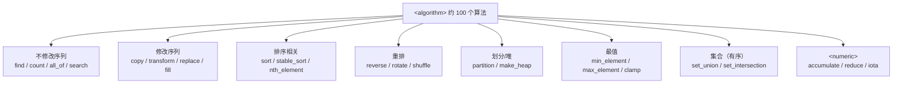

# 01 STL 算法与函数对象
**这里解决一个问题：为什么你手写的 `for` 循环应该换成 `std::sort` / `std::find_if`，以及 lambda 里的捕获什么时候会让你崩。**

算法库是 STL 里"性价比最高"的部分——约 100 个算法，覆盖了 90% 的数据处理需求，且每个都经过几十年的优化和验证。lambda 则是让这些算法好用的粘合剂。

## 本页学什么

- `<algorithm>` / `<numeric>` 的算法分类与选型
- lambda 的完整语法：捕获列表的五种形式
- **捕获的生命周期陷阱**（悬空引用，最容易出的隐蔽 bug）
- `std::function` 的代价（什么时候不该用）
- C++20 ranges：管道式组合

## 1. 算法全览

### 按功能分类



| 分类 | 常用算法 | 头文件 |
| --- | --- | --- |
| 查找 | `find` `find_if` `find_if_not` `search` `binary_search` `lower_bound` | `<algorithm>` |
| 计数/判定 | `count` `count_if` `all_of` `any_of` `none_of` | `<algorithm>` |
| 遍历 | `for_each` | `<algorithm>` |
| 复制/变换 | `copy` `copy_if` `transform` `move` | `<algorithm>` |
| 填充/替换 | `fill` `generate` `replace` `replace_if` | `<algorithm>` |
| 删除 | `remove` `remove_if` `unique` | `<algorithm>` |
| 排序 | `sort` `stable_sort` `partial_sort` `nth_element` | `<algorithm>` |
| 重排 | `reverse` `rotate` `shuffle` | `<algorithm>` |
| 划分 | `partition` `stable_partition` | `<algorithm>` |
| 最值 | `min` `max` `min_element` `max_element` `minmax_element` `clamp`（C++17） | `<algorithm>` |
| 堆 | `make_heap` `push_heap` `pop_heap` `sort_heap` | `<algorithm>` |
| 集合 | `set_union` `set_intersection` `set_difference` `merge` `includes` | `<algorithm>` |
| 数值 | `accumulate` `reduce`（C++17） `iota` `inner_product` `partial_sum` | `<numeric>` |
| 排列 | `next_permutation` `prev_permutation` | `<algorithm>` |

### 关键：算法操作的是迭代器，不是容器

```cpp
std::sort(v.begin(), v.end());             // 对整个 vector
std::sort(v.begin(), v.begin() + 5);       // 只排前 5 个
std::sort(arr, arr + 10);                  // C 数组也行（指针就是迭代器）
```

**这是 STL 最重要的设计决策之一**：算法和容器解耦。同一个 `std::sort` 可以排 `vector`、`deque`、C 数组。

代价是：**算法不知道容器，所以不能改变容器大小**。`std::remove` 不会真的删除元素——见下面。

### remove 不删除元素：经典陷阱

```cpp
// remove_demo.cpp
#include <vector>
#include <algorithm>
#include <cstdio>

int main() {
    std::vector<int> v{1, 2, 3, 2, 4, 2, 5};
    std::printf("before: ");                 for (int x : v) std::printf("%d ", x);
    std::printf("  (size=%zu)\n", v.size());

    auto new_end = std::remove(v.begin(), v.end(), 2);

    std::printf("after remove: ");
    for (int x : v) std::printf("%d ", x);
    std::printf("  (size=%zu -- 没变！)\n", v.size());
    std::printf("logical end offset = %zu\n", new_end - v.begin());

    v.erase(new_end, v.end());   // 真正删除
    std::printf("after erase:  ");
    for (int x : v) std::printf("%d ", x);
    std::printf("  (size=%zu)\n", v.size());
}
```

**实测输出：**

```text
before: 1 2 3 2 4 2 5   (size=7)
after remove: 1 3 4 5 4 2 5   (size=7 -- 没变！)
logical end offset = 4
after erase:  1 3 4 5   (size=4)
```

**`remove` 只是把"不该删的"往前搬，返回新的逻辑终点；容器的 `size` 不变。** 必须配合 `erase`——这就是著名的 **erase-remove 惯用法**：

```cpp
v.erase(std::remove(v.begin(), v.end(), 2), v.end());
```

C++20 起，`std::erase`（非成员函数）把这个惯用法直接封装了：

```cpp
std::erase(v, 2);                        // C++20，等价于上面的写法
std::erase_if(v, [](int x){ return x % 2 == 0; });
```

### 排序算法的复杂度与稳定性

| 算法 | 平均复杂度 | 稳定？ | 说明 |
| --- | --- | --- | --- |
| `std::sort` | O(n log n) | **否** | 通常是 introsort（快排 + 堆排兜底） |
| `std::stable_sort` | O(n log n)（有额外内存时） | **是** | 归并排序，需要内存 |
| `std::partial_sort` | O(n log k) | 否 | 只排前 k 个 |
| `std::nth_element` | **O(n)** | 否 | 只保证第 n 位就位 |

:::caution[std::sort 的最坏复杂度]
C++11 起，`std::sort` 的复杂度保证是 **O(n log n) 次比较**（不再是 C++03 的 "平均 O(n log n)"）。这个保证是靠 introsort 实现的——递归深度超过阈值时切换到堆排序。

但**它不稳定**：相等元素的相对顺序可能改变。需要稳定就用 `stable_sort`。
:::

### 实测：手写循环 vs std::accumulate

```cpp
// algo_bench.cpp
#include <vector>
#include <numeric>
#include <algorithm>
#include <chrono>
#include <cstdio>

template<typename F> long long us(F&& f) {
    auto t0 = std::chrono::high_resolution_clock::now(); f();
    auto t1 = std::chrono::high_resolution_clock::now();
    return std::chrono::duration_cast<std::chrono::microseconds>(t1-t0).count();
}

int main() {
    std::vector<int> v(1000000);
    for (int i = 0; i < 1000000; ++i) v[i] = i % 100;

    long long hand = 0, stl = 0;
    long long r1 = 0, r2 = 0;
    for (int rep = 0; rep < 5; ++rep) {
        hand += us([&]{ long long s = 0;
            for (size_t i = 0; i < v.size(); ++i) s += v[i]; r1 = s; });
        stl  += us([&]{ r2 = std::accumulate(v.begin(), v.end(), 0LL); });
    }
    std::printf("hand loop      : %lld us (avg %lld)\n", hand, hand/5);
    std::printf("std::accumulate: %lld us (avg %lld)\n", stl, stl/5);
    std::printf("results equal? %s (%lld vs %lld)\n", r1==r2?"yes":"no", r1, r2);
}
```

**实测输出（`-O2`）：**

```text
hand loop      : 678 us (avg 135)
std::accumulate: 617 us (avg 123)
results equal? yes (49500000 vs 49500000)
```

**结论：性能上没有理由拒绝 STL 算法。** 用它们是为了**表达意图**（`accumulate` 一眼看出是求和，`for` 循环要读完才知道在干嘛）。

---

**翻页**：[下一页 →](./stl-algorithms-02) · [返回目录](./)
