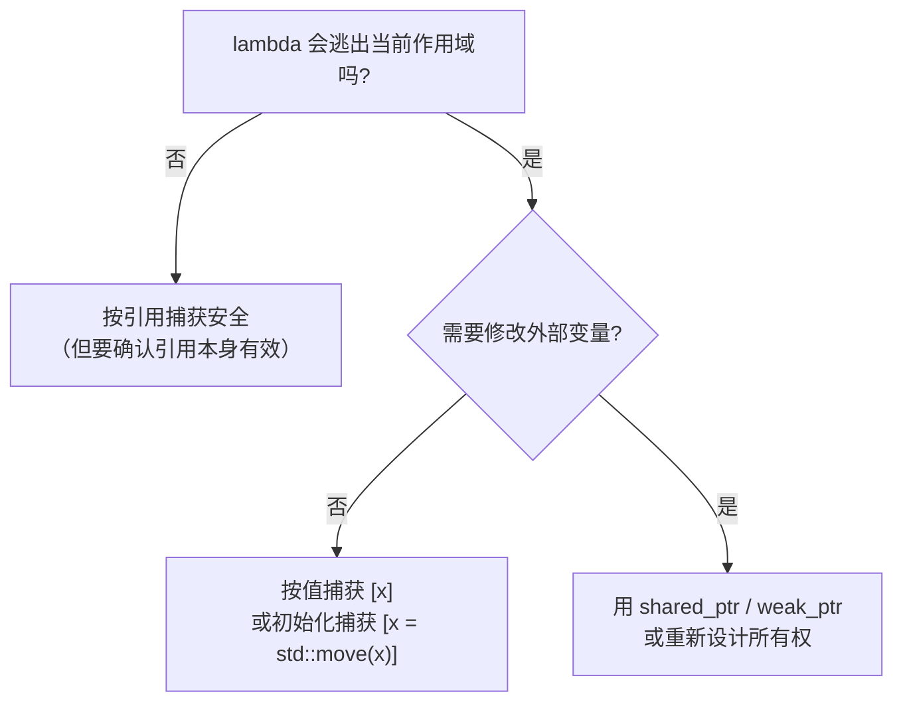

# 02 lambda 深度
lambda 是 C++11 引入的**匿名函数对象**。编译器为它生成一个**唯一的闭包类型**（closure type），并重载 `operator()`。

### 完整语法

```cpp
[capture](parameters) specifiers -> return_type requires-clause { body }
```

只有 `[]` 和 `{}` 是必须的：

```cpp
auto f1 = []{ return 1; };                      // 最简
auto f2 = [](int x){ return x * 2; };
auto f3 = [](int x) -> double { return x / 2.0; };
auto f4 = [](int x) mutable { /* 可修改按值捕获的变量 */ };
auto f5 = [](auto x){ return x + 1; };          // C++14 泛型 lambda
auto f6 = [](int x) noexcept { return x; };
```

### 五种捕获形式

```cpp
// capture.cpp
#include <cstdio>
#include <string>

int main() {
    int a = 1, b = 2;
    std::string s = "str";

    auto c1 = [ ]        { return 42; };              // 不捕获
    auto c2 = [a]        { return a; };               // 按值捕获 a
    auto c3 = [&b]       { return b; };               // 按引用捕获 b
    auto c4 = [=]        { return a + b; };           // 按值捕获所有（不推荐）
    auto c5 = [&]        { return a + b; };           // 按引用捕获所有（不推荐）
    auto c6 = [a, &b]    { return a + b; };           // 混合
    auto c7 = [=, &b]    { return a + b; };           // 默认按值，b 按引用
    auto c8 = [&s, a]    { return a + (int)s.size(); };// 显式列出

    std::printf("c1=%d c2=%d c3=%d c4=%d c5=%d c6=%d c7=%d c8=%d\n",
                c1(), c2(), c3(), c4(), c5(), c6(), c7(), c8());

    // C++14 初始化捕获（捕获移动-only 对象、或重命名）
    auto c9 = [x = a + 10] { return x; };             // 初始化捕获
    std::printf("c9=%d\n", c9());

    // 捕获 *this（C++17）
    struct S {
        int v = 5;
        auto getter() { return [*this] { return v; }; }  // C++17：拷贝整个对象
    };
    S obj;
    std::printf("S getter=%d\n", obj.getter()());

    std::printf("sizeof(c1)=%zu sizeof(c2)=%zu sizeof(c8)=%zu\n",
                sizeof(c1), sizeof(c2), sizeof(c8));
}
```

**实测输出：**

```text
c1=42 c2=1 c3=2 c4=3 c5=3 c6=3 c7=3 c8=4
c9=11
S getter=5
sizeof(c1)=1 sizeof(c2)=4 sizeof(c8)=16
```

**捕获列表对照：**

| 写法 | 含义 | 版本 |
| --- | --- | --- |
| `[]` | 不捕获 | C++11 |
| `[x]` | 按值捕获 `x` | C++11 |
| `[&x]` | 按引用捕获 `x` | C++11 |
| `[=]` | 隐式按值捕获用到的所有自动变量 | C++11（**不推荐**） |
| `[&]` | 隐式按引用捕获用到的所有自动变量 | C++11（**不推荐**） |
| `[this]` | 捕获 `this` 指针 | C++11 |
| `[*this]` | 拷贝整个对象 | C++17 |
| `[x = expr]` | 初始化捕获 | C++14 |
| `[=, &x]` | 默认按值，x 按引用 | C++11 |

:::warning[不要用 `[=]` 和 `[&]`]
`[=]` 的问题：**你以为按值捕获很安全，但它捕获的是 `this` 指针而不是对象**（C++11 到 C++17 中，在成员函数里用 `[=]` 捕获成员变量实际是捕获 `this`）。一旦 lambda 逃出对象生命周期，就是悬空指针。

C++20 起，`[=]` 隐式捕获 `this` **被弃用**（deprecated），应该显式写 `[this]` 或 `[*this]`。

**规则：显式列出你要捕获的每个变量。** 多打几个字符，换来的是"我一眼能看出这个 lambda 依赖什么、生命周期是什么"。
:::

### lambda 的大小：捕获多少就多大

```cpp
// lambda_size.cpp
#include <cstdio>
#include <string>

int main() {
    int a = 1;
    double d = 2.0;
    std::string s = "hello";

    // 注意：必须写成具名变量再 sizeof —— 直接在 sizeof 里写 lambda 表达式
    // 在 C++17 下是"未求值上下文中的 lambda"，GCC 会报错（C++20 才允许）
    auto l0 = []{ };
    auto l1 = [a]{ return a; };
    auto l2 = [a, d]{ return a + d; };
    auto l3 = [s]{ return s; };
    auto l4 = [&a]{ return a; };

    std::printf("sizeof(empty lambda)      = %zu\n", sizeof(l0));
    std::printf("sizeof(captures int)      = %zu\n", sizeof(l1));
    std::printf("sizeof(captures 2 vars)   = %zu\n", sizeof(l2));
    std::printf("sizeof(captures string)   = %zu\n", sizeof(l3));
    std::printf("sizeof(ref capture)       = %zu  (引用捕获存的是引用)\n", sizeof(l4));
}
```

**实测输出：**

```text
sizeof(empty lambda)      = 1
sizeof(captures int)      = 4
sizeof(captures 2 vars)   = 16
sizeof(captures string)   = 32
sizeof(ref capture)       = 8  (引用捕获存的是引用)
```

**空 lambda 大小是 1**（空类的规则），捕获 `int` 后是 4，捕获 `string` 后是 32。**lambda 就是个带 `operator()` 的结构体**，捕获的变量就是它的成员。

### mutable：按值捕获也能改

默认 lambda 的 `operator()` 是 `const` 的，所以**按值捕获的变量不能修改**：

```cpp
// mutable_demo.cpp
#include <cstdio>

int main() {
    int counter = 0;

    auto inc_bad = [counter]() { /* counter++; */ return counter; };  // 编译错误

    auto inc_ok = [counter]() mutable { return ++counter; };          // OK：改的是副本

    std::printf("inc_ok: %d %d %d\n", inc_ok(), inc_ok(), inc_ok());
    std::printf("outer counter still = %d\n", counter);   // 外面的没变！

    auto inc_ref = [&counter]() { return ++counter; };    // 按引用：真的改外面的
    std::printf("inc_ref: %d %d\n", inc_ref(), inc_ref());
    std::printf("outer counter now = %d\n", counter);
}
```

**实测输出：**

```text
inc_ok: 1 2 3
outer counter still = 0
inc_ref: 1 2
outer counter now = 2
```

**`mutable` 修改的是闭包里的副本，外面的变量不受影响。** 想影响外面就按引用捕获（但要注意下面说的生命周期）。

## 3. lambda 的生命周期陷阱（最重要）

这是 lambda 最容易出**隐蔽崩溃**的地方。

### 陷阱一：按引用捕获局部变量，然后 lambda 逃逸

```cpp
// dangling_lambda.cpp —— 错误示范
#include <functional>
#include <cstdio>

std::function<int()> make_lambda() {
    int local = 42;
    return [&local]() { return local; };   // 按引用捕获局部变量
}                                          // local 在这里销毁

int main() {
    auto f = make_lambda();
    std::printf("f() = %d   (UB！local 已销毁)\n", f());
}
```

**实测输出：**

```text
f() = 42   (UB！local 已销毁)
```

**它打印出了 42**——看起来完全正常。但这是**未定义行为**：栈上那块内存还没被覆盖。加个函数调用覆盖栈帧就会变：

```cpp
int main() {
    auto f = make_lambda();
    std::printf("intervening calls...\n");
    some_other_function();          // 覆盖栈
    std::printf("f() = %d   (现在是垃圾)\n", f());
}
```

:::danger[规则]
**如果一个 lambda 的生命周期可能超过它所在的作用域，绝对不能按引用捕获局部变量。** 用按值捕获（`[=]` 显式写成 `[local]`）或初始化捕获（移动）。
:::

### 陷阱二：捕获 this 指针，对象先死了

```cpp
// this_dangle.cpp —— 错误示范
#include <functional>
#include <cstdio>
#include <memory>

struct Sensor {
    int value = 100;
    auto make_callback() {
        return [this]() { return value; };   // 捕获 this 指针
    }
};

int main() {
    std::function<int()> cb;
    {
        auto s = std::make_unique<Sensor>();
        cb = s->make_callback();
    }   // s 在这里析构

    std::printf("cb() = %d   (UB：对象已销毁)\n", cb());
}
```

**实测输出：**

```text
cb() = 1091607712   (UB：对象已销毁)
```

**解法（C++17）：用 `[*this]` 拷贝整个对象：**

```cpp
auto make_callback() {
    return [*this]() { return value; };   // 拷贝对象，安全
}
```

或者用 `weak_ptr` / `enable_shared_from_this` 检查对象是否还活着。

### 陷阱三：异步回调捕获局部状态

```cpp
// 危险：异步任务捕获局部引用
void start_async() {
    RequestData data = build_request();
    enqueue_task([&data]() { process(data); });   // data 会在函数返回后销毁
}
```

**正确：按值或移动捕获：**

```cpp
void start_async() {
    RequestData data = build_request();
    enqueue_task([data = std::move(data)]() { process(data); });   // C++14 初始化捕获
}
```



---

**翻页**：[← 上一页](./stl-algorithms-01) · [下一页 →](./stl-algorithms-03) · [返回目录](./)
