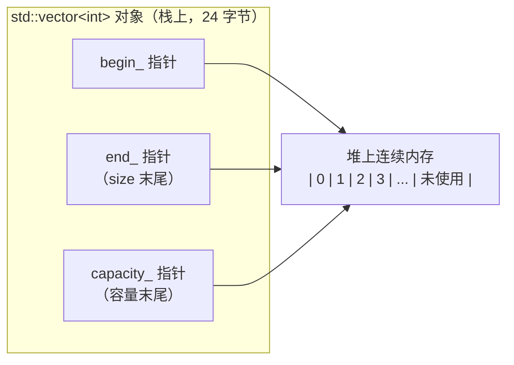

# 01 STL 容器
**这里解决一个问题：六种容器摆在面前，选哪个？以及选完之后，什么操作会让你的迭代器/引用失效。**

容器选型在 C 里不存在的——C 只有数组和手写链表。C++ 给你六种标准结构，选错不会报错，只会**悄悄变慢或者悄悄崩溃**（迭代器失效）。这一页把"内部结构 → 复杂度 → 失效规则"这条链讲清楚。

## 本页学什么

- `vector` 的内存布局与扩容策略（实测增长倍数）
- `deque`、`list`、`map`、`unordered_map`、`set` 各自的内部结构
- **迭代器失效规则**（这是最容易出隐蔽 bug 的地方）
- 复杂度对照表与选型决策表
- `string` 的 SSO（小字符串优化）实测

## 1. vector：一块连续内存

### 内部结构



`std::vector` 对象本身是**三个指针**（典型实现，如 libstdc++），数据全部在堆上。

```cpp
// vector_layout.cpp
#include <vector>
#include <cstdio>
#include <string>

int main() {
    std::vector<int> v;
    std::printf("sizeof(vector<int>)  = %zu   (3 个指针)\n", sizeof(v));
    std::printf("sizeof(vector<char>) = %zu\n", sizeof(std::vector<char>));

    v.push_back(1);
    std::printf("after 1 push: data=%p size=%zu cap=%zu\n",
                (void*)v.data(), v.size(), v.capacity());
    v.push_back(2);
    std::printf("after 2 push: data=%p size=%zu cap=%zu\n",
                (void*)v.data(), v.size(), v.capacity());

    // 元素地址是否连续？
    for (size_t i = 0; i < v.size(); ++i)
        std::printf("  &v[%zu] = %p\n", i, (void*)&v[i]);
}
```

**实测输出：**

```text
sizeof(vector<int>)  = 24   (3 个指针)
sizeof(vector<char>) = 24
after 1 push: data=000001dc4dd42d60 size=1 cap=1
after 2 push: data=000001dc4dd42d80 size=2 cap=2
  &v[0] = 000001dc4dd42d80
  &v[1] = 000001dc4dd42d84
```

**"元素是连续存储的"是标准保证（C++03 起）**，所以 `&v[0]` 可以当数组用，也能直接传给 C API：

```cpp
std::vector<int> v = get_data();
c_function(v.data(), v.size());    // 与 C 互操作的标准写法
```

### 扩容策略：实测增长倍数


```cpp
// vector_growth.cpp
#include <vector>
#include <cstdio>

int main() {
    std::vector<int> v;
    size_t prev_cap = v.capacity();
    std::printf("start: size=%zu cap=%zu\n", v.size(), v.capacity());
    for (int i = 0; i < 40; ++i) {
        v.push_back(i);
        if (v.capacity() != prev_cap) {
            std::printf("push #%2d: size=%2zu cap=%2zu  (growth %.2fx, moved=%s)\n",
                        i + 1, v.size(), v.capacity(),
                        (double)v.capacity() / prev_cap,
                        "yes");
            prev_cap = v.capacity();
        }
    }
}
```

编译运行：

```bash
g++ -std=c++17 -O2 -o vector_growth.exe vector_growth.cpp && ./vector_growth.exe
```

**实测输出（libstdc++ / MinGW）：**

```text
start: size=0 cap=0
push # 1: size= 1 cap= 1  (first allocation)
push # 2: size= 2 cap= 2  (growth 2.00x)
push # 3: size= 3 cap= 4  (growth 2.00x)
push # 5: size= 5 cap= 8  (growth 2.00x)
push # 9: size= 9 cap=16  (growth 2.00x)
push #17: size=17 cap=32  (growth 2.00x)
push #33: size=33 cap=64  (growth 2.00x)
```

:::warning[增长倍数是实现相关的]
标准**只要求** `push_back` 的摊销复杂度是 O(1)，**不规定增长倍数**。

- **libstdc++（GCC）**：2 倍
- **libc++（Clang）**：2 倍
- **MSVC**：1.5 倍

**不要写依赖具体倍数的代码。** 如果你需要"预留 N 个"，用 `reserve(N)`——那是精确的：

```cpp
std::vector<int> v;
v.reserve(1000);   // 一次性分配，之后 push 1000 次不会重分配
```
:::

### reserve 的价值：实测

```cpp
// vector_reserve.cpp
#include <vector>
#include <chrono>
#include <cstdio>

template<typename F> long long us(F&& f) {
    auto t0 = std::chrono::high_resolution_clock::now(); f();
    auto t1 = std::chrono::high_resolution_clock::now();
    return std::chrono::duration_cast<std::chrono::microseconds>(t1-t0).count();
}

int main() {
    const int N = 10000000;
    long long a = us([&]{ std::vector<int> v;
        for (int i = 0; i < N; ++i) v.push_back(i); });
    long long b = us([&]{ std::vector<int> v; v.reserve(N);
        for (int i = 0; i < N; ++i) v.push_back(i); });
    std::printf("without reserve: %lld us\n", a);
    std::printf("with    reserve: %lld us\n", b);
    std::printf("speedup: %.2fx\n", (double)a / b);
}
```

**实测输出：**

```text
without reserve: 20700 us
with    reserve: 10515 us
speedup: 1.97x
```

### shrink_to_fit 与内存回收

`clear()` **不释放内存**（`size` 变 0，`capacity` 不变）：

```cpp
// clear_capacity.cpp
#include <vector>
#include <cstdio>

int main() {
    std::vector<int> v;
    for (int i = 0; i < 1000; ++i) v.push_back(i);
    std::printf("filled:      size=%zu cap=%zu\n", v.size(), v.capacity());
    v.clear();
    std::printf("after clear: size=%zu cap=%zu   (内存还在)\n", v.size(), v.capacity());
    v.shrink_to_fit();
    std::printf("after shrink:size=%zu cap=%zu\n", v.size(), v.capacity());

    // 真正释放的惯用法：与空 vector 交换
    std::vector<int> w;
    for (int i = 0; i < 1000; ++i) w.push_back(i);
    std::printf("w before: cap=%zu\n", w.capacity());
    std::vector<int>().swap(w);
    std::printf("w after swap: cap=%zu\n", w.capacity());
}
```

**实测输出：**

```text
filled:      size=1000 cap=1024
after clear: size=0 cap=1024   (内存还在)
after shrink:size=0 cap=0
w before: cap=1024
w after swap: cap=0
```

:::info[shrink_to_fit 是非约束性的]
标准说 `shrink_to_fit` 是 **non-binding**（非约束性请求）——实现**可以完全忽略它**。上面 libstdc++ 实现了，但别依赖它。

需要确定释放时，用 `std::vector<T>().swap(v)` 这个惯用法（C++11 起也可以用 `v = {}` 配合移动赋值）。
:::

---

**翻页**：[下一页 →](./stl-containers-02) · [返回目录](./)
