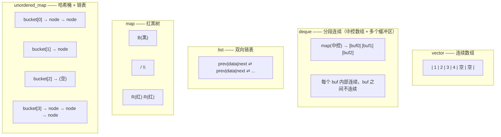

# 02 迭代器失效规则：最重要的表
这是本页**最需要记住**的部分。迭代器失效（iterator invalidation）是指：容器的结构改变后，之前拿到的迭代器/指针/引用**不再指向有效元素**，使用它就是**未定义行为**——而且通常不会崩溃，只是读到垃圾。

### vector 的失效规则

| 操作 | 迭代器 | 引用/指针 | 说明 |
| --- | --- | --- | --- |
| `push_back`（**未**触发重分配） | **end() 失效**，其它有效 | 全部有效 | 只影响尾部哨兵 |
| `push_back`（**触发**重分配） | **全部失效** | **全部失效** | 数据搬到新内存了 |
| `insert`（未重分配） | 插入点及之后失效 | 插入点及之后失效 | 元素要移动 |
| `insert`（触发重分配） | **全部失效** | **全部失效** | |
| `erase` | 被删元素及之后失效 | 被删元素及之后失效 | |
| `clear` / `~vector` | **全部失效** | **全部失效** | |
| `reserve` / `shrink_to_fit` | **全部失效** | **全部失效** | 可能重分配 |
| `resize`（增大且重分配） | **全部失效** | **全部失效** | |

```cpp
// invalidate_demo.cpp —— 演示错误用法（UB），请勿模仿
#include <vector>
#include <cstdio>

int main() {
    std::vector<int> v{1, 2, 3, 4, 5};
    std::printf("cap before = %zu\n", v.capacity());

    int* p = &v[0];            // 拿到首元素指针
    std::printf("*p = %d at %p\n", *p, (void*)p);

    v.push_back(6);            // 可能触发重分配
    std::printf("cap after  = %zu\n", v.capacity());
    std::printf("data       = %p\n", (void*)v.data());

    // 如果发生了重分配，p 现在是悬空指针，读它是 UB
    std::printf("*p now = %d (可能是垃圾，也可能是 1 —— UB)\n", *p);
}
```

**实测输出：**

```text
cap before = 5
*p = 1 at 000002578d2197f0
cap after  = 10
data       = 000002578d218420
*p now = 1 (可能是垃圾，也可能是 1 —— UB)
```

### erase 的正确写法

`erase` 返回**下一个有效迭代器**，这是遍历中删除的标准写法：

```cpp
// erase_loop.cpp
#include <algorithm>
#include <vector>
#include <cstdio>

int main() {
    std::vector<int> v{1, 2, 3, 4, 5, 6, 7, 8};

    // 正确：用 erase 的返回值
    for (auto it = v.begin(); it != v.end(); ) {
        if (*it % 2 == 0) it = v.erase(it);   // 删除偶数，it 指向下一个
        else ++it;
    }
    std::printf("after erase-if: ");
    for (int x : v) std::printf("%d ", x);
    std::printf("\n");

    // 更好的写法：erase-remove 惯用法（见 stl-algorithms）
    std::vector<int> w{1, 2, 3, 4, 5, 6};
    w.erase(std::remove_if(w.begin(), w.end(), [](int x){ return x % 2 == 0; }), w.end());
    std::printf("after remove_if: ");
    for (int x : w) std::printf("%d ", x);
    std::printf("\n");
}
```

**实测输出：**

```text
after erase-if: 1 3 5 7
after remove_if: 1 3 5
```

:::danger[范围 for 里不能增删元素]
```cpp
for (auto& x : v) {
    if (x == 3) v.push_back(4);   // UB！end() 迭代器已失效
}
```

范围 for 在循环开始时缓存了 `end()`，`push_back` 可能让它失效。**遍历中需要修改容器结构时，用显式迭代器循环。**
:::

### 各容器的失效规则总表

| 容器 | `insert` | `erase` | 重分配 | 备注 |
| --- | --- | --- | --- | --- |
| `vector` | 全部失效（若重分配）或插入点后失效 | 删除点及之后失效 | 会 | 连续内存 |
| `deque` | **通常全部失效**（首尾插入除外） | 中间删除全部失效；首尾删除只失效被删项 | 不整体搬移 | 分段连续 |
| `list` / `forward_list` | **永不失效** | **只有被删元素失效** | 不适用 | 节点式 |
| `map` / `set` / `multimap` / `multiset` | **永不失效** | **只有被删元素失效** | 不适用 | 节点式（树） |
| `unordered_map` / `unordered_set` | 若触发 rehash 则**全部失效**，否则不失效 | 只有被删元素失效 | 会 rehash | 哈希桶 |
| `array` | 不适用（固定大小） | 不适用 | 不适用 | 栈上数组 |

:::tip[一句话记忆]
**节点式容器（list / map / set）的迭代器极其稳定——插入永不让别人的迭代器失效，删除只让被删的那个失效。**

**连续式容器（vector）和分段式（deque）在插入时要小心。**

这也是"需要在遍历中修改容器"时优先考虑 `std::list` 或 `std::map` 的原因。
:::

## 3. 六种容器的内部结构



### 逐个说清

| 容器 | 内部结构 | 内存连续性 | 头文件 |
| --- | --- | --- | --- |
| `std::vector<T>` | 动态数组 | **连续** | `<vector>` |
| `std::deque<T>` | 分段连续（中控 + 定长缓冲区） | 分段连续 | `<deque>` |
| `std::list<T>` | 双向链表 | 不连续 | `<list>` |
| `std::forward_list<T>` | 单向链表（C++11） | 不连续 | `<forward_list>` |
| `std::array<T,N>` | 栈上定长数组（C++11） | **连续** | `<array>` |
| `std::set<T>` / `map<K,V>` | 红黑树 | 不连续 | `<set>` / `<map>` |
| `std::unordered_set/map` | 哈希表（C++11） | 不连续 | `<unordered_set>` / `<unordered_map>` |

### deque：被低估的容器

`deque`（double-ended queue）支持**两端 O(1) 插入删除**，且支持随机访问。它的结构是"中控数组 + 多个固定大小的缓冲区"：

```cpp
// deque_demo.cpp
#include <deque>
#include <vector>
#include <cstdio>

int main() {
    std::deque<int> d;
    std::printf("sizeof(deque<int>) = %zu  (比 vector 大：中控指针等)\n", sizeof(d));
    std::printf("sizeof(vector<int>)= %zu\n", sizeof(std::vector<int>));

    for (int i = 0; i < 5; ++i) d.push_back(i);
    for (int i = 0; i < 3; ++i) d.push_front(-i - 1);

    std::printf("d = ");
    for (int x : d) std::printf("%d ", x);
    std::printf("\n");
    std::printf("d[0]=%d d[3]=%d  (支持随机访问)\n", d[0], d[3]);
}
```

**实测输出：**

```text
sizeof(deque<int>) = 80  (比 vector 大：中控指针等)
sizeof(vector<int>)= 24
d = -3 -2 -1 0 1 2 3 4
d[0]=-3 d[3]=0  (支持随机访问)
```

**什么时候用 deque：**
- 需要**两端**高效插入删除（队列、滑动窗口、BFS）
- 但又要随机访问（`std::queue` 是 `deque` 的适配器，不暴露迭代器）

**不用 deque 的理由**：它的迭代器失效规则复杂（中间插入通常让所有迭代器失效），且缓存局部性不如 `vector`。**`vector` 是默认选择。**

### map vs unordered_map：该怎么选

| 维度 | `std::map` | `std::unordered_map` |
| --- | --- | --- |
| 内部结构 | 红黑树 | 哈希表 |
| 平均查找 | **O(log n)** | **O(1)** |
| 最坏查找 | O(log n)（有保证） | O(n)（哈希全碰撞） |
| 有序性 | **按键有序** | 无序 |
| 迭代器稳定性 | 高 | rehash 时全部失效 |
| 内存开销 | 每节点 3 指针 + 颜色位 | 桶数组 + 节点链表 |
| 需要 `operator<` | 是（或自定义比较器） | 否，需要 `std::hash` + `==` |
| 范围查询 | 支持（`lower_bound`） | 不支持 |

**实测对比：**

```cpp
// map_bench.cpp
#include <map>
#include <unordered_map>
#include <chrono>
#include <cstdio>
#include <string>

template<typename M> long long bench(const char* name, int N) {
    M m;
    auto t0 = std::chrono::high_resolution_clock::now();
    for (int i = 0; i < N; ++i) m.insert({i, i});
    long long ins = std::chrono::duration_cast<std::chrono::microseconds>(
        std::chrono::high_resolution_clock::now() - t0).count();

    long long sum = 0;
    t0 = std::chrono::high_resolution_clock::now();
    for (int i = 0; i < N; ++i) { auto it = m.find(i); if (it != m.end()) sum += it->second; }
    long long find = std::chrono::duration_cast<std::chrono::microseconds>(
        std::chrono::high_resolution_clock::now() - t0).count();

    std::printf("%-16s insert=%6lld us  find=%6lld us  (sum=%lld)\n", name, ins, find, sum);
    return ins + find;
}

int main() {
    const int N = 1000000;
    std::printf("N = %d\n", N);
    bench<std::map<int,int>>("std::map", N);
    bench<std::unordered_map<int,int>>("unordered_map", N);
}
```

**实测输出：**

```text
N = 1000000
std::map         insert= 83264 us  find= 43996 us  (sum=499999500000)
unordered_map    insert= 42621 us  find=  3457 us  (sum=499999500000)
```

:::caution[unordered_map 的最坏情况]
哈希表的 O(1) 是**平均**复杂度。如果哈希函数很差（或遭遇恶意碰撞攻击），最坏是 O(n)。

而 `std::map` 的 O(log n) 是**最坏情况保证**。

**对安全敏感/不可接受抖动的场景，`std::map` 更稳。** 另外 `unordered_map` 的常数因子较大——元素数量少（几百以内）时，`std::map` 甚至可能更快，因为它的缓存行为更可预测。**不要凭直觉，测。**
:::

### set 与 map 的接口细节

```cpp
// map_api.cpp
#include <map>
#include <unordered_map>
#include <cstdio>
#include <string>

int main() {
    std::map<std::string, int> m;

    // 四种插入方式的区别
    m["a"] = 1;                          // operator[]：不存在则默认构造，会覆盖
    auto [it1, ok1] = m.insert({"b", 2}); // insert：已存在则不插入（不覆盖）
    auto [it2, ok2] = m.insert({"a", 99});
    auto [it3, ok3] = m.try_emplace("c", 3);   // C++17：原地构造，更高效
    auto [it4, ok4] = m.insert_or_assign("a", 100);  // C++17：不存在则插入，存在则赋值

    std::printf("insert b: ok=%d  insert a(dup): ok=%d value=%d\n", ok1, ok2, it2->second);
    std::printf("try_emplace c: ok=%d value=%d\n", ok3, it3->second);
    std::printf("insert_or_assign a: ok=%d value=%d\n", ok4, it4->second);

    // 查找：find vs count vs contains（C++20）
    std::printf("m.count(\"zzz\") = %zu\n", m.count("zzz"));
    std::printf("m.find(\"zzz\") == end() ? %s\n", m.find("zzz") == m.end() ? "yes" : "no");

    // 有序性
    std::printf("ordered keys: ");
    for (const auto& [k, v] : m) std::printf("%s=%d ", k.c_str(), v);
    std::printf("\n");

    // 范围查询（map 独有）
    m["d"] = 4; m["e"] = 5;
    auto lo = m.lower_bound("b");
    auto hi = m.upper_bound("d");
    std::printf("range [b, d]: ");
    for (auto i = lo; i != hi; ++i) std::printf("%s ", i->first.c_str());
    std::printf("\n");
}
```

**实测输出：**

```text
insert b: ok=1  insert a(dup): ok=0 value=100
try_emplace c: ok=1 value=3
insert_or_assign a: ok=0 value=100
m.count("zzz") = 0
m.find("zzz") == end() ? yes
ordered keys: a=100 b=2 c=3
range [b, d]: b c d
```

:::warning[operator[] 的两个陷阱]
1. **`m[key]` 在 key 不存在时会插入一个默认构造的元素**。如果你只想"查"，用 `find()`，不要用 `operator[]`——它会修改容器。
2. **因此 `operator[]` 不是 const 的**，在 `const map` 上用不了。const 场景用 `at()`（越界抛异常）或 `find()`。

`std::unordered_map` 同理。**养成习惯：查询用 `find`，插入用 `insert`/`try_emplace`。**
:::

---

**翻页**：[← 上一页](./stl-containers-01) · [下一页 →](./stl-containers-03) · [返回目录](./)
