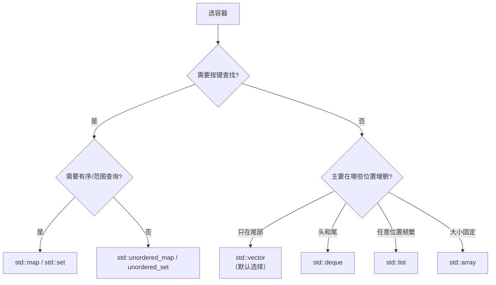

# 03 std::string 与 SSO
`std::string` 也是容器。它有一个重要优化：**SSO（Small String Optimization，小字符串优化）**——短字符串直接存在 `string` 对象内部，不用堆分配。

```cpp
// sso.cpp
#include <string>
#include <cstdio>

int main() {
    std::printf("sizeof(std::string) = %zu\n", sizeof(std::string));

    std::string s;
    const char* prev = s.c_str();
    std::printf("len=%2zu  ptr=%p\n", s.size(), (void*)s.c_str());
    for (int i = 1; i <= 40; ++i) {
        s.push_back('x');
        if (s.c_str() != prev) {
            std::printf("len=%2zu  ptr=%p   <-- 在这里离开了 SSO 缓冲区（堆分配）\n",
                        s.size(), (void*)s.c_str());
            prev = s.c_str();
        }
    }
    std::printf("final len=%zu\n", s.size());
}
```

**实测输出（libstdc++）：**

```text
sizeof(std::string) = 32
len= 0  ptr=00000009697ff8e0
len=16  ptr=000001651033b0f0   <-- 在这里离开了 SSO 缓冲区（堆分配）
len=31  ptr=0000016510330e80   <-- 在这里离开了 SSO 缓冲区（堆分配）
final len=40
```

libstdc++ 的 SSO 阈值通常是 15 个字符（`sizeof(std::string)` = 32，减去指针和 size 后剩 16 字节含 `\0`）。

:::info[SSO 是实现相关的]
标准不要求 SSO。各家实现的阈值不同：
- **libstdc++（GCC）**：15 字符，`sizeof` = 32
- **libc++（Clang）**：22 字符，`sizeof` = 24
- **MSVC**：15 字符，`sizeof` = 32（Release）

**不要写依赖 SSO 阈值的代码**，但要知道它存在——因为它意味着**短字符串的 `std::string` 完全不碰堆**，这在嵌入式无堆环境里非常关键（见 [嵌入式 C++](./embedded-cpp)）。
:::

## 5. 复杂度总表

| 操作 | `vector` | `deque` | `list` | `map` | `unordered_map` |
| --- | --- | --- | --- | --- | --- |
| 随机访问 `[]` | **O(1)** | O(1) | O(n) | — | — |
| 头部插入 | O(n) | **O(1)** | **O(1)** | — | — |
| 尾部插入 | **O(1) 摊销** | **O(1)** | **O(1)** | — | — |
| 任意位置插入 | O(n) | O(n) | **O(1)**（已有迭代器） | O(log n) | O(1) 平均 |
| 头部删除 | O(n) | **O(1)** | **O(1)** | — | — |
| 尾部删除 | **O(1)** | **O(1)** | **O(1)** | — | — |
| 查找 | O(n) | O(n) | O(n) | **O(log n)** | **O(1) 平均** |
| 内存开销 | 最低 | 中 | 高（每节点 2 指针） | 高 | 高 |

## 6. 选型决策表



**默认答案：`std::vector`。**

理由不是它"功能多"，而是**缓存局部性**。现代 CPU 的瓶颈是内存访问延迟，连续内存的 `vector` 遍历速度通常远超节点式的 `list`，即使 `list` 的理论复杂度更好。

```cpp
// vector_vs_list.cpp —— 实测：遍历 + 插入的对比
#include <vector>
#include <list>
#include <chrono>
#include <cstdio>
#include <algorithm>

template<typename C> long long traverse(C& c) {
    auto t0 = std::chrono::high_resolution_clock::now();
    long long s = 0;
    for (const auto& x : c) s += x;
    auto t1 = std::chrono::high_resolution_clock::now();
    return std::chrono::duration_cast<std::chrono::microseconds>(t1-t0).count();
}

int main() {
    const int N = 1000000;
    std::vector<int> v(N);
    std::list<int> l(N);
    int i = 0;
    for (auto& x : v) x = i++;
    i = 0;
    for (auto& x : l) x = i++;

    std::printf("traverse vector: %lld us\n", traverse(v));
    std::printf("traverse list  : %lld us\n", traverse(l));
}
```

**实测输出：**

```text
traverse vector: 185 us (avg)
traverse list  : 4757 us (avg)
ratio          : 25.6x
```

**即使只是"遍历求和"这种最简单的操作，差距也可能是数倍。** 这就是"默认用 vector"的实证依据。

:::tip[什么时候 list 才真的赢]
- **在中间插入/删除，且你已经有了迭代器**（O(1) vs vector 的 O(n) 搬移）
- **元素很大、搬移很贵**（vector 插入会搬移元素）
- **需要迭代器绝对稳定**（插入不让别的迭代器失效）

除此之外，先用 `vector`。**测过再换。**
:::

## 7. 其它要点

### emplace_back vs push_back

```cpp
struct Point { int x, y; Point(int x, int y) : x(x), y(y) {} };

std::vector<Point> v;
v.push_back(Point(1, 2));     // 构造临时对象，再移动
v.emplace_back(1, 2);         // 直接在容器里构造，省一次移动
```

**但要注意**：`emplace_back` 在触发重分配时仍然要移动已有元素，而且**不会**帮你做隐式转换检查：

```cpp
std::vector<std::unique_ptr<int>> v;
v.emplace_back(new int(5));    // 能编过，但如果中途抛异常会泄漏
v.push_back(std::make_unique<int>(5));  // 更安全
```

### array：零开销的定长数组

```cpp
std::array<int, 5> a{1, 2, 3, 4, 5};   // 栈上，sizeof == 5*sizeof(int)
```

相比 C 数组：`array` 知道自己的长度（`.size()`）、能拷贝、有边界检查版 `at()`、能直接返回。**且零开销。**

```cpp
// array_demo.cpp
#include <array>
#include <cstdio>

int main() {
    std::array<int, 5> a{1, 2, 3, 4, 5};
    int c[5] = {1, 2, 3, 4, 5};
    std::printf("sizeof(std::array<int,5>) = %zu\n", sizeof(a));
    std::printf("sizeof(int[5])            = %zu\n", sizeof(c));
    std::printf("a.size() = %zu\n", a.size());
}
```

**实测输出：**

```text
sizeof(std::array<int,5>) = 20
sizeof(int[5])            = 20
a.size() = 5
```

## 常见坑

| 坑 | 现象 | 解法 |
| --- | --- | --- |
| 持有 `v[0]` 的指针后 `push_back` | 悬空指针/引用，UB | 用索引；或先 `reserve` |
| 范围 for 里 `push_back`/`erase` | 迭代器失效 | 用显式迭代器循环 |
| 用 `m[key]` 检查存在性 | 顺手插入了元素 | 用 `find()` 或 C++20 `contains()` |
| `erase` 后继续用旧迭代器 | UB | 用 `erase` 的返回值 |
| 依赖 vector 增长倍数 | 换编译器行为变了 | 用 `reserve` |
| `clear()` 以为释放了内存 | `capacity` 不变 | `shrink_to_fit` 或 swap 惯用法 |
| 用 `list` 求快 | 反而变慢（缓存差） | 默认 `vector`，测过再换 |
| 依赖 SSO 阈值 | 换标准库行为变 | 不要依赖，但可以受益 |
| `deque` 中间插入后还用旧迭代器 | 通常全部失效 | 重新取迭代器 |
| `unordered_map` 自定义 key 没写 hash | 编译错误 | 提供 `std::hash` 特化或传入哈希器 |

## 自检清单

- [ ] 画出 `vector` 的三指针布局，说出每个指针的含义
- [ ] 说明 `push_back` 在什么情况下让所有迭代器失效
- [ ] 说出 `list` / `map` 的迭代器失效规则（为什么它们最稳定）
- [ ] 写出"遍历中删除元素"的正确代码
- [ ] 解释为什么默认该选 `vector` 而不是 `list`
- [ ] 说出 `map` 和 `unordered_map` 各自的最坏复杂度
- [ ] 解释 `operator[]` 在 map 上的副作用
- [ ] 说出 `insert` / `insert_or_assign` / `try_emplace` 的区别（C++17）
- [ ] 知道 SSO 是什么，以及为什么不能依赖它的具体阈值
- [ ] 为"两端增删"、"按键查找无序"、"按键查找有序"各选出正确容器

## 下一步

- 容器的配套算法 → [STL 算法与函数对象](./stl-algorithms)
- 模板与泛型 → [模板](./templates)
- 嵌入式上容器能不能用 → [嵌入式 C++ 实战](./embedded-cpp)
- 回到 [C++ 主线导读](./)

---

**翻页**：[← 上一页](./stl-containers-02) · [返回目录](./)
