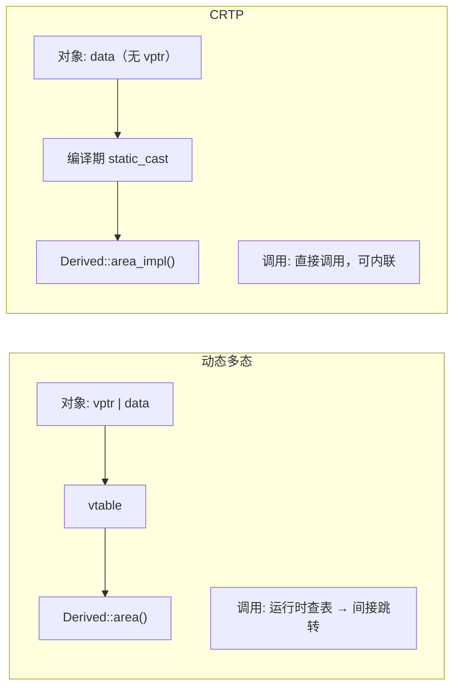

# 04 CRTP：编译期多态
**CRTP = Curiously Recurring Template Pattern**（奇异递归模板模式）。写法是"一个类继承自以自己为模板参数的基类"：

```cpp
struct Derived : Base<Derived> { };   // 看起来很怪，但很有用
```

### 它解决了什么：静态多态

虚函数（动态多态）的代价是：每个对象一个 vptr、每次调用一次间接跳转。CRTP 做到**同样的接口复用，但零运行时开销**：

```cpp
// crtp.cpp
#include <cstdio>

// 基类模板：用 static_cast 在编译期"下调"到派生类
template<typename Derived>
class Shape {
public:
    double area() const {
        return static_cast<const Derived*>(this)->area_impl();
    }
    void describe() const {
        std::printf("  shape with area %.2f\n", area());
    }
};

class Circle : public Shape<Circle> {
    double r_;
public:
    explicit Circle(double r) : r_(r) {}
    double area_impl() const { return 3.14159265 * r_ * r_; }
};

class Square : public Shape<Square> {
    double s_;
public:
    explicit Square(double s) : s_(s) {}
    double area_impl() const { return s_ * s_; }
};

// 泛型函数：编译期决议，无虚表
template<typename T>
void report(const Shape<T>& s) {
    s.describe();
}

int main() {
    Circle c(2.0);
    Square q(3.0);
    report(c);
    report(q);

    std::printf("sizeof(Circle) = %zu   (无 vptr！)\n", sizeof(c));
    std::printf("sizeof(Square) = %zu\n", sizeof(q));
}
```

**实测输出：**

```text
  shape with area 12.57
  shape with area 9.00
sizeof(Circle) = 8   (无 vptr！)
sizeof(Square) = 8
```

注意 `sizeof(Circle)` ——如果用的是虚函数，这里会是 16（8 字节 vptr + 8 字节 double）。CRTP 下它**只有 8**。



### CRTP 的三个用途

1. **静态多态**（上面这个例子）：零开销的"接口"
2. **混入（mixin）/ 代码注入**：基类给派生类添加功能（如 `enable_shared_from_this` 就是这个模式）
3. **编译期计数器 / 类型注册**：每个派生类实例化一份基类的 static 成员

### CRTP 的代价

| 优点 | 缺点 |
| --- | --- |
| 零运行时开销，可内联 | **没有运行时多态**：不能把不同派生类放进同一个容器 |
| 编译期就能发现"没实现接口" | 代码可读性差，报错难懂 |
| 对象更小 | 每个派生类都实例化一份基类代码（代码膨胀） |

**怎么选：**

- 需要**运行时**决定调用哪个实现（异构容器、插件）→ 虚函数
- 类型在**编译期**已知、追求零开销 → CRTP
- C++20 起也可以考虑用 Concepts + 模板约束代替 CRTP 的部分场景

## 8. 其它要点

### 模板定义必须在头文件里

因为模板需要在**实例化点**看到完整定义。这导致：

- 模板代码几乎全在 `.h`（或 `.hpp`）里
- 编译变慢（每个用到它的 `.cpp` 都要重新实例化）
- C++20 的**显式实例化**和**模块**能缓解，但模块的工具链支持仍在成熟中

### 显式实例化（控制代码膨胀）

```cpp
// 头文件里只声明
template<typename T> void foo(T);

// 某个 .cpp 里显式实例化需要的版本
template void foo<int>(int);
template void foo<double>(double);

// 别的 .cpp 里声明"别再实例化了"
extern template void foo<int>(int);
```

### `typename` 和 `template` 关键字

访问依赖类型时要加 `typename`：

```cpp
template<typename T>
void f() {
    typename T::value_type x;   // 必须加 typename：告诉编译器这是类型
}
```

C++20 起在很多场合可以省略，但**写上永远是对的**。

## 常见坑

| 坑 | 现象 | 解法 |
| --- | --- | --- |
| 模板定义放在 `.cpp` | 链接错误 undefined reference | 放头文件，或显式实例化 |
| 忘记 `typename` | 编译错误"need typename before" | 依赖类型前加 `typename` |
| 试图偏特化函数模板 | 编译错误 | 用重载或 `if constexpr` |
| 空参数包用一元折叠 | 编译错误 | 用二元折叠或加初值 |
| SFINAE 错误信息爆炸 | 几百行模板回溯 | 用 C++20 Concepts |
| CRTP 想放进异构容器 | 做不到 | 需要运行时多态就用虚函数 |
| 模板递归深度过大 | 编译慢/内存爆 | 减少递归层数，用 `if constexpr` |
| 依赖 `T::size()` 但类型没有 | 硬错误（不在立即上下文里） | 用 `requires` 或 `if constexpr` |
| `template<>` 全特化没写对 | 静默走了主模板 | 检查特化的类型是否完全匹配 |
| 头文件模板导致编译慢 | 每次改都全量重编 | 显式实例化 / 预编译头 / C++20 模块 |

## 自检清单

- [ ] 解释模板实例化：为什么"模板本身不生成代码"
- [ ] 说出函数模板类型推导时数组和函数的退化规则
- [ ] 区分全特化和偏特化，并知道函数模板不能偏特化
- [ ] 写出四种折叠表达式的形式
- [ ] 解释 SFINAE 的"S"和"N"各代表什么，以及它为什么能工作
- [ ] 说出 Concepts 相对 SFINAE 的三个优势
- [ ] 用 `requires` 表达式写出一个检查"有 `.begin()` 且返回可解引用"的 concept
- [ ] 解释 CRTP 的原理和它相对虚函数的取舍
- [ ] 判断给定场景该用虚函数、CRTP 还是普通模板
- [ ] 知道 `if constexpr` 与普通 `if` 的本质区别（分支是否实例化）

## 下一步

- 模板配算法 → [STL 算法与函数对象](./stl-algorithms)
- 深入类型系统与推导 → [移动语义与完美转发](./move-semantics)
- 嵌入式上的模板取舍 → [嵌入式 C++ 实战](./embedded-cpp)
- 回到 [C++ 主线导读](./)

---

**翻页**：[← 上一页](./templates-03) · [返回目录](./)
