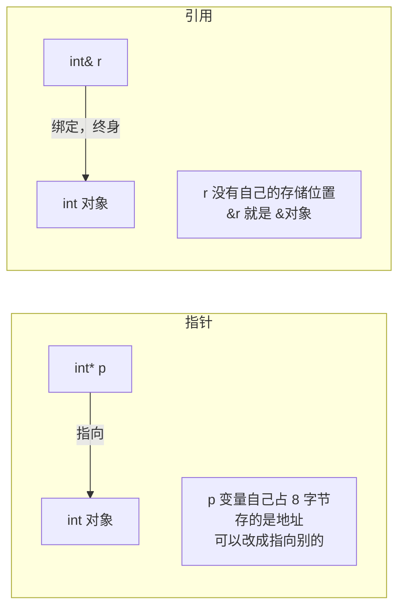
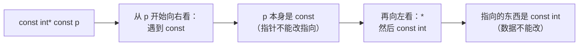

# 01 从 C 到 C++
**这里解决一个问题：你写 C 已经很顺手了，到了 C++ 里哪些习惯必须改，改了能得到什么。**

C++ 的大部分"新语法"其实都是**为了让编译器能帮你查出 C 里查不出的错**。所以这一页的每一条，我都会说清"不这么写在 C 里会出什么事"。

## 本页学什么

- 引用：一个"不可能为空的、自动解引用的指针"，以及它和指针的真实区别
- `const` 正确性：四个位置各管什么，怎么读声明
- 命名空间：替代 C 的 `xxx_` 前缀
- 重载、默认参数：消灭 C 里的 `func_int` / `func_float` 命名
- `auto`、`decltype`：让编译器写类型
- 范围 `for`：消灭"下标越界"这类 bug
- `nullptr`：消灭 `NULL` 的重载歧义

## 1. 引用：语法糖还是真东西？

### 一句话定义

**引用是某个已存在对象的别名。** 标准对它的实现方式不作规定——但所有主流实现里，引用就是一个**自动解引用的、不可为空的、不可重绑定的指针**，占用和指针一样的空间。

先用实测确认这一点：

```cpp
// ref_size.cpp
#include <cstdio>

struct Probe {
    int  v;
    int& r;    // 引用成员
    int* p;    // 指针成员
};

int main() {
    int x = 10;
    int& rx = x;
    int* px = &x;

    std::printf("sizeof(int)      = %zu\n", sizeof(int));
    std::printf("sizeof(int&)     = %zu   <-- 引用的 sizeof 是"被引用类型的大小"\n", sizeof(int&));
    std::printf("sizeof(int*)     = %zu\n", sizeof(int*));
    std::printf("sizeof(Probe)    = %zu   <-- 引用成员和指针成员占一样多\n", sizeof(Probe));
    std::printf("offsetof v,r,p   = %zu %zu %zu\n",
                offsetof(Probe, v), offsetof(Probe, r), offsetof(Probe, p));

    std::printf("&x = %p  &rx = %p  px = %p\n",
                (void*)&x, (void*)&rx, (void*)px);

    rx = 99;
    std::printf("after rx=99, x = %d\n", x);

    // 反例：把带副作用的表达式直接塞进 printf 参数
    int y = 10;
    int& ry = y;
    std::printf("side=%d y=%d\n", (ry = 99), y);   // 结果取决于求值顺序
}
```

编译运行：

```bash
g++ -std=c++17 -O0 -o ref_size.exe ref_size.cpp && ./ref_size.exe
```

**实测输出：**

```text
sizeof(int)      = 4
sizeof(int&)     = 4   <-- 引用的 sizeof 是"被引用类型的大小"
sizeof(int*)     = 8
sizeof(Probe)    = 24  <-- 引用成员和指针成员占一样多
offsetof v,r,p   = 0 8 16
&x = 0000001b8c7ff75c  &rx = 0000001b8c7ff75c  px = 0000001b8c7ff75c
after rx=99, x = 99
side=99 y=10
```

:::danger[注意最后一行：side=99 但 y=10]
`ry = 99` 明明执行了（返回 99），同一个 `printf` 里读到的 `y` 却是 10。

原因：**函数实参的求值顺序是未指定的（unspecified）**。GCC 在 x86-64 上通常从右往左求值，所以 `y` 先被读走（10），之后才执行 `ry = 99`。

**这不是引用的坑，是"把带副作用的表达式塞进函数实参"的坑**，而且换编译器、换优化等级都可能得到不同结果（本例在 `-O0` 和 `-O2` 下输出一致，但这是巧合，不是保证）。

正确写法是拆成两条语句：

```cpp
ry = 99;
std::printf("y = %d\n", y);   // 稳定输出 99
```
:::

三个被实测确认的事实：

1. `sizeof(int&)` 是 **4**，等于 `sizeof(int)`——**引用的 `sizeof` 永远返回"被引用类型"的大小**，不是引用自身占的空间。这是标准规定的。
2. 在结构体里，`int&` 成员和 `int*` 成员**都占 8 字节**（64 位平台），偏移各占一格。这暴露了引用的真实存储成本。
3. `&rx` 得到的地址**和 `&x` 完全相同**——引用没有自己的地址，取址就是取被引用对象的地址。

### 引用 vs 指针：逐条对照

| 特性 | 引用 `T&` | 指针 `T*` |
| --- | --- | --- |
| 能否为空 | **不能**（标准意义上；制造空引用是 UB） | 能，常见 |
| 能否不初始化 | **不能**，声明时必须绑定 | 能（野指针的来源） |
| 能否重绑定 | **不能**，绑定后永远指向那个对象 | 能，`p = &other;` |
| 取内容 | 直接用 `r`，无需 `*` | 必须 `*p` 或 `p->` |
| 自身占用空间 | 标准未规定；实现上与指针相同 | 明确是指针大小 |
| `sizeof(r)` | 返回**被引用类型**的大小 | 返回指针大小 |
| 数组 | **没有"引用数组"**，但可以数组引用 `int (&a)[10]` | 可以 `T* arr[]` |
| 算术 | 不能 `r++` 移动（那是给对象加 1） | 可以 `p++` |



### 什么时候用引用，什么时候用指针

:::tip[一条实用规则]
**能用引用就用引用；只有两种情况下必须用指针：**

1. **这个参数/成员可以"没有"**（可空）→ 用指针（`T*`）
2. **需要重新指向别的对象** → 用指针

函数参数尤其如此：

```cpp
void process(const std::vector<int>& data);   // 我要读它，它必须存在
void maybe_process(const std::vector<int>* data);  // 可能为 nullptr
```
:::

### 悬空引用：引用的头号杀手

引用不能为空，但它**能悬空**——被引用的对象死了，引用还在。这比野指针更隐蔽，因为语法上它看起来完全合法：

```cpp
// dangling.cpp  —— 故意的错误示范
#include <cstdio>

int& bad() {
    int local = 42;
    return local;        // 返回局部变量的引用
}

int main() {
    int& r = bad();
    std::printf("%d\n", r);   // 未定义行为
}
```

编译：

```bash
g++ -std=c++17 -Wall -o dangling.exe dangling.cpp
```

**编译器的真实警告（GCC）：**

```text
dangling.cpp: In function 'int& bad()':
dangling.cpp:6:12: warning: reference to local variable 'local' returned [-Wreturn-local-addr]
    6 |     return local;        // 返回局部变量的引用
      |            ^~~~~
```

:::warning[注意]
它只是 warning，不是 error，程序照样能编出来并运行——而且**很多时候会"正常"打印出 42**，因为栈上的那块内存还没被覆盖。**这正是它危险的原因：未定义行为不等于崩溃。**

永远开启 `-Wall -Wextra`，并且把 warning 当 error：`-Werror`。
:::

## 2. const 正确性：四个位置

`const` 是 C++ 里最被低估的特性。它不只是"不能改"，它是**一份给编译器和人看的契约**。

### const 能出现在四个地方

```cpp
// const_positions.cpp
#include <cstdio>

struct Thing {
    mutable int cache_hits = 0;   // mutable：即使在 const 对象上也能改

    int  value       = 10;
    int* ptr_to_int  = nullptr;   // 普通指针
    const int*  p1   = nullptr;   // 指向 const 的指针（数据不能改）
    int* const  p2   = nullptr;   // const 指针（指针不能改）
    const int* const p3 = nullptr;// 都不能改

    int  get()          const { return value; }        // const 成员函数
    void set(int v)           { value = v; }
};

int main() {
    const Thing t;
    std::printf("t.get() = %d\n", t.get());
    // t.set(5);  // 编译错误：const 对象不能调用非 const 成员函数
}
```

**const 成员函数** 是 C++ 独有的（C 里没有成员函数）。`int get() const` 末尾那个 `const` 修饰的是**隐含的 `this` 指针**：

- 普通成员函数里，`this` 的类型是 `Thing*`
- `const` 成员函数里，`this` 的类型是 `const Thing*`

所以 const 成员函数**不能修改非 `mutable` 的成员**。这就是 `mutable` 存在的理由——给"逻辑上不改变对象状态，但物理上要写点东西"的场景开个口子（典型：缓存、互斥锁）。

### 怎么读一个复杂声明：右左法则

`const int* const p` 到底是谁不能改？用**右左法则**：



对照表：

| 声明 | 指针能改指向？ | 数据能改？ | 人话 |
| --- | --- | --- | --- |
| `int* p` | 能 | 能 | 全都能改 |
| `const int* p` | 能 | **不能** | "指向常量的指针" |
| `int* const p` | **不能** | 能 | "常量指针" |
| `const int* const p` | **不能** | **不能** | 全都不能改 |

等价写法：`const int* p` 和 `int const* p` 完全一样。**推荐写 `const int*`**（把 const 放前面更符合直觉）。

### const 引用：最重要的用法

```cpp
void print(const std::string& s);   // 不拷贝，也不修改
```

这是 C++ 里**最高频的写法**。相比 `void print(std::string s)`（会拷贝一次）和 `void print(std::string& s)`（能修改、且不能接临时对象），`const&` 三个好处全占：

1. 不拷贝（大对象省时间）
2. 不修改（调用者放心）
3. **能接临时对象**（这是 `T&` 做不到的）

```cpp
// const_ref.cpp
#include <string>
#include <cstdio>

void by_value(std::string s)          { std::printf("by_value  size=%zu\n", s.size()); }
void by_ref  (std::string& s)         { std::printf("by_ref    size=%zu\n", s.size()); }
void by_cref (const std::string& s)   { std::printf("by_cref   size=%zu\n", s.size()); }

int main() {
    std::string a = "hello";
    by_value(a);
    by_ref(a);
    by_cref(a);

    by_cref("temporary");   // OK：const& 能绑临时对象
    by_value("temporary");  // OK：拷贝一份
    // by_ref("temporary"); // 编译错误：非 const 左值引用不能绑右值
    (void)a;
}
```

**取消注释 `by_ref("temporary")` 后的真实编译错误：**

```text
const_ref.cpp:4:20: error: cannot bind non-const lvalue reference of type 'std::string&'
{aka 'std::__cxx11::basic_string<char>&'} to an rvalue of type 'std::string'
{aka 'std::__cxx11::basic_string<char>'}
```

### const 的"传染性"

`const` 是**会传染的**：一个 const 对象只能调用 const 成员函数；const 成员函数里拿到的成员指针也是 const 的。这条链让编译器能静态地证明"这个函数不会改状态"。

:::caution[但 const 不是线程安全]
`const` 只保证"不通过这个引用修改"，**不保证别的线程不修改同一个对象**。`const` 和线程安全是两件事，别混为一谈。
:::

---

**翻页**：[下一页 →](./transition-02) · [返回目录](./)
