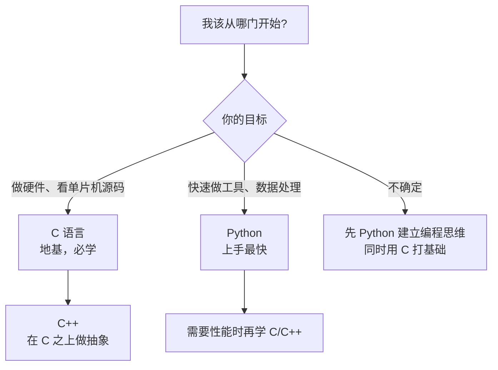

# 软件编程

**这里解决一个问题：把语言本身学透。**

嵌入式也好、服务器也好、写工具也好，最后都要落到「用某门语言把想法写对」。这个板块不教你某个框架怎么调 API，而是教你**这门语言为什么是这样设计的**——因为只有懂了原理，遇到没见过的报错才知道往哪查。

## 三条主线怎么选



| 主线 | 适合谁 | 学完能做什么 | 和本机硬件的关系 |
| --- | --- | --- | --- |
| [**Python**](./python/) | 零基础、想快速出成果 | 写脚本、爬数据、做自动化、跑 AI 模型 | 上位机、数据分析、串口工具 |
| [**C**](./c/) | 想懂底层、要写固件 | 看穿指针与内存，读懂 RTOS 与驱动源码 | **ESP32 / STM32 的主力语言** |
| [**C++**](./cpp/) | 有 C 基础、要写大型系统 | 用 RAII 和模板写零开销抽象 | 嵌入式上层框架、桌面工具 |

:::tip[给你的建议路线]
如果你是为了玩板子：**先 C，后 C++，Python 当工具用**。
如果你完全没写过代码：**先 Python 建立"程序是怎么跑的"这个直觉，再回头学 C**——直接从 C 入门的人，十有八九会卡在指针上放弃。

两条路都能走通，区别只是先撞哪面墙。
:::

## 三条主线都遵循同一套结构

每一页都是这个顺序，不跳步：

```
原理（为什么是这样）→ 可运行代码 + 真实输出 → 怎么验证你懂了 → 常见坑表格 → 自检清单
```

**为什么坚持"真实输出"？** 因为教程最常见的错误不是讲错概念，而是给了一段**跑不起来或者早就过时**的代码。本站的代码示例尽量在本机实测过，输出直接贴原文。

## 每门语言学到什么程度算够

| 阶段 | 标志 | 对应页面 |
| --- | --- | --- |
| 入门 | 能读懂别人写的简单程序 | 语法基础 |
| 上手 | 能不查资料写出几十行的完整功能 | 数据类型 / 函数 / 类 |
| 熟练 | 知道同一件事有几种写法，以及各自代价 | 进阶特性 / 标准库 |
| 通透 | 能解释「为什么语言要这样设计」 | 内存模型 / 并发 / 未定义行为 |

**大部分教程停在「上手」。** 这个板块的目标是把你推到「熟练」和「通透」——因为嵌入式开发里，一个不懂内存模型的程序员写出来的 bug，是查不出来的。

## 学习方式

1. **一定要动手敲**。看懂和写出来之间隔着一整个调试过程，而调试才是真正学东西的地方
2. **每页的自检清单逐条打勾**，打不了勾就回去重看，别往下走
3. **遇到报错先自己查官方文档**，再问 AI——AI 给的代码经常是看起来对但跑不通的

:::warning[关于 AI 生成代码]
现在很多人用 AI 学编程，这没问题，但有个陷阱：**AI 会自信地给你一段编译不过的代码，还附上解释**。

正确用法是：让它写，然后**你必须自己编译运行一遍**。验证不通过就让 AI 看报错——这个过程本身就是最好的学习。详见 [AI 辅助开发](../ai-coding/)。
:::

## 下一步

- 想立刻动手写第一行代码 → [Python 主线](./python/)
- 想搞懂指针和内存 → [C 主线](./c/)
- 想学现代 C++ → [C++ 主线](./cpp/)
- 想学板子怎么开发 → [硬件开发](../hardware/)

---

**其他板块**：[快速上手](../quickstart/)（零基础玩板子）· [硬件开发](../hardware/) · [AI 辅助开发](../ai-coding/) · [速查表](../reference/)
