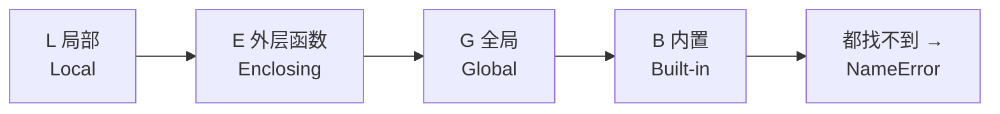

# 17 作用域与全局变量

**本课目标**：搞清变量在哪些地方能用，避开 `UnboundLocalError` 这个高频报错。

## 作用域是什么

**作用域 = 一个变量能被访问的范围。**

```python
def f():
    secret = "只在函数里存在"
    print(secret)

f()
print(secret)        # 会报错
```

输出：

```text
只在函数里存在
NameError: name 'secret' is not defined
```

`secret` 是**局部变量**，函数执行完就没了，外面看不见。

## 两类变量

```python
global_var = "我是全局的"

def show():
    local_var = "我是局部的"
    print(global_var)      # ✅ 能读全局
    print(local_var)       # ✅ 能读自己内部的

show()
print(global_var)          # ✅ 外面能读全局
print(local_var)           # ❌ NameError
```

| 类型 | 定义位置 | 在哪能用 |
| --- | --- | --- |
| 全局变量 | 函数外 | 整个文件 |
| 局部变量 | 函数内 | 只在那个函数内 |

:::tip[函数内部能「读」全局变量]
```python
name = "小明"

def greet():
    print(f"你好，{name}")     # 直接读，没问题

greet()
```

**读是可以的，改才需要特殊处理**（见下）。
:::

## 函数内部改全局变量：需要 global

:::danger[这是最容易困惑的一点]
```python
count = 0

def increment():
    count = count + 1      # 想改全局

increment()
```

报错：

```text
UnboundLocalError: cannot access local variable 'count'
where it is not associated with a value
```

**但明明 count 在外面定义了！**
:::

### 为什么会这样

:::tip[深入一点：Python 的规则是「赋值即局部」]
Python 看到函数里有一句 `count = ...`，就判定 `count` 是这个函数的**局部变量**（不管外面有没有同名的）。

于是 `count + 1` 里的 `count` 指的是「还没赋值的局部变量」——读它自然就报错了。

**规则**：函数内只要对某变量**赋值**，它就整个函数内都是局部的。

（**第一遍看不懂可以跳过**，记住下面的解法即可。）
:::

### 解法：用 global 声明

```python
count = 0

def increment():
    global count           # 声明：我要用的是全局那个
    count = count + 1

increment()
increment()
print(count)
```

输出：

```text
2
```

### 只读不写，不需要 global

```python
name = "小明"

def greet():
    # 没有对 name 赋值，所以不需要 global
    print(f"你好，{name}")
```

## nonlocal：改外层函数的变量

`global` 针对全局，`nonlocal` 针对**外层函数**的变量：

```python
def make_counter():
    n = 0

    def add():
        nonlocal n          # 用的是外层 make_counter 的 n
        n += 1
        return n

    return add


c = make_counter()
print(c(), c(), c())
```

输出：

```text
1 2 3
```

:::tip[这个模式叫「闭包」，很有用]
`make_counter()` 返回的 `add` 函数「记住了」`n` 这个变量，即使 `make_counter` 已经执行完了。

所以 `c` 每次调用都能在上次的基础上加 1。

**这是实现计数器、状态保存的经典手法**，进阶课程会深入讲。
:::

### 不用 nonlocal 会怎样

```python
def make_counter():
    n = 0
    def add():
        n += 1        # 没有 nonlocal
        return n
    return add

c = make_counter()
c()                   # UnboundLocalError
```

和 `global` 的情况一样：因为有赋值，`n` 被判定为 `add` 的局部变量。

## LEGB：变量查找顺序

Python 找一个变量时，按这个顺序搜：



```python
x = "全局"          # G

def outer():
    x = "外层"      # E
    def inner():
        x = "局部"  # L
        print(x)
    inner()

outer()
```

输出：

```text
局部
```

**就近原则**：先找自己的，找不到才往外找。

去掉 `inner` 里的 `x`，就会用到外层的：

```python
def outer():
    x = "外层"
    def inner():
        print(x)      # 自己没有，用外层的
    inner()
outer()
```

输出：

```text
外层
```

## 为什么应该少用全局变量

```python
# 反面例子
data = []
status = "idle"

def load():
    global data, status
    data = read_file()
    status = "loaded"

def process():
    global status
    if status == "loaded":
        ...
```

:::warning[全局变量的三个问题]
1. **谁都可能改它**，出了问题不知道是谁改的
2. **测试困难**，每个测试都要先重置全局状态
3. **函数不再独立**，看不出它依赖什么

**程序一大，全局变量就是 bug 温床。**
:::

### 更好的做法：用参数和返回值

```python
def load(filename):
    """读文件，返回数据和新状态"""
    data = read_file(filename)
    return data, "loaded"


def process(data, status):
    if status == "loaded":
        ...
```

**所有依赖从参数进来，所有结果从返回值出去。** 函数变成「纯」的：

- 一眼能看出它需要什么
- 不依赖外部状态
- 测试时随便传假数据

:::tip[什么时候可以用全局变量]
确实有一些合理场景：

- **常量**：`MAX_SIZE = 100`、`PI = 3.14159`（用全大写表示「不该改」）
- **程序配置**：启动时读一次，之后只读
- **单例对象**：日志器等

**判断标准：这个值是「只读的配置」还是「会变的状态」？** 前者可以全局，后者尽量避免。
:::

## 常量的写法

```python
# 常量用全大写，表示「约定不改」
MAX_RETRY = 3
TIMEOUT_SECONDS = 30
API_BASE_URL = "https://example.com/api"


def fetch(url, retry=MAX_RETRY):
    ...
```

Python 没有真正的「常量」语法（写了还是能改），**全大写只是约定**，告诉大家别动它。

## 常见错误

| 错误 | 报错 | 原因 | 解决 |
| --- | --- | --- | --- |
| 函数内改全局变量 | UnboundLocalError | 没声明 global | 加 `global x` |
| 内层函数改外层变量 | UnboundLocalError | 没声明 nonlocal | 加 `nonlocal x` |
| 函数外访问局部变量 | NameError | 局部变量出了函数就销毁 | 用返回值传出去 |
| 参数与全局同名 | 结果不符合预期 | 参数遮蔽了全局 | 换个名字 |
| 在循环里定义函数用循环变量 | 结果都是最后一个值 | 闭包延迟绑定 | 用默认参数固定 |

:::danger[闭包的延迟绑定陷阱]
```python
funcs = []
for i in range(3):
    funcs.append(lambda: i)

for f in funcs:
    print(f())
```

输出：

```text
2
2
2
```

**不是 0 1 2！** 因为 lambda 里的 `i` 是在**调用时**才查找的，那时循环已经结束，`i` 是 2。

修法：用默认参数在定义时固定住：

```python
funcs.append(lambda i=i: i)
```

这个坑很隐蔽，遇到「结果全是最后一个值」就想想它。
:::

## 本课自检

- [ ] 知道局部变量出了函数就没了
- [ ] 知道函数内能**读**全局变量
- [ ] 知道函数内**改**全局变量需要 `global`
- [ ] 能解释为什么 `count = count + 1` 会 UnboundLocalError
- [ ] 会用 `nonlocal` 修改外层函数变量
- [ ] 知道 LEGB 的查找顺序
- [ ] 能说出全局变量的三个坏处
- [ ] 知道「参数进、返回值出」是更好的设计
- [ ] 知道常量用全大写
- [ ] 知道闭包延迟绑定陷阱

## 下一步

[18 模块与 import](./18-modules) —— 学会拆文件、用别人写的代码，这是走向大型程序的第一步。
