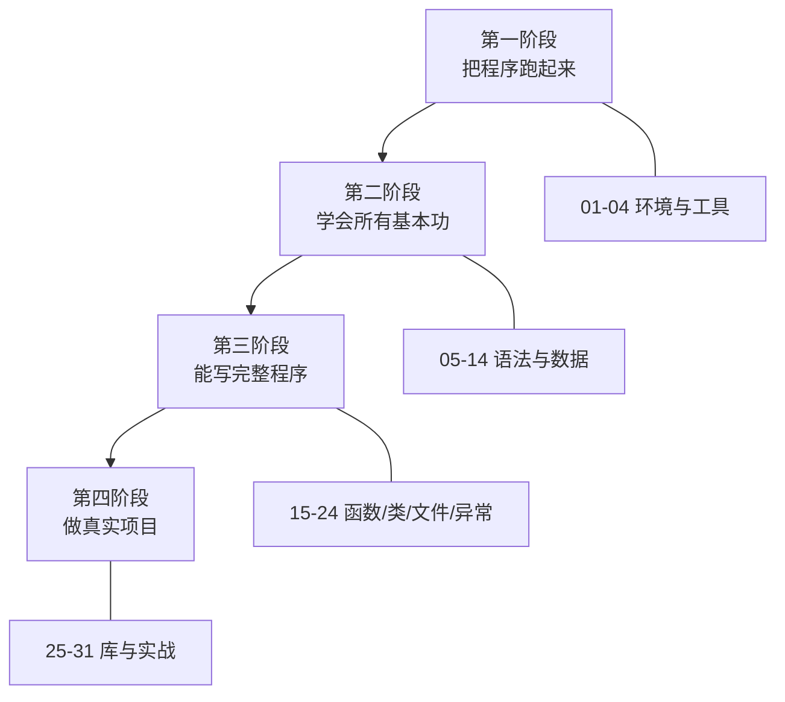

# Python 零基础完整教程

**这条线假设你从没写过代码。** 不知道什么是变量、什么是循环、终端在哪——都没关系，我们从最开头讲。

如果你已经会写程序，只是想补 Python 语法，请走 [Python 进阶教程](../python/)。

## 这条线怎么设计的

| 特点 | 说明 |
| --- | --- |
| **每节只讲一件事** | 一节 150～250 行，15 分钟内能读完并做完 |
| **绝不跳步** | 上一节用到的东西，前一节一定讲过 |
| **每节都有能跑的代码** | 复制粘贴就能看到结果，不用装一堆东西 |
| **先会用，再讲为什么** | 原理放在「深入一点」里，第一遍可以跳过 |

:::tip[关于「深入一点」小节]
你会在一些页面看到这样的折叠块。它们讲的是**原理和边界情况**，第一遍读不懂完全可以跳过——先把东西用起来，回头再看会有顿悟的感觉。

这不是偷懒。零基础阶段最大的敌人是「还没做出东西就被原理劝退」。
:::

## 学习路线

## 全部 31 节

### 第一阶段：把程序跑起来（4 节）

先把环境弄好，让屏幕上出现你自己写的字。这一步做完，你就已经「会编程」了——剩下的只是学更多工具。

| # | 课 | 你会做出什么 |
| --- | --- | --- |
| 01 | [Python 是什么，装哪个版本](./01-what-is-python) | 知道 Python 能干什么、该装什么 |
| 02 | [安装与验证环境](./02-install) | 电脑上跑出 `Hello, World` |
| 03 | [认识终端与运行方式](./03-terminal) | 会用终端运行 .py 文件 |
| 04 | [编辑器与第一个项目](./04-editor) | 用 VS Code 写并运行程序 |

### 第二阶段：语法与数据（10 节）

这是最枯燥也最必要的部分。**不要跳**——后面所有内容都建立在这里。

| # | 课 | 你会做出什么 |
| --- | --- | --- |
| 05 | [变量与赋值](./05-variables) | 理解「名字指向值」这件事 |
| 06 | [数字与运算](./06-numbers) | 会做四则运算、取整、求余 |
| 07 | [字符串入门](./07-strings) | 拼接、格式化、切片 |
| 08 | [输入与输出](./08-io) | 程序和用户对话 |
| 09 | [条件判断 if](./09-if) | 程序会做选择 |
| 10 | [循环 for 与 while](./10-loops) | 程序会重复做事 |
| 11 | [列表 list](./11-list) | 存一堆数据 |
| 12 | [字典 dict](./12-dict) | 存「名字 → 值」的对应关系 |
| 13 | [元组与集合](./13-tuple-set) | 知道还该有哪些容器 |
| 14 | [阶段实战：猜数字游戏](./14-project-guess) | 把前 9 节串成一个完整程序 |

### 第三阶段：能写完整程序（10 节）

到这里你能写几十行的程序了。这一阶段教你把程序组织好，并且处理真实世界的脏数据。

| # | 课 | 你会做出什么 |
| --- | --- | --- |
| 15 | [函数入门](./15-functions) | 把代码打包复用 |
| 16 | [函数进阶：参数与返回值](./16-functions-advanced) | 会写带默认值、可变参数的函数 |
| 17 | [作用域与全局变量](./17-scope) | 知道变量在哪能用 |
| 18 | [模块与 import](./18-modules) | 会用别人写的代码 |
| 19 | [文件读写](./19-files) | 程序能保存数据 |
| 20 | [异常处理 try/except](./20-exceptions) | 程序出错不会崩 |
| 21 | [面向对象：类与对象](./21-class) | 会用类组织复杂逻辑 |
| 22 | [面向对象进阶：继承](./22-inherit) | 理解类之间的关系 |
| 23 | [推导式与常用写法](./23-comprehension) | 代码更短更清晰 |
| 24 | [阶段实战：通讯录](./24-project-contacts) | 用类 + 文件做完整应用 |

### 第四阶段：做真实项目（7 节）

| # | 课 | 你会做出什么 |
| --- | --- | --- |
| 25 | [常用标准库速成](./25-stdlib) | 会处理时间、路径、JSON |
| 26 | [正则表达式入门](./26-regex) | 能从杂乱文本里提数据 |
| 27 | [第三方库与 pip](./27-pip) | 会安装和使用别人的库 |
| 28 | [调试技巧与读懂报错](./28-debug) | 出错了知道怎么查 |
| 29 | [代码风格与命名](./29-style) | 写出别人看得懂的代码 |
| 30 | [实战：批量处理文件](./30-project-files) | 自动化日常重复劳动 |
| 31 | [实战：抓取网页数据](./31-project-web) | 抓取并分析网页内容 |

## 学完之后

- 想系统补原理（GIL、内存模型、装饰器、并发）→ [Python 进阶教程](../python/)
- 想开始玩硬件 → [快速上手](../../quickstart/) 或 [ESP 系列](../../hardware/esp/)
- 想学 C 语言（嵌入式必学）→ [C 语言教程](../c/)

## 学习建议

1. **每天 1～2 节，别贪多**。编程是肌肉记忆，不是背知识
2. **代码一定要自己敲一遍**，不要复制粘贴。手敲才会遇到那些「少个冒号」的报错，而读懂报错才是真正的能力
3. **报错不是失败，是提示**。看不懂就把报错复制去搜，或者看 [第 28 节](./28-debug)
4. **卡住超过 30 分钟就先跳过**，回头再看往往就懂了
