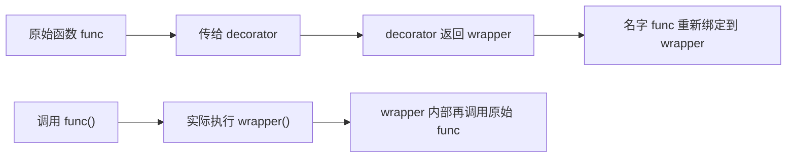

# 01 装饰器：接收函数、返回函数
## 1. 装饰器：接收函数、返回函数


### 原理

因为函数是一等对象（第 5 页），所以可以写出「输入一个函数、输出一个新函数」的函数。装饰器的 `@` 只是语法糖：

```python
@decorator
def func():
    pass

# 完全等价于：
def func():
    pass
func = decorator(func)
```



### 写一个

```python
import functools
import time


def log_calls(fn):
    @functools.wraps(fn)          # 把 fn 的元信息复制到 wrapper
    def wrapper(*args, **kwargs):
        print(f"  调用 {fn.__name__}{args}")
        result = fn(*args, **kwargs)
        print(f"  -> {result!r}")
        return result
    return wrapper


@log_calls
def add(a, b):
    """加法"""
    return a + b


print("结果:", add(1, 2))
print("名字保留了吗:", add.__name__)
print("文档保留了吗:", add.__doc__)
```

```text
  调用 add(1, 2)
  -> 3
结果: 3
名字保留了吗: add
文档保留了吗: 加法
```

### `functools.wraps` 为什么必须写

不加会怎样：

```python
def no_wraps(fn):
    def wrapper(*a, **k):
        return fn(*a, **k)
    return wrapper

@no_wraps
def sub(a, b):
    return a - b

print("__name__ 变成了:", sub.__name__)
```

```text
__name__ 变成了: wrapper
```

函数**被伪装了**——`sub.__name__` 是 `wrapper`，文档字符串、`__annotations__` 全丢了。这会破坏：

- 调试和日志（全都显示 `wrapper`）
- 依赖 `__name__` 的框架（Flask 路由、pytest 收集）
- `help()` 和自动生成文档
- `inspect.signature()`

:::danger[写装饰器一律加 `@functools.wraps(fn)`]
这一行成本为零，忘了它会在几周后以极难排查的方式报复你——比如某个 Web 框架报「路由重名」，而实际上所有视图函数的名字都叫 `wrapper`。
:::

### 带参数的装饰器

`@repeat(3)` 比 `@log_calls` 多了一层——因为 `@` 后面是个**表达式**，它的结果才是真正的装饰器：

```python
def repeat(times):              # 外层：接收装饰器参数
    def decorator(fn):          # 中层：接收函数
        @functools.wraps(fn)
        def wrapper(*a, **k):   # 内层：实际被调用的
            out = None
            for _ in range(times):
                out = fn(*a, **k)
            return out
        return wrapper
    return decorator


@repeat(3)
def greet():
    print("  hi", end=" ")
    return "done"


print()
print("结果:", greet())
```

```text
  hi   hi   hi 结果: done
```

展开看：`greet = repeat(3)(greet)`——先调 `repeat(3)` 得到 decorator，再用它包 `greet`。

### 用在类上

装饰器能装饰任何可调用对象，包括类：

```python
def singleton(cls):
    instances = {}
    @functools.wraps(cls)
    def get_instance(*a, **k):
        if cls not in instances:
            instances[cls] = cls(*a, **k)
        return instances[cls]
    return get_instance


@singleton
class Config:
    def __init__(self):
        self.value = 1


print("是同一个实例吗:", Config() is Config())
```

```text
是同一个实例吗: True
```

### `functools.lru_cache`：备忘录模式

```python
@functools.lru_cache(maxsize=128)
def fib(n):
    return n if n < 2 else fib(n - 1) + fib(n - 2)

print("fib(30) =", fib(30))
print(fib.cache_info())
fib.cache_clear()
print("清空后:", fib.cache_info())
```

```text
fib(30) = 832040
CacheInfo(hits=28, misses=31, maxsize=128, currsize=31)
清空后: CacheInfo(hits=0, misses=0, maxsize=128, currsize=0)
```

朴素递归的 `fib(30)` 要调用约 270 万次，加了 `lru_cache` 后只有 59 次调用。**这是装饰器最实用的一例。**

3.9+ 有更简单的 `@functools.cache`（`maxsize=None` 的别名）。

:::caution[lru_cache 的两个前提]
1. **函数必须是纯的**——同样的输入永远返回同样的输出。缓存了带副作用或依赖外部状态的函数会得到陈旧结果
2. **参数必须可哈希**——list、dict 不能当参数，要转成 tuple

另外注意 `lru_cache` 会**持有参数引用**，缓存大量大对象时可能造成内存不释放。
:::

---

**翻页**：[02 生成器与迭代器协议 →](./adv-02-generator) · [返回目录](./)
