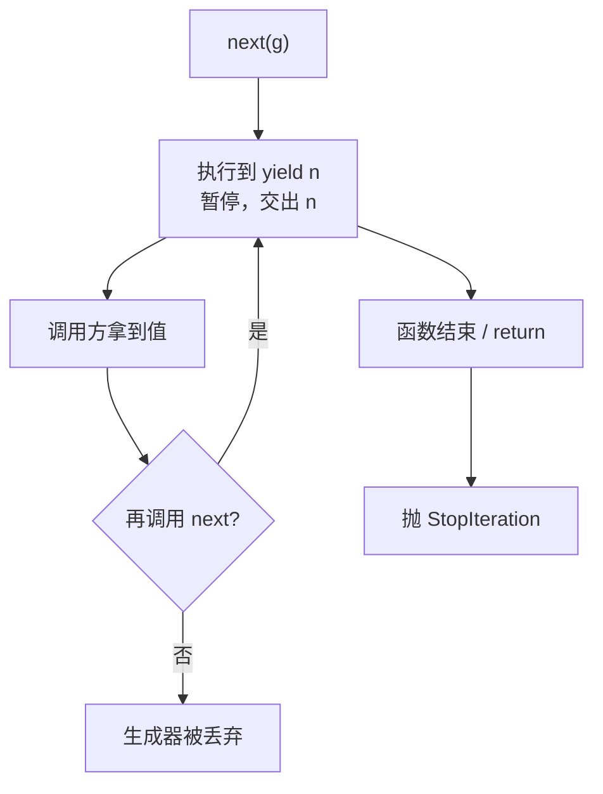
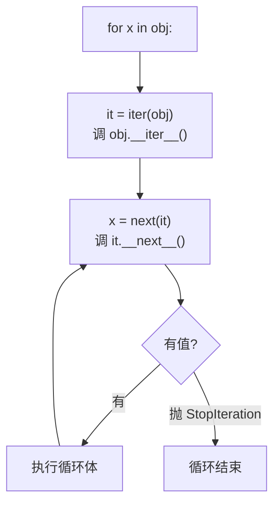

# 02 生成器与迭代器协议
## 2. 生成器：惰性的力量

### 原理


函数里出现 `yield`，它就**不再是普通函数**——调用它返回一个**生成器对象**，函数体不会执行。

```python
def countdown(n):
    print("  开始")
    while n > 0:
        yield n
        n -= 1
    print("  结束")

g = countdown(3)
print("创建后什么都没打印，类型:", type(g).__name__)
print("next:", next(g))
print("next:", next(g))
for v in g:
    print("  for 循环:", v)
```

```text
创建后什么都没打印，类型: generator
  开始
next: 3
next: 2
  for 循环: 1
  结束
```



**关键特性**：`yield` 会**暂停函数并保留全部局部状态**，下次从暂停处继续。这和普通函数「返回即销毁栈帧」完全不同。

### 为什么重要：省内存

```python
import sys

gen = (x * x for x in range(10**6))
lst = [0] * 1000

print("生成器表达式占:", sys.getsizeof(gen), "字节")
print("一千个元素的列表占:", sys.getsizeof(lst), "字节")
```

```text
生成器表达式占: 208 字节
一千个元素的列表占: 8056 字节
```

一百万个元素的生成器只占 208 字节——因为它**不存数据，只存计算规则**。

**用生成器的场景**：

- 处理大文件（一行一行读，不整个载入）
- 数据管道（一连串转换）
- 无限序列

```python
def read_lines(path):
    with open(path, encoding="utf-8") as f:
        for line in f:
            yield line.rstrip("\n")

# 用起来像列表，但内存恒定
# for line in read_lines("huge.log"):
#     process(line)
```

### `send`、`throw`、`close`

生成器是双向的——可以往里送值：

```python
def echo():
    got = yield "ready"           # yield 表达式可以接收值
    while True:
        got = yield f"echo {got}"

e = echo()
print("next:", next(e))           # 启动到第一个 yield
print("send:", e.send("hi"))      # 把 "hi" 送进生成器
e.close()
print("已关闭")
```

```text
next: ready
send: echo hi
已关闭
```

`gen.send(v)` 让 `yield` 表达式的值为 `v`。这是 **协程**的雏形——第 8 页的 `async/await` 就是在它之上建立的。

### `yield from`：委托

```python
def inner():
    yield 1
    yield 2

def outer():
    yield from inner()      # 把 inner 的产出直接透传
    yield 3

print(list(outer()))
```

```text
[1, 2, 3]
```

`yield from` 不只是语法糖——它还**双向透传** `send` 和 `throw`，所以能用来做生成器嵌套。

### 生成器是「一次性」的

```python
g = (x for x in range(3))
print(list(g))      # [0, 1, 2]
print(list(g))      # [] —— 已经耗尽了
```

耗尽后不能再遍历。需要多次遍历就用列表，或者每次重新创建生成器。

## 3. 迭代器协议

`for` 循环背后就是两个方法：



自己实现一个：

```python
class Count:
    def __init__(self, n):
        self.n = n
        self.i = 0

    def __iter__(self):
        return self          # 迭代器返回自己

    def __next__(self):
        if self.i >= self.n:
            raise StopIteration
        self.i += 1
        return self.i

print(list(Count(3)))
```

```text
[1, 2, 3]
```

**两个概念要分清**：

| 概念 | 有什么方法 | 例子 |
| --- | --- | --- |
| **可迭代对象** Iterable | `__iter__()` | `list`、`str`、`dict`、生成器 |
| **迭代器** Iterator | `__iter__()` + `__next__()` | `iter([1,2])`、生成器、上面的 `Count` |

```python
it = iter([1, 2])
print("类型:", type(it).__name__)
print("有 __next__ 吗:", hasattr(it, "__next__"))
print("列表本身有 __next__ 吗:", hasattr([1, 2], "__next__"))
```

```text
类型: list_iterator
有 __next__ 吗: True
列表本身有 __next__ 吗: False
```

**列表是可迭代的，但不是迭代器**——每次 `iter(list)` 都返回**新的独立**迭代器，所以可以嵌套两层循环遍历同一个列表。

:::tip[判断用哪个]
- 只需要能被 `for` 遍历 → 实现 `__iter__` 即可（通常返回生成器最简单）
- 需要记住遍历进度 → 实现 `__iter__` + `__next__`

最常见的偷懒写法是让 `__iter__` 本身成为生成器函数：

```python
class Bag:
    def __init__(self, items): self.items = items
    def __iter__(self):
        for item in self.items:
            yield item
```

`yield` 让 `__iter__` 自动返回生成器，不用手写 `__next__` 和 `StopIteration`。
:::

---

**翻页**：[← 01 装饰器：接收函数、返回函数](./adv-01-decorator) · [03 上下文管理器：with 的背后 →](./adv-03-context) · [返回目录](./)
