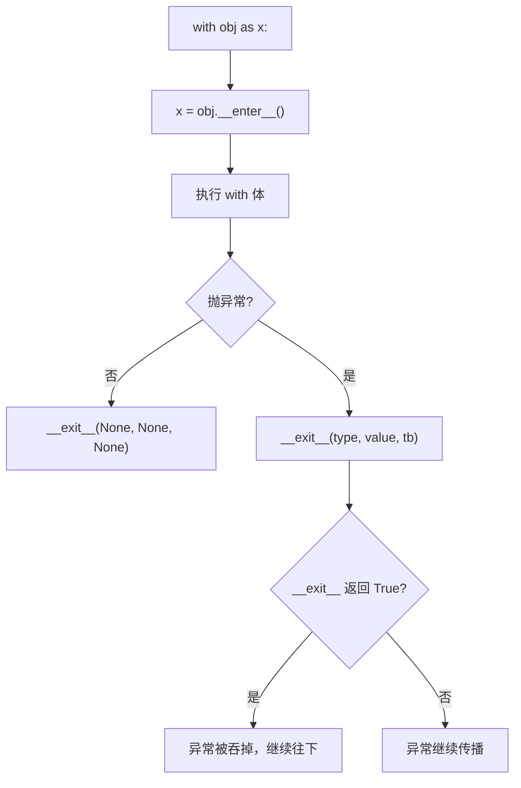

# 03 上下文管理器：with 的背后
## 4. 上下文管理器：`with` 的背后

### 协议

`with` 语句背后是 `__enter__` 和 `__exit__` 两个方法：

```python
class Managed:
    def __enter__(self):
        print("  __enter__")
        return self          # 这个返回值给 as 后面的变量

    def __exit__(self, exc_type, exc_value, traceback):
        print(f"  __exit__ exc_type={exc_type.__name__ if exc_type else None}")
        return False         # False = 不吞异常，继续往外抛

with Managed() as m:
    print("  执行体")
```

```text
  __enter__
  执行体
  __exit__ exc_type=None
```

**即使执行体抛异常，`__exit__` 也一定会被调用**——这就是 `with` 能保证资源释放的原因：

```python
try:
    with Managed():
        raise RuntimeError("出事了")
except RuntimeError as e:
    print("  异常继续向外传播:", e)
```

```text
  __enter__
  __exit__ exc_type=RuntimeError
  异常继续向外传播: 出事了
```



**`__exit__` 返回 `True` 会吞掉异常**：

```python
class Suppress:
    def __enter__(self):
        return self
    def __exit__(self, *exc):
        return True          # 吞掉一切异常

with Suppress():
    raise RuntimeError("这个异常消失了")

print("  照样执行到这里")
```

```text
  照样执行到这里
```

:::danger[不要乱返回 True]
吞掉异常会让 bug 彻底消失无踪。只有在**明确知道**该异常应该被忽略时才这么做——标准库提供了 `contextlib.suppress` 专门干这件事，比手写返回 `True` 意图清楚得多。
:::

### 用 `contextlib` 更省事

手写类太啰嗦，用 `@contextmanager` 把生成器变成上下文管理器：

```python
from contextlib import contextmanager

@contextmanager
def tag(name):
    print(f"<{name}>")
    try:
        yield              # yield 之前 = __enter__，之后 = __exit__
    finally:
        print(f"</{name}>")

with tag("div"):
    print("  内容")
```

```text
<div>
  内容
</div>
```

`yield` 的位置就是分界：之前的代码是 `__enter__`，`finally` 里的是 `__exit__`。

标准库还给了几个现成的：

```python
from contextlib import suppress, ExitStack, nullcontext

with suppress(FileNotFoundError):      # 忽略指定异常
    open("不存在的文件").close()
print("suppress 生效")

with ExitStack() as stack:             # 动态数量的上下文
    stack.enter_context(tag("a"))
    stack.enter_context(tag("b"))

print("nullcontext:", type(nullcontext()).__name__)   # 什么都不做的占位
```

```text
suppress 生效
<a>
<b>
</b>
</a>
nullcontext: nullcontext
```

`ExitStack` 适用于「运行时才知道要进多少个上下文」的场景，`nullcontext` 用于「有时需要上下文、有时不需要」的条件分支。

---

**翻页**：[← 02 生成器与迭代器协议](./adv-02-generator) · [04 描述符、元类与属性钩子 →](./adv-04-descriptor) · [返回目录](./)
