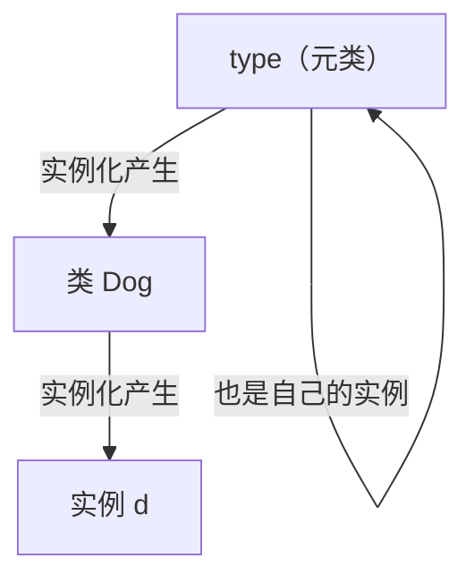

# 04 描述符、元类与属性钩子
## 5. 描述符：property 和方法的实现原理

**这是本页最有价值的一节**——它解释了 Python 对象模型里最核心的一块。

描述符是实现了 `__get__` / `__set__` / `__delete__` 中任意一个的类。它**控制了对某个属性的访问**。

```python
class Positive:
    def __set_name__(self, owner, name):
        self._name = name          # 自动获知自己被赋给了哪个名字

    def __get__(self, obj, objtype=None):
        if obj is None:
            return self            # 通过类访问时返回描述符自己
        return obj.__dict__.get(self._name)

    def __set__(self, obj, value):
        if value <= 0:
            raise ValueError(f"{self._name} 必须 > 0，收到 {value}")
        obj.__dict__[self._name] = value


class Order:
    qty = Positive()               # 类属性是描述符实例
    def __init__(self, qty):
        self.qty = qty             # 触发 __set__


o = Order(3)
print("读取:", o.qty)

try:
    Order(-1)
except ValueError as e:
    print("->", e)

print("通过类访问:", Order.qty)
```

```text
读取: 3
-> qty 必须 > 0，收到 -1
通过类访问: <__main__.Positive object at 0x...>
```

`__set_name__`（3.6+）让描述符自动知道自己叫 `qty`，不用再写 `qty = Positive("qty")`。

### 两类描述符，优先级不同

| 类型 | 实现了 | 优先级 |
| --- | --- | --- |
| **数据描述符** | `__get__` + `__set__`（或 `__delete__`） | **高于**实例 `__dict__` |
| **非数据描述符** | 只有 `__get__` | **低于**实例 `__dict__` |

验证数据描述符优先：

```python
class WithProp:
    @property
    def v(self):
        return "来自 property"

wp = WithProp()
wp.__dict__["v"] = "来自实例字典"
print(wp.v)          # property 赢了
```

```text
来自 property
```

即使实例字典里塞了同名值，`property`（数据描述符）依然优先。这保证了 `property` 的 setter 永远生效。

### 关键洞察：方法就是非数据描述符

```python
def f():
    pass

print("函数有 __get__ 吗:", hasattr(f, "__get__"))
print("函数有 __set__ 吗:", hasattr(f, "__set__"))
```

```text
函数有 __get__ 吗: True
函数有 __set__ 吗: False
```

**函数只有 `__get__`，没有 `__set__`——所以它是非数据描述符。** 这就解释了第 6 页的现象：

- `Dog.bark`（通过类访问）→ 调 `bark.__get__(None, Dog)` → 返回**普通函数**
- `d.bark`（通过实例访问）→ 调 `bark.__get__(d, Dog)` → 返回一个**已绑定 self 的方法对象**

所以「`self` 自动传入」这件事，就是描述符 `__get__` 干的。同样地：

| 语法 | 底层描述符 |
| --- | --- |
| `obj.method()` | `function` 的描述符行为 |
| `obj.attr`（`@property`） | `property` 类 |
| `@classmethod` | `classmethod` 类 |
| `@staticmethod` | `staticmethod` 类 |
| `__slots__` 的成员 | `member_descriptor` |

**一句话总结**：Python 的整个属性访问体系（方法绑定、property、classmethod、slots）都建立在描述符协议之上。理解它就理解了 Python 对象模型的一半。

## 6. 元类：类的类

### 原理

普通对象是类的实例，而**类本身也是对象**——它是**元类**的实例。默认元类是 `type`。



```python
class Dog:
    pass

d = Dog()
print("实例的类型:", type(d))
print("类的类型:", type(Dog))
print("type 的类型:", type(type))
```

```text
实例的类型: <class '__main__.Dog'>
类的类型: <class 'type'>
type 的类型: <class 'type'>
```

`type(type)` 是 `type` 自己——这是个自洽的闭环，也是 Python 类型系统的根基。

### 自定义元类

```python
class Meta(type):
    registry = {}

    def __new__(mcls, name, bases, namespace, **kw):
        cls = super().__new__(mcls, name, bases, namespace)
        mcls.registry[name] = cls          # 类创建时自动登记
        return cls

    def __call__(cls, *args, **kwargs):
        print(f"  Meta.__call__ for {cls.__name__}")
        return super().__call__(*args, **kwargs)   # cls.__new__ + cls.__init__


class Base(metaclass=Meta):
    pass

class Child(Base):
    pass

print("已登记的类:", sorted(Meta.registry))
Child()          # 触发 Meta.__call__
```

```text
已登记的类: ['Base', 'Child']
  Meta.__call__ for Child
```

两个钩子分工明确：

- **`__new__`**（在元类上）：类**被创建**时调用 → 用于注册、改类属性、校验
- **`__call__`**（在元类上）：类**被实例化**时调用 → 用于单例、缓存实例

注意 `Child` 没有写 `metaclass=Meta` 却也被登记了——**元类会被继承**。

### 更轻的替代：`__init_subclass__`

如果你只想「子类被定义时做点事」（最常见的需求），3.6+ 的 `__init_subclass__` 就够了，**不需要元类**：

```python
class Plugin:
    subclasses = []

    def __init_subclass__(cls, **kwargs):
        super().__init_subclass__(**kwargs)
        Plugin.subclasses.append(cls.__name__)

class P1(Plugin):
    pass

class P2(Plugin):
    pass

print("已注册的插件:", Plugin.subclasses)
```

```text
已注册的插件: ['P1', 'P2']
```

:::warning[99% 的场景不需要元类]
这是 Python 社区公认的一条经验。**元类是「你以为需要一个元类」时最先被过度使用的特性**。

优先顺序：

1. 普通函数和类
2. 装饰器
3. `__init_subclass__`（子类注册、校验）
4. 类装饰器
5. **元类**（最后手段）

元类的合理场景：ORM（把类定义映射成数据库表，Django 就是这么干的）、API 框架的声明式定义、强制性的类级约束。写业务代码时几乎用不到。
:::

## 7. 属性访问钩子

三个层次的拦截：

| 钩子 | 何时调用 | 用途 |
| --- | --- | --- |
| `__getattr__` | **只在正常查找失败时** | 兜底、懒加载、代理 |
| `__getattribute__` | **每次访问都调用** | 全局拦截（危险，容易无限递归） |
| `__setattr__` | 每次赋值 | 校验、只读属性 |

```python
class Lazy:
    def __getattr__(self, name):
        return f"自动生成的 {name}"

lz = Lazy()
print(lz.不存在的属性)
lz.x = 1
print("已存在的属性不走 __getattr__:", lz.x)
```

```text
自动生成的 不存在的属性
已存在的属性不走 __getattr__: 1
```

```python
class Validate:
    def __setattr__(self, name, value):
        if name == "age" and value < 0:
            raise ValueError("age 必须 >= 0")
        super().__setattr__(name, value)      # 必须调父类，否则无限递归

v = Validate()
v.age = 5
try:
    v.age = -1
except ValueError as e:
    print("->", e)
```

```text
-> age 必须 >= 0
```

:::danger[`__getattribute__` 和 `__setattr__` 必须调 `super()`]
在这两个方法里写 `self.x = ...` 会**再次触发 `__setattr__`**，形成无限递归直到 `RecursionError`。

唯一的正确写法是 `super().__setattr__(name, value)` 或 `object.__setattr__(self, name, value)`。

同理，`__getattribute__` 里读任何属性都要走 `super().__getattribute__(name)`。
:::

---

**翻页**：[← 03 上下文管理器：with 的背后](./adv-03-context) · [05 模式匹配、异常组与综合实战 →](./adv-05-modern) · [返回目录](./)
