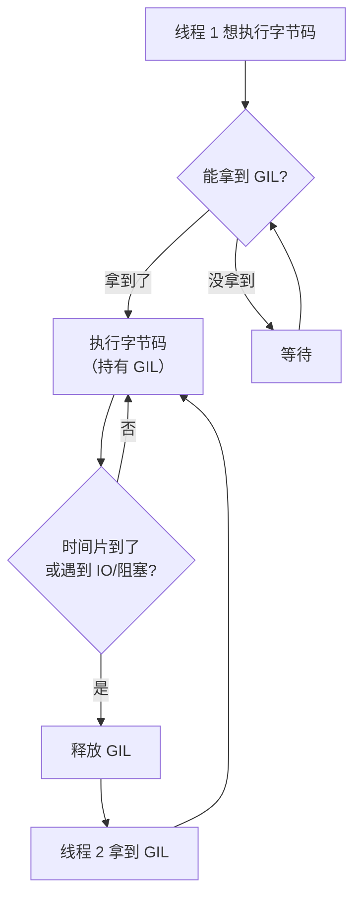

# 01 并发
**本页学什么**：Python 并发是最容易被误解的一块——网上充满了「Python 多线程没用」这类半错的话。这一页用**本机实测数据**告诉你 GIL 到底限制什么、不限制什么，以及四种并发模型该怎么选。

本页所有性能数字都是在这台机器上真跑出来的（12 逻辑 CPU，Python 3.11.9），不同机器数值会变，但**相对关系**是稳定的。

## 1. GIL 是什么


**GIL（Global Interpreter Lock，全局解释器锁）** 是 CPython 解释器里的一把互斥锁，它规定：**同一时刻只有一个线程能执行 Python 字节码**。



### 为什么要有它

这不是设计失误，而是一个**明确的工程权衡**：

1. **CPython 的内存管理不是线程安全的**。它用**引用计数**管理对象生命周期——每个对象记着「有几个引用」，减到 0 就回收。如果两个线程同时改同一个对象的引用计数，计数会错乱，导致**内存泄漏或提前释放（段错误）**
2. 给每个对象都加锁（细粒度锁）会让单线程性能**大幅下降**，而且极易死锁
3. GIL 是一个**粗粒度但极快**的方案：单线程性能几乎无损，写 C 扩展也简单

**代价**：纯 Python 的 CPU 密集任务无法用多线程利用多核。

:::info[GIL 保护的是「解释器」，不是你的数据]
这是最关键的澄清。GIL 保证的是「字节码执行不会把解释器搞崩」，**它完全不保证你的业务逻辑是原子的**。

`a += 1` 看着是一行，实际是「读 → 加 → 写」三步字节码，中间随时可能被切走。本页第 4 节会用实测证明它确实会出错。
:::

### GIL 何时释放

这是实用价值最高的一节：

| 情况 | 释放 GIL 吗 | 意味着 |
| --- | --- | --- |
| 时间片用完（默认 5 ms） | ✅ | 长时间计算会被打断，让别的线程跑 |
| **IO 操作**（文件、网络） | ✅ | **IO 密集多线程有效** |
| `time.sleep()` | ✅ | 睡眠时不占 GIL |
| **C 扩展的长时间计算**（numpy、hashlib） | ✅（扩展主动释放） | **numpy 多线程真的能并行** |
| 纯 Python 计算循环 | ❌（只在时间片边界切换） | **无法多核并行** |

```python
import sys
print("切换间隔（秒）:", sys.getswitchinterval())
sys.setswitchinterval(0.001)        # 可调
print("改后:", sys.getswitchinterval())
```

```text
切换间隔（秒）: 0.005
改后: 0.001
```

`sys.getswitchinterval()` 默认 0.005 秒（5 毫秒）——线程最多连续执行这么久就让出 GIL。**调小它会让线程切换更频繁、响应更快，但整体吞吐下降**（切换本身有成本）。

## 2. 实测：三种负载下的表现

这是本页的核心证据。同一台机器，12 个逻辑 CPU。

### IO 密集：多线程大胜

```python
import threading, time

def io_task():
    time.sleep(0.5)

start = time.perf_counter()
io_task(); io_task()
print(f"串行两次: {time.perf_counter() - start:.3f}s")

start = time.perf_counter()
threads = [threading.Thread(target=io_task) for _ in range(2)]
for t in threads: t.start()
for t in threads: t.join()
print(f"两个线程: {time.perf_counter() - start:.3f}s")
```

```text
串行两次: 1.001s
两个线程: 0.501s
```

**加速比 2.0x（理想值）。** 因为 `time.sleep()` 会释放 GIL，两个线程的等待时间完全重叠。

**结论：IO 密集（爬虫、文件读写、网络请求、数据库查询）用多线程，收益接近线性。**

### CPU 密集：多线程反而更慢

```python
import threading, time

def cpu_task(n=30_000_000):
    s = 0
    for i in range(n):
        s += i
    return s

start = time.perf_counter()
cpu_task(); cpu_task()
print(f"串行两次: {time.perf_counter() - start:.3f}s")

start = time.perf_counter()
threads = [threading.Thread(target=cpu_task) for _ in range(2)]
for t in threads: t.start()
for t in threads: t.join()
print(f"两个线程: {time.perf_counter() - start:.3f}s")
```

```text
串行两次: 1.592s
两个线程: 1.738s
```

**不仅没加速，还慢了 9%。** 慢是因为两个线程轮流拿 GIL，**平白多了上下文切换的开销**，收益却是零。

更重的负载也一样（用 `math.sqrt` 做浮点计算）：

```text
线程版: 1.075s（串行 0.954s，慢 13%）
```

### CPU 密集：多进程真加速

```python
import multiprocessing as mp
import math, time

def heavy(n=8_000_000):
    s = 0.0
    for i in range(1, n):
        s += math.sqrt(i)
    return s

if __name__ == "__main__":
    start = time.perf_counter()
    heavy(); heavy()
    serial = time.perf_counter() - start
    print(f"串行: {serial:.3f}s")

    start = time.perf_counter()
    with mp.Pool(2) as pool:
        pool.map(heavy, [8_000_000, 8_000_000])
    parallel = time.perf_counter() - start
    print(f"两进程: {parallel:.3f}s  加速比 {serial / parallel:.2f}x")
```

```text
串行: 0.954s
两进程: 0.646s  加速比 1.48x
```

**每个进程有独立的 GIL，所以能真正用上多核。**

:::warning[但多进程不是免费的]
注意加速比是 **1.48x 而不是 2x**，差额来自：

1. **进程启动开销**：Windows 上用 `spawn`，要重新导入主模块（本机约 0.1～0.2 秒）
2. **数据序列化**：参数和返回值要在进程间 pickle 传递，大对象很贵
3. **内存**：每个进程都有独立的 Python 解释器，10 个进程就是 10 份内存

**任务太小时，多进程比串行还慢。** 前面 `cpu_task`（3 千万次整数加法）那次实测就是：串行 1.613s，进程池 1.756s——**更慢**，因为任务本身不够重，撑不起启动成本。

判断标准：**单个任务的计算时间要远大于 0.1 秒**，多进程才划算。
:::

### 汇总表

| 负载类型 | 多线程 | 多进程 | asyncio |
| --- | --- | --- | --- |
| IO 密集 | ✅ **最佳**（2.0x） | ⚠️ 能行但笨重 | ✅ **最佳**（几千并发） |
| CPU 密集（纯 Python） | ❌ 反而变慢 | ✅ **唯一选择**（1.48x） | ❌ 无效 |
| CPU 密集（numpy/C 扩展） | ✅ 有效（扩展释放 GIL） | ✅ 有效 | ❌ 无效 |
| 高并发长连接 | ⚠️ 线程太多会耗尽内存 | ❌ | ✅ **最佳** |

## 3. threading：正确的用法

```python
import threading

results = {}

def worker(name, delay):
    import time
    time.sleep(delay)
    results[name] = f"{name} 完成"

threads = [
    threading.Thread(target=worker, args=("A", 0.3)),
    threading.Thread(target=worker, args=("B", 0.2)),
]
for t in threads:
    t.start()
for t in threads:      # join 等所有线程结束
    t.join()

print(results)
```

```text
{'B': 'B 完成', 'A': 'A 完成'}
```

### 用 `ThreadPoolExecutor` 更省事

手写 `Thread` 太底层，标准库封装了线程池：

```python
from concurrent.futures import ThreadPoolExecutor, as_completed

def fetch(url_id):
    return f"result-{url_id}"

with ThreadPoolExecutor(max_workers=4) as executor:
    futures = [executor.submit(fetch, i) for i in range(5)]
    for fut in as_completed(futures):      # 谁先完成先处理谁
        print(fut.result())
```

```text
result-0
result-1
result-2
result-3
result-4
```

或者更简单：

```python
with ThreadPoolExecutor(2) as ex:
    print(list(ex.map(lambda i: i * i, [1, 2, 3])))
```

```text
[1, 4, 9]
```

`map` 保证**按输入顺序**返回，`as_completed` 按**完成顺序**返回。

### 线程安全：queue 是首选

多线程共享数据时，用 `queue.Queue`——它内部已经加了锁：

```python
import queue

q = queue.Queue(maxsize=2)
q.put(1)
q.put(2)
print("大小:", q.qsize(), "| 满了:", q.full())
print("取:", q.get())

print("可用类型:", [n for n in ("Queue", "LifoQueue", "PriorityQueue", "SimpleQueue")
                    if hasattr(queue, n)])
```

```text
大小: 2 | 满了: True
取: 1
可用类型: ['Queue', 'LifoQueue', 'PriorityQueue', 'SimpleQueue']
```

**生产者-消费者模式**用它最省心：`Queue` 是线程安全的，用它传数据就基本不用自己加锁了。

---

**翻页**：[下一页 →](./concurrency-02) · [返回目录](./)
