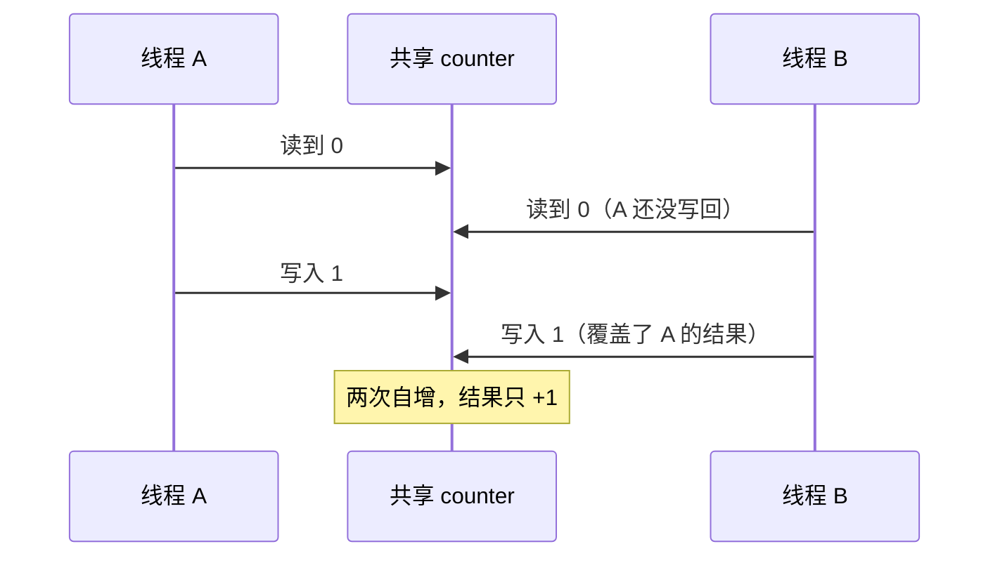

# 02 竞态：GIL 不保护你的逻辑
这一节用实测证明「GIL 保证线程安全」是错的。

### 第一次实测：居然没出错？

```python
import threading

counter = 0

def bump():
    global counter
    for _ in range(200_000):
        counter += 1

threads = [threading.Thread(target=bump) for _ in range(4)]
for t in threads: t.start()
for t in threads: t.join()

print("counter =", counter, "期望 800000")
```

在这台机器（Python 3.11.9）上跑出来的结果：

```text
counter = 800000 期望 800000
```

**居然是对的！** 很多教程会告诉你这里一定出错，但 3.11 上它碰巧没出错。

**为什么？** 看字节码就明白了：

```python
import dis

def bump():
    global counter
    for _ in range(200000):
        counter += 1

dis.dis(bump)
```

```text
  5           2 LOAD_GLOBAL              1 (NULL + range)
             14 LOAD_CONST               1 (200000)
             16 PRECALL                  1
             20 CALL                     1
             30 GET_ITER
        >>   32 FOR_ITER                12 (to 58)
             34 STORE_FAST               0 (_)

  6          36 LOAD_GLOBAL              2 (counter)
             48 LOAD_CONST               2 (1)
             50 BINARY_OP               13 (+=)
             54 STORE_GLOBAL             1 (counter)
             56 JUMP_BACKWARD           13 (to 32)
```

CPython 3.11 只在**特定指令**上检查「要不要切换线程」（eval breaker）。这个循环里，切换点落在 `FOR_ITER` / `JUMP_BACKWARD` 上，**恰好不在 `LOAD_GLOBAL` 和 `STORE_GLOBAL` 之间**，所以一次「读-改-写」没被打断。

:::danger[这是运气，不是保证]
这依赖的是**当前 CPython 版本的实现细节**：

- 换一个 Python 版本 → 行为可能变
- 循环体换一个写法 → 行为可能变
- 系统负载不同、线程数不同 → 行为可能变

**绝不能依赖它。** 下面这个版本就能稳定复现竞态。
:::

### 稳定复现的版本

在「读」和「写」之间插一个**会让出 GIL 的操作**（比如 `time.sleep(0)`）：

```python
import threading, time

counter = {"n": 0}

def bump_slow():
    for _ in range(50_000):
        v = counter["n"]          # 读
        time.sleep(0)             # 让出 GIL，别的线程趁机插进来
        counter["n"] = v + 1      # 写

threads = [threading.Thread(target=bump_slow) for _ in range(4)]
for t in threads: t.start()
for t in threads: t.join()

print(f"结果 {counter['n']}，期望 200000")
```

三次运行的实测结果：

```text
结果 50103，期望 200000
结果 50165，期望 200000
结果 50000，期望 200000
```

**丢掉了约 75% 的增量。** 典型的「check-then-act」竞态：多个线程读到同一个旧值，各自加一后写回，后写的覆盖先写的。



### 用锁修好它

```python
import threading, time

lock = threading.Lock()
counter = 0

def bump_locked():
    global counter
    for _ in range(50_000):
        with lock:              # 同一时刻只有一个线程能进
            counter += 1

threads = [threading.Thread(target=bump_locked) for _ in range(4)]
for t in threads: t.start()
for t in threads: t.join()

print("counter =", counter, "期望 200000")
```

```text
counter = 200000 期望 200000
```

:::caution[锁的四条纪律]
1. **用 `with lock:` 而不是 `lock.acquire()` / `lock.release()`**——前者保证异常时也会释放
2. **锁要保护完整的临界区**，不能只锁「写」不锁「读」
3. **减小锁的粒度**：只锁真正需要互斥的部分，锁住整个函数等于退回串行
4. **避免死锁**：多个锁要按**固定顺序**获取；或用 `RLock`（可重入锁）处理同一线程重入

`threading` 提供的原语：

```python
import threading
print([n for n in ("Lock", "RLock", "Event", "Condition", "Semaphore", "Barrier", "Timer")
       if hasattr(threading, n)])
```

```text
['Lock', 'RLock', 'Event', 'Condition', 'Semaphore', 'Barrier', 'Timer']
```

- `Lock`：基本互斥锁
- `RLock`：同一线程可多次获取（递归函数里用）
- `Event`：一个线程等另一个线程发信号
- `Condition`：复杂的等待/通知
- `Semaphore`：限制并发数量（连接池限流）
- `Barrier`：多线程在某点汇合
:::

:::info[哪些操作实际上是原子的]
CPython 里这些**单字节码**操作不会被切走，可以不加锁：

- `list.append(x)`、`list.pop()`
- `dict[k] = v`、`dict.get(k)`
- `x = d[k]`（简单赋值）
- `collections.deque.append()` / `popleft()`

但**复合操作一律不安全**：`counter += 1`、`if k in d: d[k] = v`、`d[k] = d.get(k, 0) + 1`。

**规则很简单**：只有一个字节码指令的操作才安全。你不确定就看 `dis.dis()`。
:::

## 5. multiprocessing：绕开 GIL

```python
import multiprocessing as mp
import os

def worker(n):
    return n * n, os.getpid()

if __name__ == "__main__":                 # Windows 上必须有这行！
    with mp.Pool(2) as pool:
        results = pool.map(worker, [1, 2, 3, 4])
    print(results)
    print("主进程 PID:", os.getpid())
    print("启动方式:", mp.get_start_method())
```

```text
[(1, 12345), (4, 12346), (9, 12345), (16, 12346)]
主进程 PID: 12344
启动方式: spawn
```

注意返回的结果里带**不同的 PID**——确实在不同进程里跑的。

### 三种启动方式

| 方式 | 平台 | 行为 |
| --- | --- | --- |
| `spawn` | **Windows / macOS 默认** | 全新 Python 解释器，重新导入主模块 |
| `fork` | Linux 默认（3.14 起改为 forkserver） | 复制父进程内存，快，但会继承锁状态 |
| `forkserver` | 可选 | 预先 fork 一个干净进程，再从中 spawn |

:::danger[Windows 上必须写 `if __name__ == "__main__":`]
`spawn` 会**重新导入你的主模块**来执行子进程。如果顶层就有创建进程的代码，子进程会再创建子进程，无限递归。

典型报错（在 Windows 上跑没加保护的代码）：

```text
RuntimeError:
        An attempt has been made to start a new process before the
        current process has finished its bootstrapping phase.
```

我在本机实测时（忘了加保护）还看到过一大片 `spawn_main` 的重复 traceback——那就是无限递归的表现。

**把创建进程的代码放进 `if __name__ == "__main__":` 里，这是硬性要求。**
:::

### 进程间通信

进程**不共享内存**，要传数据必须序列化：

```python
from multiprocessing import Queue, Value, Array
import multiprocessing as mp

def producer(q):
    for i in range(3):
        q.put(i)

def consumer(q):
    out = []
    while True:
        item = q.get()
        if item is None:       # 哨兵表示结束
            break
        out.append(item)
    return out

if __name__ == "__main__":
    q = Queue()
    p = mp.Process(target=producer, args=(q,))
    p.start(); p.join()
    print("收到:", [q.get() for _ in range(3)])
```

可用的通信方式：

| 方式 | 适用 | 说明 |
| --- | --- | --- |
| `Queue` | 任意 Python 对象 | 基于 pickle，最常用 |
| `Pipe` | 两个进程点对点 | 比 Queue 快 |
| `Value` / `Array` | 简单数值/数组 | **共享内存**，无序列化开销 |
| `Manager` | 需要共享复杂状态 | 慢，但支持 dict/list |

:::warning[传给进程的东西必须可 pickle]
函数、lambda、局部类、打开的文件句柄、网络连接**都不能 pickle**。这是多进程最常见的报错来源：

```text
PicklingError: Can't pickle <function <lambda> at 0x...>
```

解决办法：用模块级的普通函数，不要用 lambda；用 `pathos`/`dill` 库可以放宽限制，但优先改代码结构。
:::

---

**翻页**：[← 上一页](./concurrency-01) · [下一页 →](./concurrency-03) · [返回目录](./)
