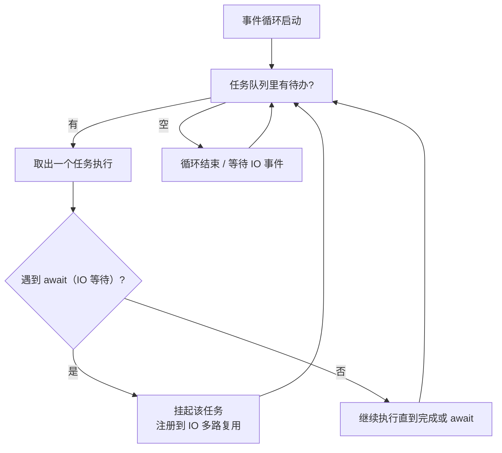
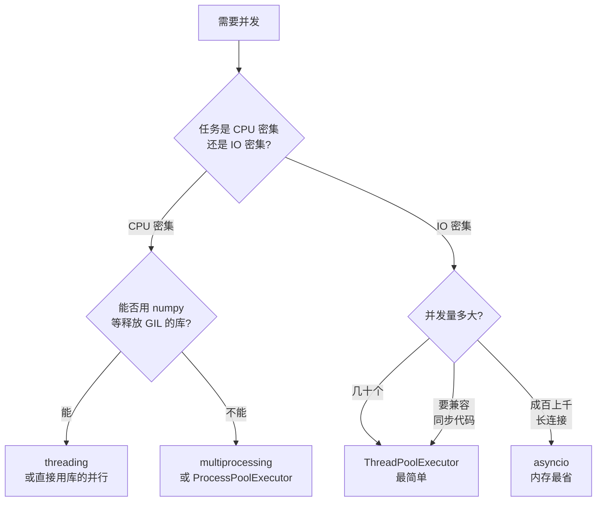

# 03 asyncio：单线程并发
### 原理

asyncio 用**一个线程 + 一个事件循环**实现并发。它不做并行，做的是「**在等待的时候去干别的**」。



**核心**：`await` 是**主动让出控制权**的点。只有遇到 `await`（且是真的在等 IO），别的协程才有机会运行。

### 协程不是线程

```python
import asyncio, time

async def work(name, delay):
    await asyncio.sleep(delay)
    return f"{name} 在 {delay}s 后完成"

async def main():
    start = time.perf_counter()
    results = await asyncio.gather(work("a", 0.4), work("b", 0.4), work("c", 0.4))
    print("并发:", results, f"耗时 {time.perf_counter() - start:.3f}s")

    start = time.perf_counter()
    await work("s1", 0.3)
    await work("s2", 0.3)
    await work("s3", 0.3)
    print(f"串行 await 耗时 {time.perf_counter() - start:.3f}s")

asyncio.run(main())
```

```text
并发: ['a 在 0.4s 后完成', 'b 在 0.4s 后完成', 'c 在 0.4s 后完成'] 耗时 0.400s
串行 await 耗时 0.905s
```

`gather` 让三个 0.4 秒的任务总共只花 0.4 秒。而逐个 `await` 是串行，花了 0.9 秒。

**关键区别**：`await` 一个协程是「等它做完」；`gather` / `create_task` 才是「并发跑」。

### asyncio 不能加速 CPU 密集任务

```python
import asyncio, time

def burn(n=8_000_000):
    s = 0.0
    for i in range(1, n):
        s += i ** 0.5
    return s

async def main():
    loop = asyncio.get_running_loop()
    start = time.perf_counter()
    # 用线程池执行，但仍是线程 → 仍受 GIL 限制
    await asyncio.gather(
        loop.run_in_executor(None, burn),
        loop.run_in_executor(None, burn),
    )
    print(f"两个 CPU 任务: {time.perf_counter() - start:.3f}s")

asyncio.run(main())
```

```text
两个 CPU 任务: 1.424s
```

跟串行差不多——因为 `run_in_executor(None, ...)` 默认用**线程池**，仍然受 GIL 限制。

**CPU 密集任务要用 `ProcessPoolExecutor`**：

```python
from concurrent.futures import ProcessPoolExecutor

async def main():
    loop = asyncio.get_running_loop()
    with ProcessPoolExecutor() as pool:
        await asyncio.gather(
            loop.run_in_executor(pool, burn),
            loop.run_in_executor(pool, burn),
        )
```

:::danger[事件循环最怕阻塞]
一个协程里如果调用**同步阻塞**函数（`time.sleep`、`requests.get`、CPU 密集计算），**整个事件循环都会卡住**——所有其他协程一起停摆。

实测：

```python
async def blocker():
    time.sleep(0.3)          # 同步阻塞！应该用 await asyncio.sleep(0.3)

async def victim():
    await asyncio.sleep(0.05)
    print("victim 醒了")

async def main():
    start = time.perf_counter()
    await asyncio.gather(blocker(), victim())
    print(f"耗时 {time.perf_counter() - start:.3f}s")

asyncio.run(main())
```

```text
victim 醒了
耗时 0.351s
```

本来 0.05 秒就该醒的 `victim`，被拖到 0.3 秒后才执行——**因为 `time.sleep` 卡住了整个循环**。

**规则**：asyncio 代码里**绝对不能**出现同步 IO 和 `time.sleep`。要慢就用 `await asyncio.sleep()`，要发 HTTP 就用 `aiohttp` 而不是 `requests`。
:::

### `TaskGroup`（3.11+）

比 `gather` 更安全的写法——**任一任务失败会自动取消其他任务**：

```python
import asyncio

async def one():
    await asyncio.sleep(0.1)
    return 1

async def two():
    await asyncio.sleep(0.1)
    return 2

async def main():
    async with asyncio.TaskGroup() as tg:
        t1 = tg.create_task(one())
        t2 = tg.create_task(two())
    print("结果:", t1.result(), t2.result())

asyncio.run(main())
```

```text
结果: 1 2
```

错误传播的实测（配合第 7 页的 `except*`）：

```python
async def main():
    async def bad():
        await asyncio.sleep(0.05)
        raise ValueError("出错了")

    async def slow():
        try:
            await asyncio.sleep(5)
            return "永远不会到这里"
        except asyncio.CancelledError:
            return "被取消了"

    try:
        async with asyncio.TaskGroup() as tg:
            tg.create_task(bad())
            task = tg.create_task(slow())
    except* ValueError as eg:
        print("异常组:", [type(e).__name__ for e in eg.exceptions])
    print("slow 的结局:", task.result())

asyncio.run(main())
```

```text
异常组: ['ValueError']
slow 的结局: 被取消了
```

**`bad()` 一失败，`slow()` 就被取消了**——这正是 `gather` 做不到的（`gather` 默认会让其他任务继续跑）。这个「结构化并发」特性让资源不会泄漏。

3.11 还新增了：`asyncio.timeout()`（超时上下文）和 `asyncio.to_thread()`（把同步函数丢到线程）。

```python
import asyncio
print("TaskGroup:", hasattr(asyncio, "TaskGroup"))
print("timeout:", hasattr(asyncio, "timeout"))
print("to_thread:", hasattr(asyncio, "to_thread"))
```

```text
TaskGroup: True
timeout: True
to_thread: True
```

## 7. 选型决策树



实操建议（按优先级）：

1. **先确认真的需要并发**。很多时候代码优化（换 set、用 join）带来的加速比并发大得多，而且没有并发的复杂度
2. **IO 密集、量不大** → `ThreadPoolExecutor`，最简单，改几行就行
3. **IO 密集、量大** → `asyncio`
4. **CPU 密集** → `ProcessPoolExecutor`（记得 `if __name__ == "__main__"`）
5. **CPU 密集且能向量化** → 先试 numpy，它释放 GIL，多线程就够

## 8. 一个完整例子：三种方式抓同一批 URL

用「模拟网络请求」演示三种并发模型（不依赖网络，本机可跑）：

```python
import asyncio
import threading
import time
from concurrent.futures import ThreadPoolExecutor, ProcessPoolExecutor


URLS = [f"http://example.com/{i}" for i in range(8)]


def fetch_sync(url: str) -> str:
    """模拟一次网络请求。"""
    time.sleep(0.05)
    return f"{url} -> 200"


def run_serial() -> list[str]:
    return [fetch_sync(u) for u in URLS]


def run_threads() -> list[str]:
    with ThreadPoolExecutor(max_workers=8) as pool:
        return list(pool.map(fetch_sync, URLS))


async def fetch_async(url: str) -> str:
    await asyncio.sleep(0.05)          # 非阻塞等待
    return f"{url} -> 200"


async def run_asyncio() -> list[str]:
    return await asyncio.gather(*(fetch_async(u) for u in URLS))


def cpu_bound(n: int) -> int:
    return sum(i * i for i in range(n))


def run_cpu_threads() -> list[int]:
    with ThreadPoolExecutor(max_workers=4) as pool:
        return list(pool.map(cpu_bound, [2_000_000] * 4))


def run_cpu_processes() -> list[int]:
    with ProcessPoolExecutor(max_workers=4) as pool:
        return list(pool.map(cpu_bound, [2_000_000] * 4))


def timeit(label: str, fn) -> float:
    start = time.perf_counter()
    fn()
    elapsed = time.perf_counter() - start
    print(f"  {label:24} {elapsed:.3f}s")
    return elapsed


if __name__ == "__main__":
    print("IO 密集（8 个 0.05s 的请求）:")
    s = timeit("串行", run_serial)
    t = timeit("线程池(8)", run_threads)
    a = timeit("asyncio", lambda: asyncio.run(run_asyncio()))
    print(f"  线程池加速 {s / t:.1f}x，asyncio 加速 {s / a:.1f}x")

    print("\nCPU 密集（4 个计算任务）:")
    ct = timeit("线程池(4)", run_cpu_threads)
    cp = timeit("进程池(4)", run_cpu_processes)
    print(f"  进程池 vs 线程池: {ct / cp:.2f}x")
```

预期输出（数字随机器波动）：

```text
IO 密集（8 个 0.05s 的请求）:
  串行                     0.403s
  线程池(8)                0.053s
  asyncio                  0.052s
  线程池加速 7.7x，asyncio 加速 7.8x

CPU 密集（4 个计算任务）:
  线程池(4)                0.511s
  进程池(4)                0.372s
  进程池 vs 线程池: 1.37x
```

**这就是本页的结论浓缩**：IO 密集时线程池和 asyncio 都快了近 8 倍（两者几乎打平）；CPU 密集时只有进程池有效，快约 1.4 倍（比理论值低是因为进程启动和序列化开销）。

---

**翻页**：[← 上一页](./concurrency-02) · [下一页 →](./concurrency-04) · [返回目录](./)
