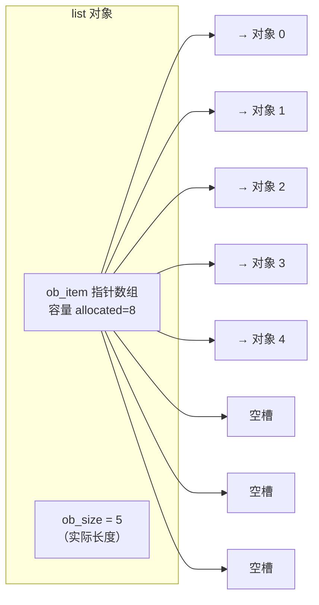
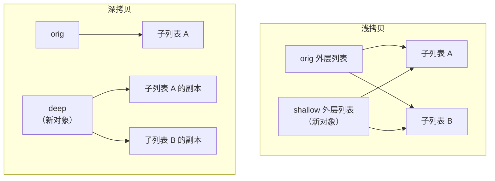

# 01 内建数据类型
**本页学什么**：不只学会用这五种容器，而是搞清**它们各自的实现方式**——由此你才能回答「这个场景该用哪个」「为什么这样写快、那样写慢」。

这一页是本线最重要的原理页之一。**选错容器带来的性能差距，可以轻松到 10 万倍**（本页有实测数据）。

## 1. list：CPython 的动态数组


### 结构


Python 的 `list` 不是链表，而是**动态数组**——一块连续的内存，里面存的不是对象本身，而是**指向对象的指针**。



理解「存的是指针」这一点，能解释三件事：

1. 列表可以装**不同类型**的东西（指针大小固定，指向什么无所谓）
2. `[1, "a", [2]]` 合法
3. 列表本身占用的是**连续内存**，所以按下标访问是 O(1)——和 C 数组一样快

### 为什么必须扩容


数组容量固定，而 `append` 要不断加元素。最简单的做法是每次 append 都重新分配一块更大的内存、把旧数据拷过去——但那样每次都是 O(n)，n 次 append 就是 O(n²)，非常慢。

CPython 用的是**过分配（over-allocation）**：每次扩容分配**比需要更多**的空间，把后续多次 append 的成本摊平。这就是常说的**均摊 O(1)**。

实测扩容过程（监听 `sys.getsizeof` 的变化）：

```python
import sys

lst = []
prev = sys.getsizeof(lst)
print(f"len=0  sizeof={prev}")
for i in range(1, 40):
    lst.append(i)
    size = sys.getsizeof(lst)
    if size != prev:
        print(f"len={len(lst):2}  sizeof: {prev} -> {size}")
        prev = size
```

```text
len=0  sizeof=56
len=1  sizeof: 56 -> 88
len=5  sizeof: 88 -> 120
len=9  sizeof: 120 -> 184
len=17 sizeof: 184 -> 248
len=25 sizeof: 248 -> 312
len=33 sizeof: 312 -> 376
```

观察容量变化（每个指针 8 字节，减去 56 字节的对象头）：

| 触发扩容时的长度 | 新容量（元素数） | 增长规律 |
| --- | --- | --- |
| 0 → 1 | 4 | 首次分配 4 |
| 4 → 5 | 8 | 8 |
| 8 → 9 | 16 | 16 |
| 16 → 17 | 24 | +8 |
| 24 → 25 | 32 | +8 |
| 32 → 33 | 40 | +8 |

CPython 的实际策略是 `new_allocated = (size + (size >> 3) + 6) & ~3`，也就是**大约 1/8 的额外余量**（再向下对齐到 4 的倍数），前期近似翻倍、后期按 1/8 增长。它比「每次翻倍」更省内存（翻倍可能造成近 50% 的浪费）。

:::info[均摊 O(1) 是什么意思]
单次 `append` 偶尔是 O(n)（要拷贝），但把 n 次 append 加起来是 O(n)，所以**平均每次是 O(1)**。这就是「均摊分析」。

对比一下：如果每次都精确分配（不留余量），n 次 append 是 O(n²)。过分配把这个降到了 O(n)。
:::

### 缩容：pop 会释放内存吗

```python
import sys

big = list(range(1000))
print("1000 个元素:", sys.getsizeof(big))

while big:
    big.pop()
print("全部 pop 后:", sys.getsizeof(big))
```

```text
1000 个元素: 8056
全部 pop 后: 56
```

**会释放。** 但注意：缩容的触发条件是长度降到**容量的一半以下**，而且不会缩到比原长度更小。所以 `pop` 大量元素确实能回收内存——这点和其他一些语言的实现不同。

:::warning[`clear()` 和 `del lst[:]` 才真正清空]
如果你只是想清空并立刻回收内存，用 `lst.clear()`。而 `lst = []` 是**绑定一个新列表**，旧列表要等没有引用后才被回收——如果还有别的标签指着它，内存不会释放。
:::

### 时间复杂度速查

| 操作 | 复杂度 | 说明 |
| --- | --- | --- |
| `lst[i]` 按下标访问 | O(1) | 连续内存直接偏移 |
| `lst.append(x)` | 均摊 O(1) | 可能触发扩容拷贝 |
| `lst.pop()` 尾部 | O(1) | |
| `lst.pop(0)` / `insert(0, x)` | **O(n)** | 要整体搬移元素 |
| `x in lst` | **O(n)** | 线性扫描 |
| `lst[i] = x` | O(1) | |
| `del lst[i]` | O(n) | 搬移 |
| `len(lst)` | O(1) | 直接读 `ob_size` |

**`pop(0)` 是 O(n)** 这一点值得单独记住：它要把它后面所有元素往前挪一位。需要频繁从头部取元素时，用 `collections.deque`（第 9 页讲）。

实测差距：

```python
import timeit

t_list = timeit.timeit("l.pop(0)", setup="l=list(range(10000))", number=2000)
t_deque = timeit.timeit("d.popleft()",
                        setup="from collections import deque; d=deque(range(10000))",
                        number=2000)
print(f"list.pop(0)   = {t_list:.4f}s")
print(f"deque.popleft = {t_deque:.4f}s")
print(f"慢了 {t_list / t_deque:.0f} 倍")
```

```text
list.pop(0)   = 0.0020s
deque.popleft = 0.0000s
慢了 51 倍
```

## 2. 切片：协议与细节

切片语法 `[start:stop:step]`，**左闭右开**（含 start，不含 stop）。

```python
s = [0, 1, 2, 3, 4, 5]
print("s[1:4]  ", s[1:4])      # [1, 2, 3]
print("s[:3]   ", s[:3])       # [0, 1, 2]
print("s[3:]   ", s[3:])       # [3, 4, 5]
print("s[::2]  ", s[::2])      # [0, 2, 4]
print("s[::-1] ", s[::-1])     # [5, 4, 3, 2, 1, 0]
print("s[-2:]  ", s[-2:])      # [4, 5]
print("s[:-2]  ", s[:-2])      # [0, 1, 2, 3]
print("s[10:20]", s[10:20])    # []  越界不报错
```

```text
s[1:4]   [1, 2, 3]
s[:3]    [0, 1, 2]
s[3:]    [3, 4, 5]
s[::2]   [0, 2, 4]
s[::-1]  [5, 4, 3, 2, 1, 0]
s[-2:]   [4, 5]
s[:-2]   [0, 1, 2, 3]
s[10:20] []
```

**越界不报错**，静默截断到边界——这是切片和索引的关键区别（`s[10]` 会抛 `IndexError`）。

### `slice` 对象

方括号里的 `1:4:2` 实际上会构造一个 `slice` 对象：

```python
sl = slice(1, 4, 2)
print(sl, "| indices(6):", sl.indices(6))
print([0,1,2,3,4,5][sl])
```

```text
slice(1, 4, 2) | indices(6): (1, 4, 2)
[1, 3]
```

这让你能把切片**存起来复用**或传给函数，也可以让自定义类支持切片（第 7 页的 `__getitem__`）。

### 切片赋值

```python
a = list(range(5))
a[1:3] = ["x", "y", "z"]      # 长度可以改变
print(a)
```

```text
[0, 'x', 'y', 'z', 3, 4]
```

**但带步长的切片赋值，长度必须严格相等**：

```python
a = list(range(5))
a[::2] = [0, 0, 0]
print(a)

a = list(range(5))
a[::2] = [0, 0]               # 数量对不上
```

```text
[0, 1, 0, 3, 0]
ValueError: attempt to assign sequence of size 2 to extended slice of size 3
```

### 切片是浅拷贝

`lst[:]` 生成一个新列表，但里面的元素还是同一批对象：

```python
s = [0, 1, 2]
print("s[:] is s :", s[:] is s)     # False，是新列表
```

```text
s[:] is s : False
```

## 3. 深浅拷贝：嵌套结构的头号坑


**浅拷贝**：只复制最外层容器，里面的元素还是共享的。

```python
import copy

orig = [[1, 2], [3, 4]]
shallow = copy.copy(orig)        # 或 orig[:] 或 list(orig)
deep = copy.deepcopy(orig)

shallow[0].append(99)            # 改浅拷贝里的子列表

print("orig    :", orig)         # 原始对象也被改了！
print("deep    :", deep)         # 深拷贝不受影响
```

```text
orig    : [[1, 2, 99], [3, 4]]
deep    : [[1, 2], [3, 4]]
```



| 方式 | 效果 | 适用 |
| --- | --- | --- |
| `b = a` | 不复制，只加标签 | 几乎所有情况都不是你要的 |
| `a.copy()` / `list(a)` / `a[:]` | 浅拷贝 | 一维且元素不可变时够用 |
| `copy.copy(a)` | 浅拷贝（通用） | 同上 |
| `copy.deepcopy(a)` | 深拷贝，递归复制 | 嵌套可变结构 |

:::danger[二维列表的经典陷阱]
```python
m = [[0]] * 3        # 三行其实是同一个列表对象！
m[0].append(1)
print(m)
```

```text
[[0, 1], [0, 1], [0, 1]]
```

你只想改第一行，结果三行全变了。因为 `*` 复制的是**引用**，不是内容。

正确写法用推导式，每次循环都新建一个列表：

```python
m = [[0] for _ in range(3)]
m[0].append(1)
print(m)
```

```text
[[0, 1], [0], [0]]
```

这个坑在写棋盘、矩阵、动态规划表时必踩一次。
:::

---

**翻页**：[下一页 →](./datatypes-02) · [返回目录](./)
