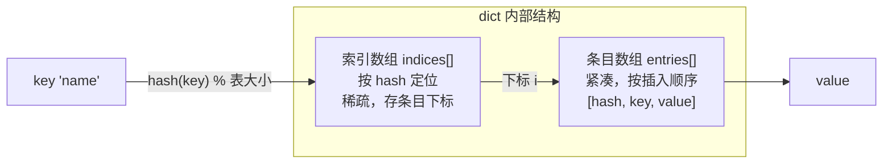
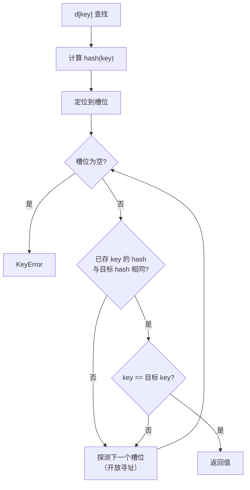

# 02 dict：哈希表
### 结构

`dict` 是**哈希表**。3.6 起 CPython 重写了实现，改为「**紧凑型哈希表**」：一个稀疏的索引数组 + 一个紧凑的条目数组。



这个设计带来两个好处：

1. **内存更省**（紧凑数组只存实际条目）
2. **天然保持插入顺序**——所以 3.7+ 的 dict 保证按插入顺序遍历（3.6 是 CPython 实现细节，3.7 才成为语言规范）

### 哈希与相等：两个必须同时满足的条件

dict 的查找靠两步：**先比哈希，再比相等**。



由此推出 dict 键的两条铁律：

1. **键必须可哈希**（实现 `__hash__`）
2. **相等的对象必须有相等的哈希值**

```python
try:
    hash([1, 2])
except TypeError as e:
    print("hash(list) ->", e)

try:
    hash({"a": 1})
except TypeError as e:
    print("hash(dict) ->", e)
```

```text
hash(list) -> unhashable type: 'list'
hash(dict) -> unhashable type: 'dict'
```

`list` 和 `dict` 不可哈希，因为它们**可变**——如果内容变了哈希也变，dict 就再也找不到它了。要用可变类型当键，转成 `tuple` 或 `frozenset`：

```python
print(hash((1, 2)) is not None)          # tuple 可哈希
print(hash(frozenset([1, 2])) is not None)  # frozenset 可哈希

try:
    hash((1, [2]))                       # 里面装了 list 就不行
except TypeError as e:
    print("hash((1, [2])) ->", e)
```

```text
True
True
hash((1, [2])) -> unhashable type: 'list'
```

### 一个反直觉的现象：`1`、`1.0`、`True` 是同一个键

```python
print("1 == 1.0 :", 1 == 1.0)
print("hash 相同:", hash(1) == hash(1.0))
print({1: "int", 1.0: "float"})
print({True: "t", 1: "one"})
```

```text
1 == 1.0 : True
hash 相同: True
{1: 'float'}
{True: 'one'}
```

后写的值覆盖前面的——因为 `1`、`1.0`、`True` 三者**相等且哈希相同**，dict 认为它们是同一个键。**如果你的字典键混用了 bool 和 int，这个坑会非常隐蔽。**

### 扩容

dict 在**填充率超过约 2/3** 时扩容（翻倍），把所有条目重新哈希一遍。所以 dict 也会「偶尔慢一下」，同样是均摊 O(1)。

```python
import sys

d = {}
prev = sys.getsizeof(d)
print(f"size=0 -> {prev}")
for i in range(1, 30):
    d[i] = i
    size = sys.getsizeof(d)
    if size != prev:
        print(f"插入第 {i:2} 个 -> {prev} -> {size}")
        prev = size
```

```text
size=0 -> 64
insert  1 -> 64 -> 224
insert  6 -> 224 -> 352
insert 11 -> 352 -> 632
insert 22 -> 632 -> 1168
```

### 常用方法与惯用法

```python
d = {"b": 2, "a": 1}

print("遍历保持插入顺序:", list(d))
print("get 缺失:", d.get("zzz"), "| 带默认值:", d.get("zzz", "N/A"))
print("setdefault:", d.setdefault("c", 3), "->", d)
print("pop:", d.pop("a"), "| pop 带默认:", d.pop("nope", "DEF"))
print("popitem（删最后一对）:", d.popitem(), "->", d)
print("fromkeys:", dict.fromkeys(["a", "b"], 0))
print("keys 支持集合运算:", {"a": 1, "b": 2}.keys() & {"b": 9}.keys())
```

```text
遍历保持插入顺序: ['b', 'a']
get 缺失: None | 带默认值: N/A
setdefault: 3 -> {'b': 2, 'a': 1, 'c': 3}
pop: 1 | pop 带默认: DEF
popitem（删最后一对）: ('c', 3) -> {'b': 2}
fromkeys: {'a': 0, 'b': 0}
keys 支持集合运算: {'b'}
```

**分组惯用法**——用 `setdefault` 一行搞定：

```python
rows = [("a", 1), ("b", 2), ("a", 3)]
groups: dict[str, list[int]] = {}
for k, v in rows:
    groups.setdefault(k, []).append(v)
print(groups)
```

```text
{'a': [1, 3], 'b': [2]}
```

第 9 页会介绍更地道的 `collections.defaultdict`，但 `setdefault` 不引入新类型，在这里更轻量。

:::caution[`.keys()` 返回的是视图，不是列表]
`d.keys()` 返回的是**动态视图**——原 dict 改了，视图跟着变。需要快照就 `list(d.keys())`：

```python
d = {"a": 1}
view = d.keys()
d["b"] = 2
print(list(view))        # ['a', 'b']，视图跟着变了
```

另外，**遍历 dict 时不能增删键**，否则 `RuntimeError: dictionary changed size during iteration`。要删就先收集：`for k in list(d): ...`。
:::

## 5. set：只有键的哈希表

`set` 的内部实现和 dict 几乎一样——**它就是没有 value 的 dict**。所以同样要求元素可哈希，同样是无序的（遍历顺序取决于哈希，不要依赖）。

```python
a = {1, 2, 3}
b = {2, 3, 4}

print("交集 a & b:", a & b)
print("并集 a | b:", a | b)
print("差集 a - b:", a - b)
print("对称差 a ^ b:", a ^ b)
print("子集 a <= {1,2,3}:", a <= {1, 2, 3})
print("真子集:", {1, 2} < {1, 2, 3})
```

```text
交集 a & b: {2, 3}
并集 a | b: {1, 2, 3, 4}
差集 a - b: {1}
对称差 a ^ b: {1, 4}
子集 a <= {1,2,3}: True
真子集: True
```

`discard` 和 `remove` 的区别：

```python
s = {1, 2, 3}
s.discard(99)          # 不存在也不报错
print("discard 不报错，s =", s)

try:
    s.remove(99)       # 不存在则 KeyError
except KeyError as e:
    print("remove ->", type(e).__name__)
```

```text
discard 不报错，s = {1, 2, 3}
remove -> KeyError
```

### 为什么 `in` 用 set 快 10 万倍

```python
import timeit

t_list = timeit.timeit("999999 in l", setup="l=list(range(1000000))", number=200)
t_set = timeit.timeit("999999 in s", setup="s=set(range(1000000))", number=200)

print(f"list: {t_list:.5f}s")
print(f"set : {t_set:.5f}s")
print(f"快 {t_list / t_set:.0f} 倍")
```

```text
list: 0.81829s
set : 0.00001s
快 103581 倍
```

**这就是本页最实用的一条结论**：需要反复做成员判断（`in`）时，先把 list 转成 set。这是一个字符的改动，换来几个数量级的性能。

:::tip[去重也用它]
```python
items = [1, 2, 2, 3, 3, 3]
print("去重:", list(set(items)))              # 顺序会丢
print("保序去重:", list(dict.fromkeys(items))) # 3.7+ 保持原顺序
```

```text
去重: [1, 2, 3]
保序去重: [1, 2, 3]
```

`set` 去重会打乱顺序；要保序就用 `dict.fromkeys`。
:::

---

**翻页**：[← 上一页](./datatypes-01) · [下一页 →](./datatypes-03) · [返回目录](./)
