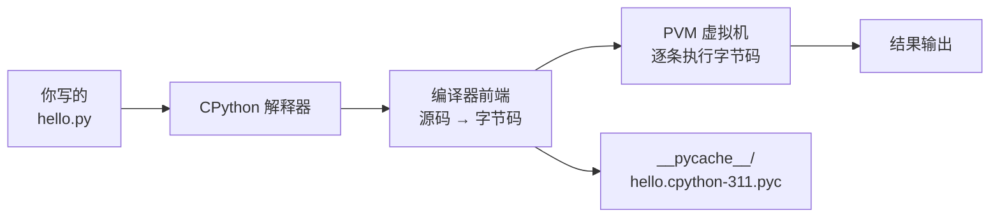
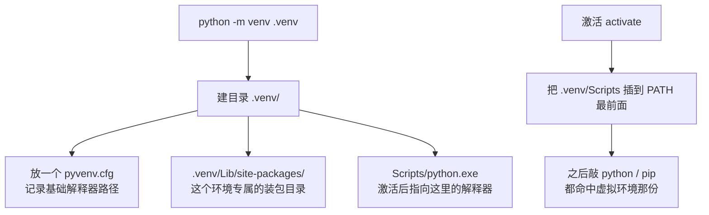

# 环境与工具链

**本页学什么**：把 Python 装对、把虚拟环境搞明白、把工具链选对——这三件事没做对，后面每一页的代码都会以各种莫名其妙的方式失败。

环境问题是新手放弃编程的第一大原因，而且它特别打击人：**你什么都没做错，代码就是跑不起来**。所以这一页会把「为什么会这样」讲清楚，而不是给你一串不知道在干嘛的命令。

## 1. Python 到底是什么：三个词别混

初学者最常被这三个词绕晕：

| 名词 | 是什么 | 类比 |
| --- | --- | --- |
| **Python 语言** | 一套语法规范（写代码的规则） | 菜谱的文字规范 |
| **CPython** | 用 C 写出来的、官方的那个解释器程序 | 按规范造出来的那台厨具 |
| **`python.exe`** | 你双击运行的那个可执行文件 | 厨具的启动按钮 |

你说「我装了 Python」，实际上是装了 **CPython 这个程序**。它读你的 `.py` 文件，一句一句执行。



关键的一步是 **源码先被编译成字节码（bytecode）**，再由 Python 虚拟机（PVM）执行。这就是为什么 Python 会有 `__pycache__` 目录——它缓存的是编译结果，下次启动省掉编译这一步。

验证一下，字节码是真实存在的：

```python
import dis

def add(a, b):
    return a + b

dis.dis(add)
```

```text
  3           0 RESUME                   0

  4           2 LOAD_FAST                0 (a)
              4 LOAD_FAST                1 (b)
              6 BINARY_OP                0 (+)
             10 RETURN_VALUE
```

`LOAD_FAST` / `BINARY_OP` / `RETURN_VALUE` 就是字节码指令。`dis` 模块是后面几页讲原理时最重要的工具，现在先记住它能把 Python 代码翻译成「机器真正执行的步骤」。

其他实现也顺带知道一下名字就够了：**PyPy**（带 JIT，长跑任务快）、**MicroPython**（跑在单片机上，和本站 [ESP32 板块](../../hardware/esp/) 有关）、**Jython / IronPython**（跑在 JVM / .NET 上）。本站全部内容默认 CPython。

## 2. 版本怎么选：这一段直接照做

:::danger[先确认你的版本号]
打开终端，运行：

```bash
python --version
```

本站实测环境：

```text
Python 3.11.9 (tags/v3.11.9:de54cf5, Apr  2 2024, 10:12:12) [MSC v.1938 64 bit (AMD64)]
```

**规则很简单：用 3.11 或 3.12。** 不要装 3.8/3.9（太老，很多语法没有），也不要追刚发布的版本（第三方库还没跟上）。
:::

版本号的读法：`3.11.9` = 主版本 3 · 次版本 11 · 补丁 9。**次版本决定语法特性，补丁只修 bug**。本线凡涉及版本差异的地方都会标注，例如 `match` 语句需要 3.10+，`asyncio.TaskGroup` 需要 3.11+。

Python 3 的每个次版本都有一年的完整支持 + 四年的安全修复，节奏可查官方文档的 [Python 开发周期](https://devguide.python.org/versions/)。**不要用已经 EOL 的版本**——它不再收到安全补丁。

### Windows 上装 Python：三个必做的勾

从 [python.org 下载页](https://www.python.org/downloads/) 下载安装包，安装时：

1. **勾选 `Add python.exe to PATH`** ——不勾的话，你在终端里敲 `python` 会提示「不是内部或外部命令」。这是新手第一大坑
2. 用默认路径安装，**路径里不要有中文和空格**
3. 装完开一个**新的**终端窗口（已开的窗口不会重新读 PATH），运行 `python --version` 验证

如果忘了勾 PATH 也不要紧，重新运行安装包选 `Modify` 补上即可，不需要卸载。

:::tip[Windows 上还有一个救星：`py` 启动器]
Windows 版 Python 会顺带装一个 `py.exe`，它永远在 PATH 里，即使你没勾选。多版本共存时用它指定版本：

```bash
py --list          # 列出已安装的所有版本
py -3.11 script.py # 明确用 3.11 跑
py -3.12 -m pip install requests
```

本站实测输出：

```text
 -V:3.11 *        Python 3.11 (64-bit)
```

星号表示默认版本。**在 Windows 上，我建议所有教程命令都用 `py` 而不是 `python`**——它永远不会指向一个你没想到的版本。
:::

## 3. 虚拟环境：为什么必须有

### 先看没有它会怎样

假设你在做一个爬虫项目，装了 `requests==2.25`；同时做一个 Web 项目，某个库要求 `requests>=2.31`。**全局只有一个 `site-packages` 目录，两个版本不能共存**，你装了新的就覆盖旧的，旧项目当场崩掉。

这就是所谓的「依赖地狱」。虚拟环境的解决思路极其朴素：**给每个项目一个独立的装包目录**。

### 原理：venv 到底做了什么

`venv` 没有复制整个 Python，它只做了三件事：



验证一下 `sys.prefix` 的变化——这是判断「我现在到底在哪个环境里」的**唯一可靠方法**：

```bash
python -c "import sys; print(sys.prefix); print(sys.base_prefix)"
```

在全局环境里，两个值相同：

```text
C:\Users\chq20\AppData\Local\Programs\Python\Python311
C:\Users\chq20\AppData\Local\Programs\Python\Python311
```

在虚拟环境里，`sys.prefix` 会指向 `.venv`，而 `sys.base_prefix` 仍指向原始解释器。**两者不同 = 你正处在虚拟环境中**。这一招在排查「我装了包为什么 import 不到」时，比什么都管用。

### 实操：标准流程

```bash
# 1. 在项目目录里创建（.venv 是约定俗成的名字，别改）
python -m venv .venv

# 2. 激活 —— Windows PowerShell
.venv\Scripts\Activate.ps1

# 2b. 激活 —— Windows CMD
.venv\Scripts\activate.bat

# 2c. 激活 —— Linux / macOS
source .venv/bin/activate

# 3. 确认激活成功（命令行前面会出现 (.venv) 前缀）
python -c "import sys; print(sys.prefix)"

# 4. 装包
python -m pip install requests

# 5. 导出依赖清单
python -m pip freeze > requirements.txt

# 6. 退出虚拟环境
deactivate
```

激活后命令行前面会出现 `(.venv)` 前缀，这是最直观的信号。

:::caution[PowerShell 报「禁止运行脚本」]
Windows PowerShell 默认禁止运行未签名脚本，激活时会报：

```text
无法加载文件 .venv\Scripts\Activate.ps1，因为在此系统上禁止运行脚本。
```

解决办法（以管理员身份运行一次即可）：

```powershell
Set-ExecutionPolicy -Scope CurrentUser RemoteSigned
```

**或者**干脆不用激活——直接使用虚拟环境里的解释器绝对路径，效果完全一样：

```bash
.venv\Scripts\python.exe script.py
.venv\Scripts\python.exe -m pip install requests
```

后一种方式在写脚本和 CI 里更可靠，因为它不依赖「当前环境是否被激活」这个状态。
:::

:::tip[永远用 `python -m pip`，不要直接用 `pip`]
这是新手第二大坑。`pip` 这个可执行文件**不一定属于你当前激活的环境**。而 `python -m pip` 的含义是「用当前这个 python 去运行 pip 模块」——它和当前解释器**必然**是同一个环境。

判断方法：

```bash
python -m pip --version
```

本站实测（注意结尾的 `python 3.11`，说明这个 pip 装在 3.11 上）：

```text
pip 26.0.1 from C:\Users\chq20\AppData\Local\Programs\Python\Python311\Lib\site-packages\pip (python 3.11)
```

如果你发现 `pip --version` 和 `python --version` 对不上号，说明你有两个 Python，`pip` 指向了另外一个。
:::

## 4. uv：新一代工具，要不要用

:::info[uv 是什么]
[uv](https://github.com/astral-sh/uv) 是 Astral（Ruff 的同一家公司）用 Rust 写的 Python 包/项目管理器，它把 `pip` + `venv` + `pip-tools` + `pyenv` 的活儿合并成一个二进制，**官方称比 pip 快 10～100 倍**。它是当前社区迁移的方向，本站也推荐，但**它不替代你对 venv 原理的理解**。
:::

命令对照表，你会用左边就会用右边：

| 传统做法 | uv 等价 | 说明 |
| --- | --- | --- |
| `python -m venv .venv` | `uv venv` | 建虚拟环境 |
| `pip install requests` | `uv pip install requests` | 装包（快很多） |
| `pip freeze > requirements.txt` | `uv pip freeze` | 导出清单 |
| `pip install -r requirements.txt` | `uv pip sync requirements.txt` | 严格同步（会卸载多余的） |
| （无对应） | `uv init` | 生成 `pyproject.toml` 项目骨架 |
| （无对应） | `uv add requests` | 装包并写入 `pyproject.toml` |
| （无对应） | `uv run script.py` | **自动建环境、自动装依赖、再运行** |
| `pyenv install 3.12` | `uv python install 3.12` | 装某个 Python 版本 |

```bash
# 最常用的三条：
uv venv                    # 建 .venv
uv pip install -r requirements.txt
uv run main.py             # 一键跑，不用手动激活
```

:::warning[什么时候别用 uv]
- **需要装带 C 扩展的老旧包**时，uv 可能缺少对应的预编译轮子而回退到源码编译，报错信息比 pip 难读——这时退回 `pip`
- **公司 CI 已经固化**了 pip 流程，别为了酷去改，收益不抵风险
- 想搞清楚「环境到底怎么搭起来的」时，**先用 venv 手工搭一遍**（见上一节），再换 uv——跳过原理直接用工具，出问题时你就会抓瞎

本站的建议：**先学会 venv + pip，再用 uv 提速**。两者不冲突，uv 兼容标准的 `requirements.txt` 和 `pyproject.toml`。
:::

## 5. 包管理的事实标准：requirements.txt 与 pyproject.toml

两种清单，用途不同，别混：

| 文件 | 是什么 | 谁生成 | 给谁用 |
| --- | --- | --- | --- |
| `requirements.txt` | **精确锁定**版本，`requests==2.31.0` | `pip freeze` | 部署、复现环境 |
| `pyproject.toml` | **声明意图**，`requests>=2.31` | 手写 / `uv init` | 项目元数据与依赖声明 |

一个典型的可部署清单长这样：

```text
# requirements.txt —— 由 pip freeze 生成，请勿手改版本号
certifi==2024.2.2
charset-normalizer==3.3.2
idna==3.6
requests==2.31.0
urllib3==2.2.1
```

注意它**同时锁定了直接依赖和间接依赖**（`requests` 依赖 `urllib3` 等）——只有全部锁定，别人的机器才能装出一模一样的环境。

而 `pyproject.toml` 只写你要什么：

```toml
[project]
name = "my-tool"
version = "0.1.0"
requires-python = ">=3.11"
dependencies = [
    "requests>=2.31",
]
```

:::caution[`pip freeze` 会把全局包也导进去]
如果你**忘了激活虚拟环境**就跑 `pip freeze`，它会把你系统里所有历史安装的包全部写进 `requirements.txt`，生成一份几百行的垃圾清单，别人拿到根本装不上。

**导出前务必确认**：命令行有 `(.venv)` 前缀，或者 `sys.prefix` 指向项目目录。
:::

## 6. 解释器怎么找模块：sys.path

「我明明装了包，为什么 `import` 报错」——99% 是 `sys.path` 的问题。查看它：

```python
import sys
for p in sys.path:
    print(p)
```

```text
C:\Users\chq20\AppData\Local\Programs\Python\Python311\python311.zip
C:\Users\chq20\AppData\Local\Programs\Python\Python311\DLLs
C:\Users\chq20\AppData\Local\Programs\Python\Python311\lib
C:\Users\chq20\AppData\Local\Programs\Python\Python311
C:\Users\chq20\AppData\Local\Programs\Python\Python311\lib\site-packages
```

**找模块的顺序就是 `sys.path` 里路径的先后顺序**，先命中先用。这个机制解释了两件事：

1. 你的脚本如果叫 `email.py` 或 `json.py`，它会**遮蔽标准库**的同名模块，导致标准库行为诡异——因为这个脚本所在目录通常排在 `sys.path` 最前面
2. 虚拟环境的原理，本质就是把 `.venv/Lib/site-packages` 插到 `sys.path` 里、并排在全局 `site-packages` 前面

:::danger[永远不要把文件命名为标准库的名字]
`json.py`、`email.py`、`random.py`、`types.py`、`socket.py`、`string.py`……这些名字会让你的程序出现「标准库突然不好使」的灵异现象。

自查方法：

```python
import json
print(json.__file__)   # 如果指向你自己的目录，立刻改名
```
:::

## 7. 写代码的地方：编辑器与 REPL

### REPL：随手验证的利器

终端里敲 `python` 就进入交互式解释器（REPL = Read-Eval-Print Loop）：

```text
Python 3.11.9 (tags/v3.11.9:de54cf5, Apr  2 2024, 10:12:12) [MSC v.1938 64 bit (AMD64)] on win32
Type "help", "copyright", "credits" or "license" for more information.
>>> 1 + 1
2
>>> "py".upper()
'PY'
>>> exit()
```

REPL 适合验证一句话的行为，**不适合写多行代码**（缩进很折磨）。本线的建议是：单行验证用 REPL，任何超过 3 行的东西都写进 `.py` 文件。

几个提效技巧：

- `_` 保存上一次的结果
- `help(str.split)` 直接看文档
- `dir(obj)` 列出对象所有属性
- **Python 3.13+ 的 REPL 有语法高亮和多行编辑**，3.11 及以前没有——如果你觉得 REPL 难用，这是原因

### 编辑器选择

| 工具 | 适合 | 备注 |
| --- | --- | --- |
| **VS Code** + Python 插件 | 几乎所有人的默认选择 | 装 `Python` 和 `Pylance` 两个插件 |
| **PyCharm** | 大型项目、重度重构 | 社区版免费，功能已够用 |
| **Cursor / 各类 AI IDE** | 想用 AI 补全 | 见本站 [AI 辅助开发](../../ai-coding/) |
| **Jupyter** | 数据分析、画图 | 单元格式执行，不适合写工程代码 |

VS Code 的三个必配项：

1. **选对解释器**：`Ctrl+Shift+P` → `Python: Select Interpreter` → 选 `.venv` 里那个。**这一步不做，编辑器里的跳转和补全全是错的**
2. 装 **Ruff** 插件：实时 lint + 格式化，秒级反馈
3. 开启保存时格式化：`"editor.formatOnSave": true`

## 8. 国内加速：换镜像源

从官方 PyPI 下载慢是常态。临时指定镜像：

```bash
python -m pip install -i https://pypi.tuna.tsinghua.edu.cn/simple requests
```

永久配置（Windows 在 `%APPDATA%\pip\pip.ini`，Linux/macOS 在 `~/.config/pip/pip.conf`）：

```ini
[global]
index-url = https://pypi.tuna.tsinghua.edu.cn/simple
trusted-host = pypi.tuna.tsinghua.edu.cn
```

uv 用户则设置环境变量 `UV_INDEX_URL`，或在 `pyproject.toml` 里配 `[[tool.uv.index]]`。

常用镜像：清华 `pypi.tuna.tsinghua.edu.cn/simple` · 阿里 `mirrors.aliyun.com/pypi/simple` · 中科大 `pypi.mirrors.ustc.edu.cn/simple`。

:::info[什么是 wheel（轮子）]
装包时你看到的 `xxx-2.31.0-py3-none-any.whl` 就是 wheel——**预编译好的二进制分发包**，装它不需要本地有编译器。

文件名 `py3-none-any` 的含义：`py3`（适用于 Python 3）· `none`（无 ABI 要求，即纯 Python）· `any`（任何平台）。

如果 pip 找不到匹配的 wheel，它会下载源码包 `.tar.gz` 并尝试本地编译——**Windows 上没有 C 编译器时这一步会失败**，报错形如 `error: Microsoft Visual C++ 14.0 is required`。遇到这个，优先找提供 wheel 的版本，或者装 Microsoft C++ Build Tools。
:::

## 9. 第一个完整项目：走一遍全流程

把上面所有东西串起来。用终端逐条执行：

```bash
# 1. 建项目目录
mkdir hello-py && cd hello-py

# 2. 建虚拟环境
python -m venv .venv

# 3. 激活（Windows PowerShell）
.venv\Scripts\Activate.ps1

# 4. 确认环境
python -c "import sys; print('venv:', sys.prefix != sys.base_prefix)"

# 5. 写代码
```

第 5 步，创建 `main.py`：

```python
import sys


def greet(name: str) -> str:
    return f"你好，{name}！Python {sys.version_info.major}.{sys.version_info.minor}"


if __name__ == "__main__":
    print(greet("世界"))
```

```bash
# 6. 运行
python main.py
```

预期输出：

```text
你好，世界！Python 3.11
```

注意到 `if __name__ == "__main__":` 这一行——它的意思是「只有被直接运行时才执行下面的代码，被 `import` 时不执行」。这是 Python 文件的标准写法，第 5 页会讲清它的原理（提示：每个模块都有一个 `__name__` 变量）。

:::tip[为什么必须写 `if __name__ == "__main__"`]
不加这层保护的后果在第 8 页会真实爆发：**Windows 的 `multiprocessing` 用 `spawn` 模式启动子进程，会重新导入你的主模块**。如果顶层就有启动进程的代码，子进程会再次启动进程，无限递归，最后炸出一堆看不懂的错误。

养成习惯，从第一个文件开始就写。
:::

## 10. 验证：你现在应该能做到的

逐条执行，全部通过才算过：

```bash
python --version                                  # 显示 3.11 或 3.12
python -c "import sys; print(sys.prefix)"         # 记住当前环境路径
python -m venv .venv                              # 能建环境
.venv\Scripts\python.exe -c "import sys; print(sys.prefix != sys.base_prefix)"   # 输出 True
python -m pip --version                           # 括号里的版本要和 python --version 对上
```

预期：

```text
Python 3.11.9
C:\Users\chq20\AppData\Local\Programs\Python\Python311
True
pip 26.0.1 from ...\site-packages\pip (python 3.11)
```

再加一个「故意找茬」的验证——确认你真的理解模块搜索顺序：

```python
import sys
print(sys.path[0])          # 空字符串或当前脚本所在目录
print(len(sys.path))
```

如果你在 REPL 里跑，`sys.path[0]` 是空字符串 `''`，代表「当前目录」。

## 常见坑

| 现象 | 真实原因 | 解决 |
| --- | --- | --- |
| `'python' 不是内部或外部命令` | 安装时没勾 Add to PATH | 重跑安装包选 `Modify` 补勾；或用 `py` 启动器 |
| `pip install` 成功了但 `import` 失败 | pip 和 python 属于不同环境 | 一律用 `python -m pip`，并核对 `python -m pip --version` |
| PowerShell 禁止运行 Activate.ps1 | 执行策略限制 | `Set-ExecutionPolicy -Scope CurrentUser RemoteSigned`，或直接用 `.venv\Scripts\python.exe` |
| `pip freeze` 导出几百行 | 忘激活虚拟环境 | 确认 `(.venv)` 前缀或 `sys.prefix != sys.base_prefix` |
| 标准库行为诡异（如 `json` 不好使） | 你的文件名叫 `json.py`，遮蔽了标准库 | 改名；用 `print(json.__file__)` 确认 |
| `Microsoft Visual C++ 14.0 is required` | 装了没有 wheel 的 C 扩展包 | 装 Build Tools，或换有 wheel 的版本 |
| 装包装到一半卡住不动 | 连的是境外 PyPI | 换清华/阿里镜像源 |
| 环境变量改了但终端没反应 | 已开的终端不会重读 PATH | 开一个新终端窗口 |
| 多版本混乱，不知道跑的是哪个 | PATH 里第一个命中 | Windows 用 `py -3.11`，Linux 用 `python3.11`；以 `sys.executable` 为准 |
| `ModuleNotFoundError` 但明明有这个文件 | 文件不在 `sys.path` 里，或目录缺 `__init__.py`（老式包） | 打印 `sys.path` 检查；或改用 `python -m yourpackage` |

## 自检清单

- [ ] 能说出「Python 语言 / CPython / python.exe」三者的区别
- [ ] 能解释为什么 Python 源码会先被编译成字节码（以及 `__pycache__` 是什么）
- [ ] 知道自己的 Python 版本号，并且知道哪些语法在自己的版本上不可用
- [ ] 能不查资料建一个 `.venv` 并激活它
- [ ] 能用 `sys.prefix != sys.base_prefix` 判断自己是否在虚拟环境中
- [ ] 解释得清为什么推荐 `python -m pip` 而不是 `pip`
- [ ] 知道 `sys.path` 的搜索顺序，以及「文件名遮蔽标准库」这个坑
- [ ] 能写出带 `if __name__ == "__main__":` 的完整脚本并运行
- [ ] 知道 `requirements.txt` 与 `pyproject.toml` 的分工
- [ ] 至少跑通一次换镜像源安装

## 下一步

环境好了，开始写真正的代码：[语法基础](./syntax)。

**参考链接**：[Python 官方下载](https://www.python.org/downloads/) · [venv 官方文档](https://docs.python.org/zh-cn/3/library/venv.html) · [pip 用户指南](https://pip.pypa.io/en/stable/user_guide/) · [uv 项目主页](https://github.com/astral-sh/uv) · [Python 版本周期](https://devguide.python.org/versions/)
