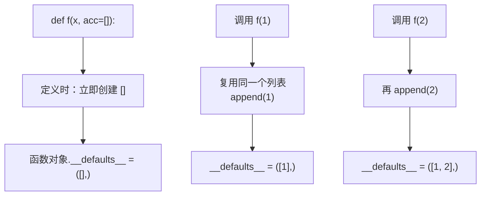
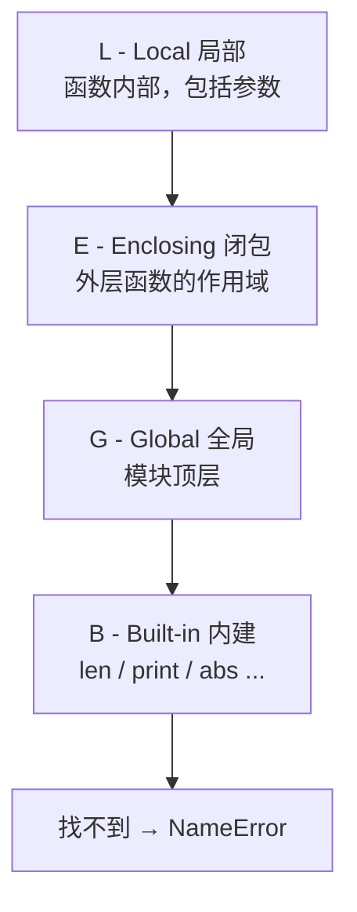

# 01 函数与作用域
**本页学什么**：函数是 Python 里组织逻辑的基本单位，而**「一个名字到底指向什么」**是理解 Python 全部高级特性的地基。这一页把这两件事讲透。

很多人写了很久 Python 仍然会对着 `UnboundLocalError` 发懵，或者被闭包捕获到「最后一个值」坑一次。它们其实都是同一个机制的两种表现——看完这页你会觉得它们理所当然。

## 1. 函数是一等对象

在 Python 里，函数**就是一个普通对象**：能赋值给变量、能当参数传、能放进列表、能作为返回值。

```python
def greet(name):
    return f"hi {name}"

say = greet                 # 不是调用，是「把函数对象绑到另一个名字」
print(say("bob"))

def apply(fn, value):
    return fn(value)

print(apply(abs, -3))
print("函数有属性:", hasattr(abs, "__name__"), abs.__name__)
```

```text
hi bob
3
函数有属性: True abs
```

注意 `say = greet` **没有括号**——带括号是「调用函数并拿返回值」，不带括号是「函数对象本身」。

这个特性是**装饰器**（第 7 页）、回调函数、策略模式的共同基础：因为函数能被传来传去，才能写出「接收一个函数、返回一个新函数」的东西。

## 2. 参数机制：五种形态

Python 的参数系统是所有主流语言里最灵活的。完整的函数签名可以长这样：

```python
def f(a, b, /, c, d, *, e, g):
    return (a, b, c, d, e, g)
```

`/` 和 `*` 是**分隔符**，把参数分成三组：

| 位置 | 类型 | 调用方式 | 名字能被外部使用吗 |
| --- | --- | --- | --- |
| `/` 之前 | 仅位置参数 positional-only | 只能按位置传 | 不能 |
| 中间 | 普通参数 | 位置或关键字都行 | 能 |
| `*` 之后 | 仅关键字参数 keyword-only | 只能按关键字传 | 必须写名字 |

```python
import inspect

def f(a, b, /, c, d, *, e, g):
    return (a, b, c, d, e, g)

print(f(1, 2, 3, 4, e=5, g=6))
print(inspect.signature(f))

try:
    f(1, b=2, c=3, d=4, e=5, g=6)    # b 是仅位置参数，不能写名字
except TypeError as e:
    print("->", e)
```

```text
(1, 2, 3, 4, 5, 6)
(a, b, /, c, d, *, e, g)
-> f() got some positional-only arguments passed as keyword arguments: 'b'
```

:::info[为什么要有「仅位置参数」]
因为它给了库作者**重命名参数的自由**。

如果参数只能按位置传，那么作者把 `def f(old_name)` 改成 `def f(better_name)` 时，**不会破坏任何调用方**——因为没人能用 `old_name=` 这种写法。标准库里大量使用，比如 `len(obj)` 不能写成 `len(obj=...)`。

你自己写函数时不必强求，但要知道 `/` 和 `*` 长什么样——读标准库签名时天天见。
:::

### 仅关键字参数（`*`）

单独一个 `*` 后面全是仅关键字参数。**这是最实用的一条**，它强制调用方写清楚名字：

```python
def connect(host, *, port=80, timeout=5, ssl=False):
    return f"{host}:{port} timeout={timeout} ssl={ssl}"

print(connect("a.com", port=443, ssl=True))
```

```text
a.com:443 timeout=5 ssl=True
```

`port` 和 `timeout` 必须写名字，读者一眼能看出 `443` 是端口。这对于有多个布尔开关的函数尤其重要——`connect("a.com", True, False)` 谁也看不懂。

### `*args` 与 `**kwargs`

```python
def var(a, *args, **kwargs):
    print("  a =", a)
    print("  args =", args, "（多余的位置参数，收成元组）")
    print("  kwargs =", kwargs, "（多余的关键字参数，收成字典）")

var(1, 2, 3, k=4, m=5)
```

```text
  a = 1
  args = (2, 3) （多余的位置参数，收成元组）
  kwargs = {'k': 4, 'm': 5} （多余的关键字参数，收成字典）
```

命名约定：`*args` 和 `**kwargs` 里的 `args`/`kwargs` 只是习惯名，**起作用的是星号**。写成 `*rest` 也完全可以。

### 调用时解包

`*` 和 `**` 在**调用侧**做相反的事——把序列/字典展开成参数：

```python
def add3(a, b, c):
    return a + b + c

print(add3(*[1, 2, 3]))              # 展开列表
print(add3(**{"a": 1, "b": 2, "c": 3}))  # 展开字典
```

```text
6
6
```

## 3. 默认参数：只求值一次（头号坑）

:::danger[永远不要用可变对象作默认值]
```python
def bad(x, acc=[]):
    acc.append(x)
    return acc

print("bad(1):", bad(1))
print("bad(2):", bad(2))
print("bad(3):", bad(3))
```

你可能以为每次都是新列表，实际输出：

```text
bad(1): [1]
bad(2): [1, 2]
bad(3): [1, 2, 3]
```

**为什么？** 因为默认参数的值在**函数定义时**就被求值并创建，之后每次调用复用同一个对象。可以查看它：

```python
print(bad.__defaults__)
```

```text
([1, 2],)
```

这个列表就活在函数对象身上，调用只是往里追加。
:::

正确写法——用 `None` 作哨兵，在函数体内新建：

```python
def good(x, acc=None):
    if acc is None:
        acc = []
    acc.append(x)
    return acc

print("good(1):", good(1))
print("good(2):", good(2))
```

```text
good(1): [1]
good(2): [2]
```



:::tip[如果调用方需要「沿用上一次」，显式传进去]
```python
result = []
good(1, result)
good(2, result)
print(result)      # [1, 2]，意图明确
```

同一个可变默认值的**复用**特性并非全是坏处——有人拿它做缓存。但那是耍花招，别在生产代码里这么干。
:::

## 4. LEGB 规则：名字是怎么被找到的

Python 查找一个名字时，按顺序查四个作用域：



```python
g = "global"

def outer():
    e = "enclosing"
    def inner():
        l = "local"
        print("  inner 能看到的:", l, e, g, len)
    inner()

outer()
```

```text
  inner 能看到的: local enclosing global <built-in function len>
```

`inner` 里没有定义 `e`、`g`、`len`，但它们沿着 LEGB 链被找到了。

:::caution[「闭包」这一层只在嵌套函数里存在]
如果 `inner` 不是在 `outer` 里面定义的，就没有 E 这一层。类体（class body）的作用域**不会**形成闭包——第 6 页讲类时会再提这个区别。
:::

### 作用域是「编译时决定的」

这是理解后面所有现象的关键：**一个名字属于哪个作用域，在函数定义时（编译成字节码时）就定死了**，不取决于运行时是否执行到赋值语句。

由此推出两条重要规则：

1. **函数内任何位置对某名字赋值，该名字就是局部变量**（除非声明了 `global` / `nonlocal`）
2. 局部名字在赋值前被读取 → `UnboundLocalError`

---

**翻页**：[下一页 →](./functions-02) · [返回目录](./)
