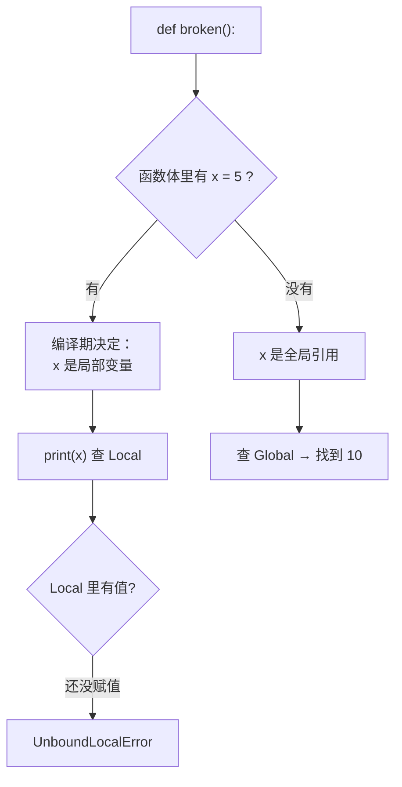

# 02 `global` 与 `nonlocal`
函数内**赋值**默认只创建/修改局部变量，不会影响全局：

```python
counter = 0

def bump_no():
    counter = 1          # 这只是创建了一个局部变量
    print("  函数内:", counter)

bump_no()
print("  函数外:", counter)
```

```text
  函数内: 1
  函数外: 0
```

要真的改全局变量，用 `global` 声明：

```python
counter = 0

def bump_global():
    global counter
    counter += 1

bump_global()
bump_global()
print("  global counter:", counter)
```

```text
  global counter: 2
```

而 `nonlocal` 用于**闭包**里修改外层函数的变量（不是全局）：

```python
def make_counter():
    count = 0
    def inc():
        nonlocal count      # 声明：我要改外层那个 count
        count += 1
        return count
    return inc

c = make_counter()
print(c(), c(), c())
```

```text
1 2 3
```

这就是**闭包**的经典用法：函数 `inc` 「记住」了外层作用域的 `count`，即使 `make_counter` 已经返回，那个变量还活着。

| 声明 | 作用 | 不写会怎样 |
| --- | --- | --- |
| `global x` | 指向模块全局的 `x` | 赋值只改局部，全局不变 |
| `nonlocal x` | 指向**外层函数**作用域的 `x` | 报 `UnboundLocalError`（或只改局部） |

:::warning[少用 `global`]
`global` 让函数有了「隐式输入和输出」，测试和调试都会变困难——任何一个函数都可能悄悄改全局状态。

真正需要跨函数共享状态时，**用类**（第 6 页）或者**用闭包**（如上例）。`global` 的合理场景主要是模块级的配置常量。
:::

## 6. `UnboundLocalError`：读完这节就不再怕它

```python
x = 10

def broken():
    print(x)      # 想读全局的 x
    x = 5         # 但这行让 x 变成了局部变量

broken()
```

```text
UnboundLocalError: cannot access local variable 'x' where it is not associated with a value
```

**为什么？** 因为函数体里出现了 `x = 5`，编译器就把 `x` 标记成局部变量。于是第一行的 `print(x)` 也去查局部作用域——而那时 `x` 还没被赋值。

注意：**全局的 `x = 10` 完全没有被考虑**，因为 LEGB 一旦在某个作用域找到这个名字的「声明」，就不再往外找了。



**解决办法**：

- 想改全局 → 加 `global x`
- 只是想读、函数里不该有同名赋值 → 改掉局部赋值，或给局部换个名字
- 在闭包里改外层 → 加 `nonlocal x`

## 7. 闭包与晚绑定：第二个头号坑

**闭包**（closure）指：内层函数引用了外层函数的变量，且外层函数已经返回，那个变量依然被「关」在里面。

先看晚绑定的坑：

```python
funcs = [lambda: i for i in range(3)]
print([f() for f in funcs])
```

你可能期待 `[0, 1, 2]`，实际：

```text
[2, 2, 2]
```

**为什么？** 这三个 lambda 都引用了**同一个名字 `i`**，而 `i` 在循环结束后是 `2`。lambda 只在**被调用时**才去查 `i` 的值——那时循环早跑完了。

可以直接看闭包里存的是什么：

```python
print([f.__closure__[0].cell_contents for f in funcs])
```

```text
[2, 2, 2]
```

三个闭包的 cell 都指向同一个值 `2`。

:::caution[闭包捕获的是「变量」，不是「值」]
这是理解一切晚绑定现象的核心：闭包保存的是**对变量的引用**，不是变量当时的快照。变量后来变了，闭包读到的就是新值。
:::

### 三种修法

**方法一（最常用）**：用默认参数在定义时把值固化下来。

```python
funcs = [lambda i=i: i for i in range(3)]
print([f() for f in funcs])
```

```text
[0, 1, 2]
```

`i=i` 的含义是「给这个 lambda 一个默认参数 `i`，其值在**每次定义时**求值并绑定」——这就实现了早绑定。

**方法二**：用工厂函数包一层，每次调用创建独立作用域。

```python
def make_func(n):
    return lambda: n

funcs = [make_func(i) for i in range(3)]
print([f() for f in funcs])
```

```text
[0, 1, 2]
```

**方法三**：用 `functools.partial`（第 9 页详讲）。

```python
from functools import partial

def show(n):
    return n

funcs = [partial(show, i) for i in range(3)]
print([f() for f in funcs])
```

```text
[0, 1, 2]
```

### 另一个常见场景：循环里创建带参数的函数

```python
def make_adders():
    return [lambda v: v + n for n in range(3)]

adders = make_adders()
print([a(10) for a in adders])
```

```text
[12, 12, 12]
```

全是 `10 + 2`。同样的晚绑定，同样的修法：`lambda v, n=n: v + n`。

## 8. 返回值

Python 的 `return a, b` 实际返回的是一个**元组**，只是语法上省略了括号：

```python
def minmax(xs):
    return min(xs), max(xs)

lo, hi = minmax([1, 5, 2])
print(lo, hi)
print("返回类型:", type(minmax([1, 2])).__name__)
```

```text
1 5
返回类型: tuple
```

**没有 `return` 或 `return` 后面没值，函数返回 `None`**：

```python
def no_return():
    pass

print(no_return())
```

```text
None
```

:::warning[「返回 None」和「没有返回值」在 Python 里是一回事]
这导致一类隐蔽 bug：你以为函数返回了东西，实际忘了写 `return`。

```python
def find(items, target):
    for i, v in enumerate(items):
        if v == target:
            print(i)      # 忘了 return！
    # 走到这里返回 None

result = find([1, 2], 2)
print("result =", result)
```

```text
1
result = None
```

静态类型检查工具（mypy）能抓到这类问题——第 10 页讲。
:::

---

**翻页**：[← 上一页](./functions-01) · [下一页 →](./functions-03) · [返回目录](./)
