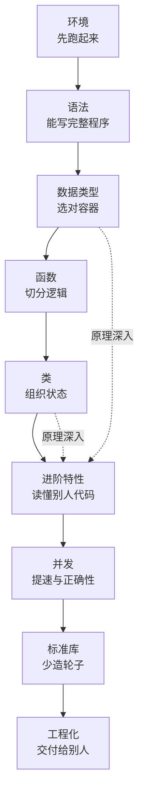
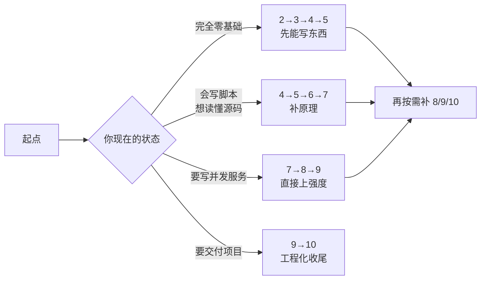

# Python 主线

**本页学什么**：这一页不教代码，只回答三个问题——这条线为什么按这个顺序排、每页到底讲什么、你怎么用才能在十页里真正学进去。

Python 大概是「入门最容易、精通最难」的语言：语法一两天就能写东西，但很多人写了三年，仍然解释不清 `a += 1` 为什么在多线程里会错、`list` 为什么 `append` 有时快有时慢、闭包为什么捕获的是最后一个值。**这条线的目标是把你从「会写」推到「知道为什么」**。

## 为什么这样排

顺序不是随便排的，它对应「你什么时候需要这个概念」：



前六页是**语言本体**，后四页是**用语言干活**。一个诚实的提醒：**第 7 页（进阶特性）和第 8 页（并发）是分水岭**——看完它们你才能读懂主流开源项目的源码，看不懂就回去补第 4、5 页。

## 十页一览

| 序号 | 页面 | 核心问题 | 学完的标志 |
| --- | --- | --- | --- |
| 1 | 导读（本页） | 这条线怎么走 | 知道自己该从哪页开始 |
| 2 | [环境与工具链](./environment) | 装什么、为什么这么装 | 独立建一个隔离环境并跑通脚本 |
| 3 | [语法基础](./syntax) | 语言的最小骨架 | 不查资料写出带分支循环的完整程序 |
| 4 | [内建数据类型](./datatypes) | 容器怎么选、为什么快 | 能说清 list 扩容策略与 dict 哈希冲突 |
| 5 | [函数与作用域](./functions) | 名字怎么解析 | 能解释 LEGB 与闭包晚绑定 |
| 6 | [面向对象](./oop) | 状态怎么组织 | 能画出 MRO 并选对 dataclass 参数 |
| 7 | [进阶特性](./advanced) | 框架代码在做什么 | 能自己写装饰器、生成器、上下文管理器 |
| 8 | [并发](./concurrency) | 什么时候真能变快 | 能给出 GIL 下的选型依据和实测数据 |
| 9 | [标准库精讲](./stdlib) | 别造轮子 | 见到问题能直接点名该用哪个模块 |
| 10 | [工程化](./engineering) | 怎么交付 | 能从零建一个带测试、带类型检查的项目 |

## 三条阅读路线

不是每个人都要从头读到尾。按你的目的挑：



- **零基础**：按 2→3→4→5→6 顺序读，别跳。每页的自检清单打不了勾就别往下走
- **有其他语言经验**（比如学过本站的 [C 主线](../c/)）：语法那页可以快读，但**第 4 页的哈希原理和第 8 页的 GIL 必须细看**——这两个是 C 里没有对应物的东西
- **只为做嵌入式上位机**：2→3→4→9 够用了，第 8 页并发按需

## 这条线的写作约定

每一页都严格是下面这个结构，不跳步：

```text
原理（为什么会这样设计）
  → 可运行代码 + 我在本机跑出来的真实输出
  → 怎么验证你确实懂了
  → 常见坑表格
  → 自检清单
```

**为什么坚持贴真实输出？** 技术教程最常见的翻车方式，不是讲错概念，而是给了一段**跑不起来、或者输出是作者脑补的**代码。本站所有示例都在本机实际执行过。

:::info[本机实测环境]
本线的所有输出都在这台机器上跑出来：

```text
Python 3.11.9 (tags/v3.11.9:de54cf5, Apr  2 2024, 10:12:12) [MSC v.1938 64 bit (AMD64)]
实现: CPython, 平台: Windows AMD64, 逻辑 CPU: 12
```

你的版本号不同不要紧，但**「大版本」（3.10 / 3.11 / 3.12）会决定某些语法是否存在**。凡是涉及版本差异的地方，本线都会显式标出，比如：

| 特性 | 引入版本 | 没有它会怎样 |
| --- | --- | --- |
| 结构化模式匹配 `match` | 3.10 | 只能写 `if/elif` 链 |
| 联合类型 `X \| Y` | 3.10 | 要写 `Union[X, Y]` |
| 异常组 `except*` | 3.11 | 异常组只能整体捕获 |
| `asyncio.TaskGroup` | 3.11 | 用 `asyncio.gather` |
| `tomllib` | 3.11 | 需要 `pip install tomli` |
| `typing.Self` | 3.11 | 要写 `TypeVar` 绑定 |

用 `python --version` 确认你自己的版本，遇到对不上的语法先查版本再怀疑自己。
:::

## 学习方法：三条硬规矩

:::tip[这三条比任何技巧都重要]
1. **必须亲手敲**。看懂和能写出来之间隔着一整个调试过程，而调试才是真正学东西的地方。本线每页有 20～40 段代码，全部敲一遍
2. **先预测输出，再运行**。预测对了说明你真懂了；预测错了，那个「咦？」的瞬间就是最有效的学习时刻
3. **自检清单逐条打勾**。打不了勾就回去重看对应小节，别硬往下走——后面每一页都假设你已经掌握前面
:::

一个具体的执行建议：为每个例子建一个 `scratch.py`，敲完就 `python scratch.py`。不要在一个文件里堆所有例子，也不要用交互式解释器抄长代码（缩进会折磨你）。

## 和本站其他板块的关系

Python 在这个站里不是主菜，是**工具与主线的选择器**：

| 你要做的事 | 该看哪 |
| --- | --- |
| 用 Python 写上位机、读串口、画数据 | 本线的 3→4→9 |
| 搞懂指针、内存、单片机固件 | [C 主线](../c/) |
| 用现代 C++ 写大型系统 | [C++ 主线](../cpp/) |
| 玩真实的板子 | [硬件开发](../../hardware/) |
| 让 AI 帮你写代码但不被坑 | [AI 辅助开发](../../ai-coding/) |

:::warning[关于 AI 生成代码]
现在很多人用 AI 学编程，这没问题，但有个陷阱：**AI 会非常自信地给你一段跑不通或者早已过时的代码，还附上一套听起来很有道理的解释**。

正确用法是：让它写，然后**你必须自己运行一遍**。跑不通就把报错原文丢回给它——这个来回本身就是最好的学习过程。本线所有页面都假设你会自己验证。
:::

## 怎么算「学完了」

对照这张表，别自我感觉良好：

| 阶段 | 标志 | 对应页面 |
| --- | --- | --- |
| 入门 | 能读懂别人写的简单程序 | 语法基础 |
| 上手 | 能不查资料写出几十行的完整功能 | 数据类型 / 函数 / 类 |
| 熟练 | 知道同一件事有几种写法，以及各自代价 | 进阶特性 / 标准库 |
| 通透 | 能解释「为什么语言要这样设计」 | 并发 / 内存模型 |

**大部分教程停在「上手」。** 这条线的目标是把你推到「熟练」和「通透」。

## 下一步

从 [环境与工具链](./environment) 开始——先把代码跑起来，再谈原理。

---

**其他板块**：[软件编程总览](../) · [快速上手](../../quickstart/) · [硬件开发](../../hardware/) · [AI 辅助开发](../../ai-coding/) · [速查表](../../reference/)
