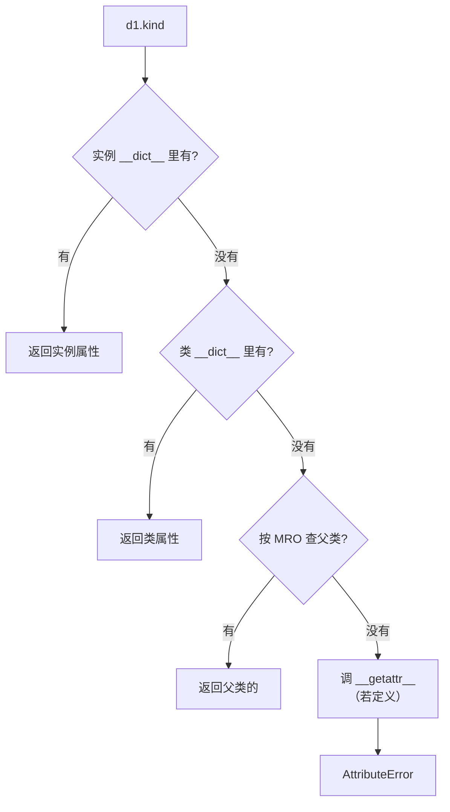
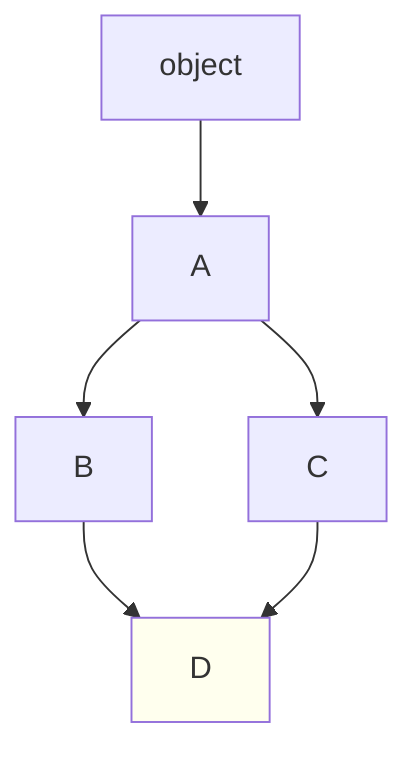
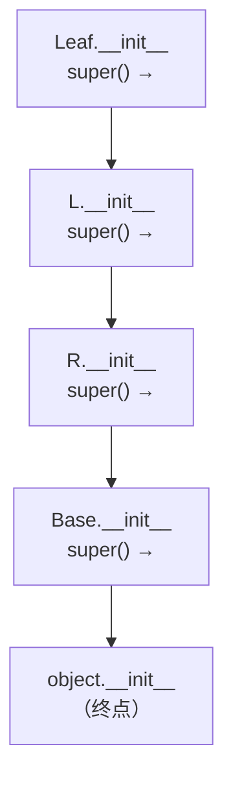

# 01 面向对象
**本页学什么**：类不只是「把函数和数据打包」，它是一套**属性查找协议**。理解这套协议，你才能看懂 MRO、描述符、`dataclass`，以及为什么 Django ORM 和 pydantic 能那样工作。

## 1. 类与实例：两个命名空间

```python
class Dog:
    kind = "犬科"            # 类属性：属于类，所有实例共享

    def __init__(self, name):
        self.name = name     # 实例属性：每个实例独一份

    def bark(self):
        return f"{self.name}: 汪"

d1 = Dog("小黑")
d2 = Dog("小白")

print(d1.bark())
print("实例属性:", d1.name, d2.name)
print("类属性:", d1.kind, d2.kind, Dog.kind)
print("d1.__dict__:", d1.__dict__)
print("Dog.__dict__ keys:", [k for k in Dog.__dict__ if not k.startswith("_")])
```

```text
小黑: 汪
实例属性: 小黑 小白
类属性: 犬科 犬科 犬科
d1.__dict__: {'name': '小黑'}
Dog.__dict__ keys: ['kind', '__init__', 'bark']
```

每个对象都有一个 `__dict__` 存放自己的属性。`d1.__dict__` 里只有 `name`，而 `kind` 和 `bark` 在类的 `__dict__` 里。

### 属性查找链



**实例属性遮蔽类属性**——这点非常实用（可用来给单个实例开特例），但也带来本页第一个大坑。

:::danger[类属性是可变的 → 所有实例共享]
```python
class Shared:
    items = []          # 定义在类体里，所有实例共享同一个列表

a1, a2 = Shared(), Shared()
a1.items.append(1)
print("a2 看到的:", a2.items)
print("是同一个对象吗:", a1.items is a2.items)
```

```text
a2 看到的: [1]
是同一个对象吗: True
```

这和上一页「可变默认参数」是**同一个模式**：定义在类体时执行一次，之后所有人共用。

**可变的东西（list、dict、set）一定要放进 `__init__`**：

```python
class Correct:
    def __init__(self):
        self.items = []     # 每个实例一份

b1, b2 = Correct(), Correct()
b1.items.append(1)
print("b2 看到的:", b2.items)
```

```text
b2 看到的: []
```

**规则**：不可变的常量（字符串、数字、元组）放类体当默认值很好；可变容器一律放 `__init__`。
:::

## 2. 方法：`self` 到底是什么

```python
d = Dog("小黑")
print(d.bark)          # 绑定方法
print(Dog.bark)        # 普通函数
print(d.bark())
print(Dog.bark(d))     # 等价！手动传入实例
```

```text
<bound method Dog.bark of <__main__.Dog object at 0x...>>
<function Dog.bark at 0x...>
小黑: 汪
小黑: 汪
```

`self` **不是关键字**，只是约定的名字。`d.bark()` 等价于 `Dog.bark(d)`——Python 自动把实例作为第一个参数传进去。

这种「通过类访问得到函数、通过实例访问得到已绑定方法」的机制叫**描述符协议**，第 7 页会揭开它的实现。

## 3. 三种方法：`@classmethod` 与 `@staticmethod`

```python
class DateUtil:
    kind = "date"

    def __init__(self, value):
        self.value = value

    @classmethod
    def from_str(cls, s):        # cls 是类本身，不是实例
        print("  cls =", cls.__name__)
        return cls(int(s))       # 用 cls 构造，子类会自动用子类的类型

    @staticmethod
    def is_leap(year):           # 不接收 self 也不接收 cls
        return year % 4 == 0 and (year % 100 != 0 or year % 400 == 0)

d = DateUtil.from_str("2024")
print("类型:", type(d).__name__, "| 值:", d.value)
print("2024 闰年:", DateUtil.is_leap(2024), "| 2100 闰年:", DateUtil.is_leap(2100))
```

```text
  cls = DateUtil
类型: DateUtil | 值: 2024
2024 闰年: True | 2100 闰年: False
```

| 类型 | 第一个参数 | 用途 |
| --- | --- | --- |
| 实例方法 | `self`（实例） | 需要读写实例状态 |
| `@classmethod` | `cls`（类） | **替代构造器**；需要用到类本身 |
| `@staticmethod` | 无 | 只是逻辑上属于这个类，不需要实例或类 |

`@classmethod` 最重要的用途是**替代构造器**。因为用 `cls(...)` 而不是硬编码类名，子类继承后自动返回子类实例：

```python
class MyDate(DateUtil):
    pass

print(type(MyDate.from_str("2025")).__name__)   # MyDate，不是 DateUtil
```

```text
MyDate
```

如果写成硬编码 `return DateUtil(int(s))`，子类就永远返回父类类型了。

:::tip[`@staticmethod` 用得太多是坏味道]
如果一个函数既不需要 `self` 也不需要 `cls`，它往往**本来就该是个模块级函数**。Python 不像 Java 那样强制一切放进类里，模块就是天然的命名空间。
:::

## 4. 继承与 MRO

### 单继承很简单

```python
class Animal:
    def speak(self):
        return "..."

class Dog(Animal):
    def speak(self):
        return "汪"

print(Dog().speak())
print("MRO:", [c.__name__ for c in Dog.__mro__])
```

```text
汪
['Dog', 'Animal', 'object']
```

### 多继承与 C3 线性化

多继承时，方法查找顺序由 **MRO（Method Resolution Order）** 决定，CPython 用 **C3 线性化算法**生成。

```python
class A:
    def who(self): return "A"
class B(A):
    def who(self): return "B"
class C(A):
    def who(self): return "C"
class D(B, C):
    pass

print("D 的 MRO:", [c.__name__ for c in D.__mro__])
print("D().who():", D().who())
```

```text
D 的 MRO: ['D', 'B', 'C', 'A', 'object']
D().who(): B
```



查找顺序是 `D → B → C → A`。注意 **`A` 在 `B` 和 `C` 之后**——这正是 C3 算法的关键：**一个类的所有父类，必须排在它自己之后**（单调性）。

C3 的两个约束：

1. **子类优先于父类**
2. **多个父类保持声明顺序**（`class D(B, C)` 里 B 在 C 前）

如果这两个约束冲突，Python 直接拒绝创建这个类：

```python
try:
    class E(A, B):      # A 是 B 的父类，但这里把 A 写在 B 前面
        pass
except TypeError as e:
    print("->", e)
```

```text
-> Cannot create a consistent method resolution order (MRO) for bases A, B
```

因为 `class E(A, B)` 要求「A 在 B 前」，但 A 是 B 的父类，要求「B 在 A 前」，自相矛盾。

## 5. `super()`：不是「调用父类」

`super()` 的含义是「**按 MRO 找下一个**」，不是「调用父类」。这个区别在多重继承里至关重要。

```python
class Base:
    def __init__(self, **kw):
        print("  Base.__init__", kw)
        super().__init__()

class L(Base):
    def __init__(self, **kw):
        print("  L.__init__")
        super().__init__(**kw)      # 沿 MRO 往下走

class R(Base):
    def __init__(self, **kw):
        print("  R.__init__")
        super().__init__(**kw)

class Leaf(L, R):
    def __init__(self, **kw):
        print("  Leaf.__init__")
        super().__init__(**kw)

Leaf()
print("Leaf MRO:", [c.__name__ for c in Leaf.__mro__])
```

```text
  Leaf.__init__
  L.__init__
  R.__init__
  Base.__init__ {}
Leaf MRO: ['Leaf', 'L', 'R', 'Base', 'object']
```

注意 `L.__init__` 里的 `super().__init__()` 调用的是 **`R.__init__`，不是 `Base.__init__`**——因为 Leaf 的 MRO 里 L 后面是 R。

这就是**协作式多重继承**：每个类的 `__init__` 都调用 `super().__init__()` 并透传剩余参数，控制流沿着 MRO 走一遍，每个类的初始化代码都恰好执行一次。



:::caution[协作式继承的两个纪律]
1. **每个类都调用 `super().__init__()`**，哪怕它的父类是 `object`
2. **用 `**kwargs` 透传**并各自取走自己需要的参数，不要写死参数列表

不遵守的话会出现「某个父类的 `__init__` 根本没被调用」或 `TypeError`。这也是为什么多继承容易出问题——**优先用组合（把对象作为属性）而不是继承**，多继承主要用于 mixin（小的、无状态的功能块）。
:::

---

**翻页**：[下一页 →](./oop-02) · [返回目录](./)
