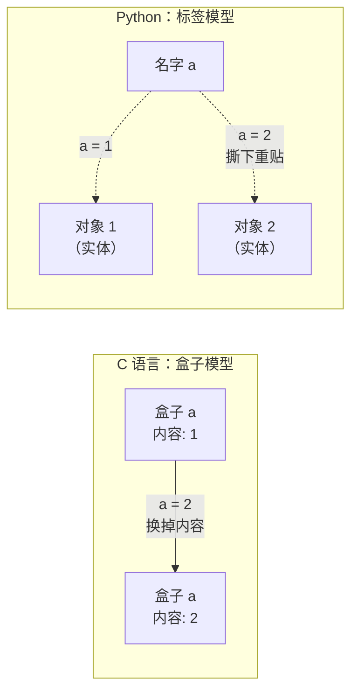

# 01 语法基础
**本页学什么**：把 Python 的最小骨架搭起来——变量、类型、运算符、控制流。读完你能不查资料写出几十行的完整程序。

这一页故意不讲太深的对象模型细节（那是第 4 页的事），但会先把**一个最容易误解的观念**钉死，因为后面全部内容都建立在它之上。

## 1. Python 的变量是「标签」，不是「盒子」

这是新人最需要纠正的第一个直觉。

在 C 语言里，`int a = 1;` 的意思是「准备一个叫 `a` 的盒子，往里面放 1」；给 `a` 赋新值是**把盒子里的东西换掉**。

在 Python 里，**变量只是一个贴在对象上的标签（名字）**。对象才是实体。



用代码验证——`id()` 返回对象在内存中的身份：

```python
a = 1
print("a = 1    ->", id(a))
a = 2
print("a = 2    ->", id(a))

b = a
print("b = a    ->", id(b), "same object:", id(b) == id(a))
```

```text
a = 1    -> 140735655635864
a = 2    -> 140735655635896
b = a    -> 140735655635896 same object: True
```

`id` 变了，说明**换的是标签指向的对象，不是对象的内容**。而 `b = a` 并没有复制任何东西，只是给同一个对象多贴了一个标签。

这个模型直接推出了 Python 里最著名的那个坑（第 4 页会深讲）：

```python
x = [1, 2]
y = x          # 只是多一个标签，没有复制列表
y.append(3)
print(x)       # x 也被改了
```

```text
[1, 2, 3]
```

:::tip[一句话记住]
赋值 **从不复制对象**，它只绑定名字。要复制必须显式调用 `list(x)`、`x.copy()` 或 `copy.deepcopy(x)`（第 4 页详解）。
:::

### 顺带：不需要声明类型

Python 是**动态类型**语言——类型属于对象，不属于变量。同一个名字可以随时指向不同类型的对象：

```python
v = 1
print(type(v).__name__)
v = "now a string"
print(type(v).__name__)
v = [1, 2]
print(type(v).__name__)
```

```text
int
str
list
```

**动态**不等于**弱类型**。Python 是强类型语言：类型之间不会偷偷转换。

```python
print("3" + 3)
```

```text
TypeError: can only concatenate str (not "int") to str
```

它明确拒绝，而不是猜你想要 `"33"`。想拼接就自己转：`"3" + str(3)`。这个「拒绝猜测」的设计能拦住大量隐蔽 bug。

## 2. 内建类型速览

先认识名字，第 4 页逐个深挖。

| 类型 | 例子 | 特点 |
| --- | --- | --- |
| `int` | `42`, `-7`, `2**100` | **任意精度**，永不溢出 |
| `float` | `3.14`, `1e-9` | IEEE 754 双精度，有精度问题 |
| `bool` | `True`, `False` | 是 `int` 的子类，`True == 1` |
| `str` | `"hi"`, `'hi'` | **不可变**，Unicode |
| `bytes` | `b"hi"` | 不可变字节序列，用于 IO 与网络 |
| `list` | `[1, 2]` | **可变**序列，动态数组 |
| `tuple` | `(1, 2)` | **不可变**序列 |
| `dict` | `{"a": 1}` | 哈希表，3.7+ 保证插入顺序 |
| `set` | `{1, 2}` | 去重集合，无序 |
| `NoneType` | `None` | 空值占位，不是 0 也不是 `False` |

`bool` 是 `int` 的子类这件事，会让人写出奇怪的代码却能跑：

```python
print(True + True)      # 2
print(isinstance(True, int))
print(True == 1, True is 1)
```

```text
2
True
True False
```

注意最后一行：`True == 1` 为真（值相等），但 `True is 1` 为假（不是同一个对象）。这引出了下一个关键区别。

## 3. `==` 与 `is`：值的相等 vs 身份的相同

```python
a = [1, 2]
b = [1, 2]        # 内容相同，但是两个独立的列表对象

print("a == b :", a == b)   # 值相等？
print("a is b :", a is b)   # 同一个对象？
print("id 相同:", id(a) == id(b))
```

```text
a == b : True
a is b : False
id 相同: False
```

**规则**：

- 比较**内容**用 `==`
- 比较**身份**用 `is`，而 `is` 的日常用途只有一个：**和 `None` 比较**

```python
result = None
if result is None:        # 正确
    print("no result")

if result == None:        # 能跑，但别这么写
    print("no result")
```

为什么和 `None` 要用 `is`？因为 `None` 是**单例**——整个程序里只有一个 `None` 对象，`is` 判断既准确又快。而 `==` 会去调用自定义类的 `__eq__`，可能被重载成奇怪的语义。

:::caution[`is` 和小整数：一个会骗人的现象]
```python
print(256 is 256)     # True
print(257 is 257)     # 通常 True，但不保证！
```

CPython 缓存了 `-5` 到 `256` 的小整数，所以它们复用同一对象。但 `257` 是否复用**取决于解释器的优化细节**（同一行里的常量会被折叠，跨行就不一定）。本站实测：

```text
INT 256 is True
INT 257 is (same line) True
```

**结论：永远不要用 `is` 比较数字或字符串的值。** 这个现象只是 CPython 的实现细节，不是语言规范。比较值就用 `==`。
:::

## 4. 真值测试：什么算「假」

Python 里任何对象都能当条件用。规则很统一：

```python
for v in [0, 0.0, "", [], {}, None, False, "0", [0], -1]:
    print(f"  {v!r:8} -> {bool(v)}")
```

```text
  0        -> False
  0.0      -> False
  ''       -> False
  []       -> False
  {}       -> False
  None     -> False
  False    -> False
  '0'      -> True
  [0]      -> True
  -1       -> True
```

**假值只有这些**：`None`、`False`、数字零（`0`、`0.0`、`0j`）、空容器（`""`、`[]`、`{}`、`set()`、`()`）、以及自定义对象里 `__bool__` 返回 `False` 或 `__len__` 返回 0 的。

**其他一切都是真**。特别注意 `"0"`（字符串）和 `[0]`（含元素的列表）都是真的——它们非空。

### 由此而来的 Python 惯用法

```python
name = input("名字: ") or "匿名"     # 空输入则用默认值
items = get_items() or []            # None 或空都兜住
```

:::warning[`or` 兜底的陷阱]
上面这招很方便，但它把 `None`、`""`、`0`、`[]` **一视同仁**地当成「没值」。如果你的 `0` 或空列表是**合法的有效值**，这样写会把它悄悄丢掉：

```python
count = 0
print(count or "无数据")      # 输出「无数据」，但 0 明明是有效计数！
```

```text
无数据
```

这种情况要显式判断：

```python
count = 0
print("无数据" if count is None else count)
```
:::

## 5. `and` / `or` 返回的不是布尔值

这是 Python 和其他语言一个显著不同、也非常实用的设计：**逻辑运算符返回的是操作数本身，不是 `True`/`False`**。

```python
print(0 or "default")       # 'default'
print("given" or "default") # 'given'
print([] or {})             # {}
print(1 and 2)              # 2
print(0 and 2)              # 0
print("" or 0 or "last")    # 'last'
```

```text
default
given
{}
2
0
last
```

规则：

- `a or b`：**`a` 为真就返回 `a`**，否则返回 `b`
- `a and b`：**`a` 为假就返回 `a`**，否则返回 `b`

两者都是**短路**的——`or` 在确定 `a` 为真后根本不求值 `b`，`and` 在确定 `a` 为假后也不求值 `b`。这个特性可以安全地把危险操作放在后面：

```python
items = []
# 列表为空时不访问 items[0]，不会 IndexError
if items and items[0] == "x":
    print("first is x")
else:
    print("empty or not x")
```

```text
empty or not x
```

---

**翻页**：[下一页 →](./syntax-02) · [返回目录](./)
